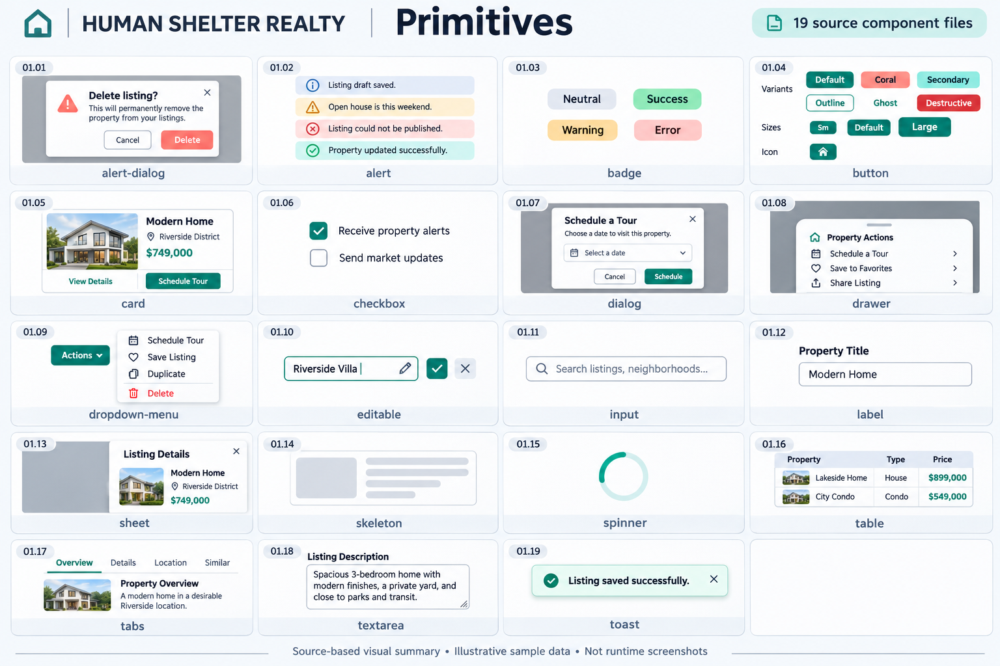
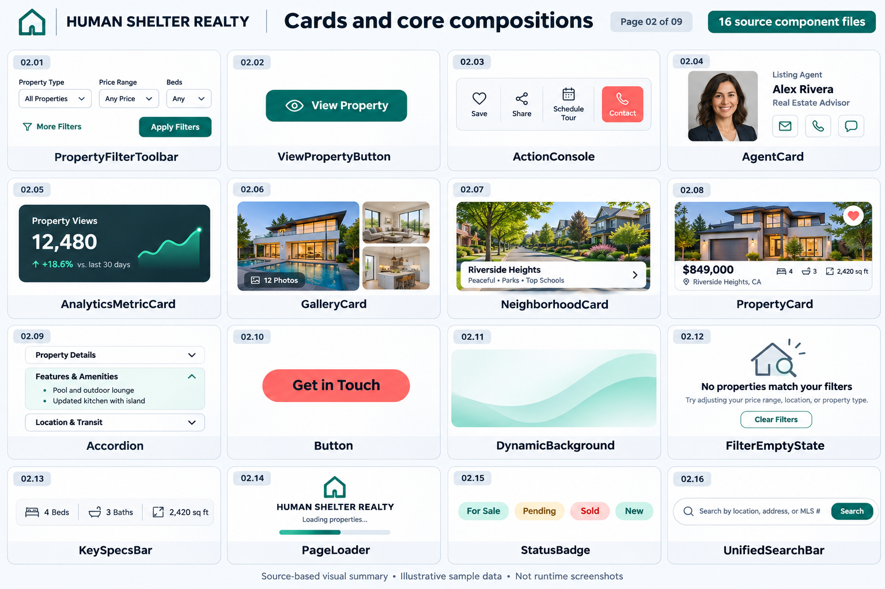
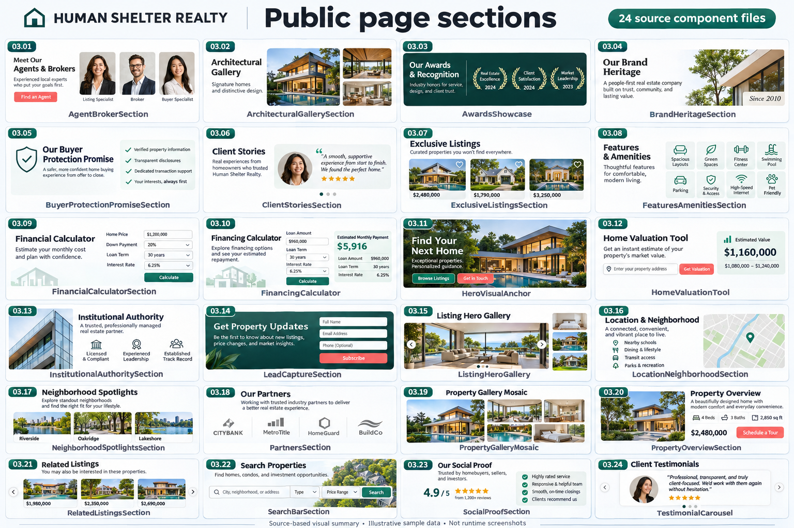
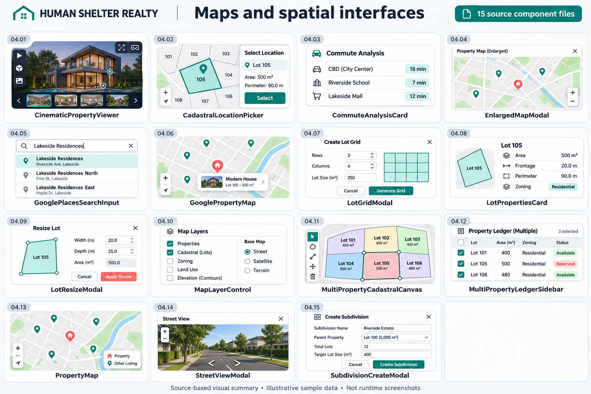
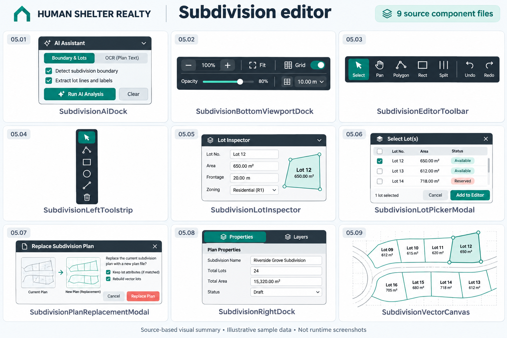
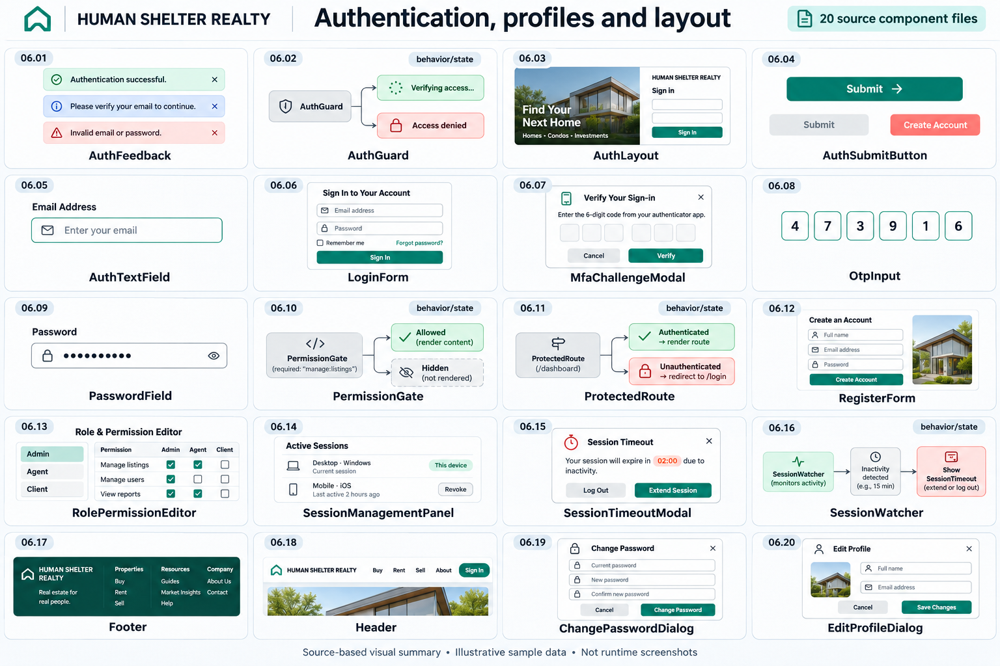
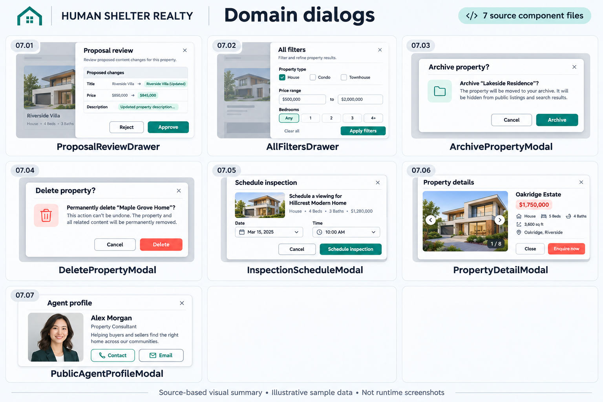
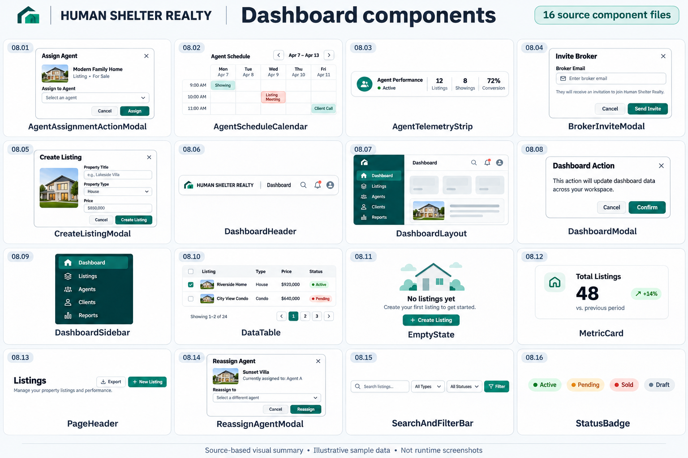
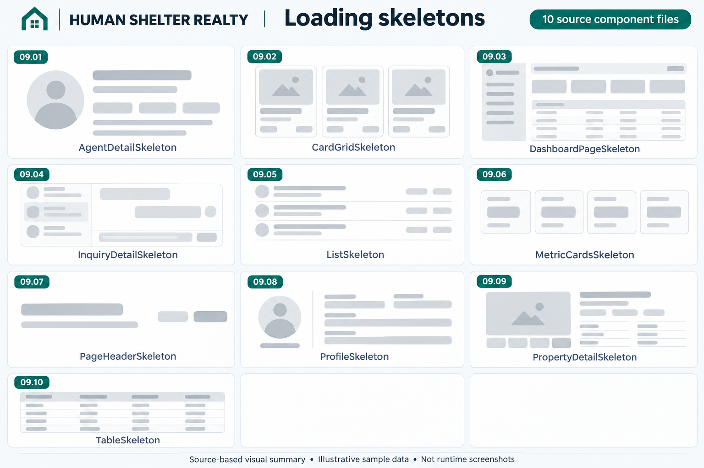

# UI Library Visual Atlas

Generated 2026-11-05 from `frontend/src/components/`.

136 non-test JSX/TSX source files are assigned once across nine sheets. Each specimen represents a component file/family, including composed subcomponents rather than a separate tile for every named export. Tests, non-JSX helpers, hooks, services, pages, and assets are outside this component inventory. These are generated source-based illustrations, not runtime screenshots or a guarantee of exact visual fidelity. Sample content is fictional. AuthGuard, ProtectedRoute, PermissionGate, and SessionWatcher are shown as behavior/state specimens where appropriate.

## 01 — Primitives

| Specimen | Source component |
|---|---|
| 01.01 alert-dialog | [ui/alert-dialog.jsx](../../frontend/src/components/ui/alert-dialog.jsx) |
| 01.02 alert | [ui/alert.jsx](../../frontend/src/components/ui/alert.jsx) |
| 01.03 badge | [ui/badge.jsx](../../frontend/src/components/ui/badge.jsx) |
| 01.04 button | [ui/button.jsx](../../frontend/src/components/ui/button.jsx) |
| 01.05 card | [ui/card.jsx](../../frontend/src/components/ui/card.jsx) |
| 01.06 checkbox | [ui/checkbox.jsx](../../frontend/src/components/ui/checkbox.jsx) |
| 01.07 dialog | [ui/dialog.jsx](../../frontend/src/components/ui/dialog.jsx) |
| 01.08 drawer | [ui/drawer.jsx](../../frontend/src/components/ui/drawer.jsx) |
| 01.09 dropdown-menu | [ui/dropdown-menu.jsx](../../frontend/src/components/ui/dropdown-menu.jsx) |
| 01.10 editable | [ui/editable.jsx](../../frontend/src/components/ui/editable.jsx) |
| 01.11 input | [ui/input.jsx](../../frontend/src/components/ui/input.jsx) |
| 01.12 label | [ui/label.jsx](../../frontend/src/components/ui/label.jsx) |
| 01.13 sheet | [ui/sheet.jsx](../../frontend/src/components/ui/sheet.jsx) |
| 01.14 skeleton | [ui/skeleton.jsx](../../frontend/src/components/ui/skeleton.jsx) |
| 01.15 spinner | [ui/spinner.jsx](../../frontend/src/components/ui/spinner.jsx) |
| 01.16 table | [ui/table.jsx](../../frontend/src/components/ui/table.jsx) |
| 01.17 tabs | [ui/tabs.jsx](../../frontend/src/components/ui/tabs.jsx) |
| 01.18 textarea | [ui/textarea.jsx](../../frontend/src/components/ui/textarea.jsx) |
| 01.19 toast | [ui/toast.jsx](../../frontend/src/components/ui/toast.jsx) |

## 02 — Cards and core compositions

| Specimen | Source component |
|---|---|
| 02.01 PropertyFilterToolbar | [properties/PropertyFilterToolbar.jsx](../../frontend/src/components/properties/PropertyFilterToolbar.jsx) |
| 02.02 ViewPropertyButton | [ui/buttons/ViewPropertyButton.jsx](../../frontend/src/components/ui/buttons/ViewPropertyButton.jsx) |
| 02.03 ActionConsole | [ui/cards/ActionConsole.jsx](../../frontend/src/components/ui/cards/ActionConsole.jsx) |
| 02.04 AgentCard | [ui/cards/AgentCard.jsx](../../frontend/src/components/ui/cards/AgentCard.jsx) |
| 02.05 AnalyticsMetricCard | [ui/cards/AnalyticsMetricCard.jsx](../../frontend/src/components/ui/cards/AnalyticsMetricCard.jsx) |
| 02.06 GalleryCard | [ui/cards/GalleryCard.jsx](../../frontend/src/components/ui/cards/GalleryCard.jsx) |
| 02.07 NeighborhoodCard | [ui/cards/NeighborhoodCard.jsx](../../frontend/src/components/ui/cards/NeighborhoodCard.jsx) |
| 02.08 PropertyCard | [ui/cards/PropertyCard.jsx](../../frontend/src/components/ui/cards/PropertyCard.jsx) |
| 02.09 Accordion | [ui/core/Accordion.jsx](../../frontend/src/components/ui/core/Accordion.jsx) |
| 02.10 Button | [ui/core/Button.jsx](../../frontend/src/components/ui/core/Button.jsx) |
| 02.11 DynamicBackground | [ui/core/DynamicBackground.jsx](../../frontend/src/components/ui/core/DynamicBackground.jsx) |
| 02.12 FilterEmptyState | [ui/core/FilterEmptyState.jsx](../../frontend/src/components/ui/core/FilterEmptyState.jsx) |
| 02.13 KeySpecsBar | [ui/core/KeySpecsBar.jsx](../../frontend/src/components/ui/core/KeySpecsBar.jsx) |
| 02.14 PageLoader | [ui/core/PageLoader.jsx](../../frontend/src/components/ui/core/PageLoader.jsx) |
| 02.15 StatusBadge | [ui/core/StatusBadge.jsx](../../frontend/src/components/ui/core/StatusBadge.jsx) |
| 02.16 UnifiedSearchBar | [ui/search/UnifiedSearchBar.jsx](../../frontend/src/components/ui/search/UnifiedSearchBar.jsx) |

## 03 — Public page sections

| Specimen | Source component |
|---|---|
| 03.01 AgentBrokerSection | [ui/sections/AgentBrokerSection.jsx](../../frontend/src/components/ui/sections/AgentBrokerSection.jsx) |
| 03.02 ArchitecturalGallerySection | [ui/sections/ArchitecturalGallerySection.jsx](../../frontend/src/components/ui/sections/ArchitecturalGallerySection.jsx) |
| 03.03 AwardsShowcase | [ui/sections/AwardsShowcase.jsx](../../frontend/src/components/ui/sections/AwardsShowcase.jsx) |
| 03.04 BrandHeritageSection | [ui/sections/BrandHeritageSection.jsx](../../frontend/src/components/ui/sections/BrandHeritageSection.jsx) |
| 03.05 BuyerProtectionPromiseSection | [ui/sections/BuyerProtectionPromiseSection.jsx](../../frontend/src/components/ui/sections/BuyerProtectionPromiseSection.jsx) |
| 03.06 ClientStoriesSection | [ui/sections/ClientStoriesSection.jsx](../../frontend/src/components/ui/sections/ClientStoriesSection.jsx) |
| 03.07 ExclusiveListingsSection | [ui/sections/ExclusiveListingsSection.jsx](../../frontend/src/components/ui/sections/ExclusiveListingsSection.jsx) |
| 03.08 FeaturesAmenitiesSection | [ui/sections/FeaturesAmenitiesSection.jsx](../../frontend/src/components/ui/sections/FeaturesAmenitiesSection.jsx) |
| 03.09 FinancialCalculatorSection | [ui/sections/FinancialCalculatorSection.jsx](../../frontend/src/components/ui/sections/FinancialCalculatorSection.jsx) |
| 03.10 FinancingCalculator | [ui/sections/FinancingCalculator.jsx](../../frontend/src/components/ui/sections/FinancingCalculator.jsx) |
| 03.11 HeroVisualAnchor | [ui/sections/HeroVisualAnchor.jsx](../../frontend/src/components/ui/sections/HeroVisualAnchor.jsx) |
| 03.12 HomeValuationTool | [ui/sections/HomeValuationTool.jsx](../../frontend/src/components/ui/sections/HomeValuationTool.jsx) |
| 03.13 InstitutionalAuthoritySection | [ui/sections/InstitutionalAuthoritySection.jsx](../../frontend/src/components/ui/sections/InstitutionalAuthoritySection.jsx) |
| 03.14 LeadCaptureSection | [ui/sections/LeadCaptureSection.jsx](../../frontend/src/components/ui/sections/LeadCaptureSection.jsx) |
| 03.15 ListingHeroGallery | [ui/sections/ListingHeroGallery.jsx](../../frontend/src/components/ui/sections/ListingHeroGallery.jsx) |
| 03.16 LocationNeighborhoodSection | [ui/sections/LocationNeighborhoodSection.jsx](../../frontend/src/components/ui/sections/LocationNeighborhoodSection.jsx) |
| 03.17 NeighborhoodSpotlightsSection | [ui/sections/NeighborhoodSpotlightsSection.jsx](../../frontend/src/components/ui/sections/NeighborhoodSpotlightsSection.jsx) |
| 03.18 PartnersSection | [ui/sections/PartnersSection.jsx](../../frontend/src/components/ui/sections/PartnersSection.jsx) |
| 03.19 PropertyGalleryMosaic | [ui/sections/PropertyGalleryMosaic.jsx](../../frontend/src/components/ui/sections/PropertyGalleryMosaic.jsx) |
| 03.20 PropertyOverviewSection | [ui/sections/PropertyOverviewSection.jsx](../../frontend/src/components/ui/sections/PropertyOverviewSection.jsx) |
| 03.21 RelatedListingsSection | [ui/sections/RelatedListingsSection.jsx](../../frontend/src/components/ui/sections/RelatedListingsSection.jsx) |
| 03.22 SearchBarSection | [ui/sections/SearchBarSection.jsx](../../frontend/src/components/ui/sections/SearchBarSection.jsx) |
| 03.23 SocialProofSection | [ui/sections/SocialProofSection.jsx](../../frontend/src/components/ui/sections/SocialProofSection.jsx) |
| 03.24 TestimonialCarousel | [ui/sections/TestimonialCarousel.jsx](../../frontend/src/components/ui/sections/TestimonialCarousel.jsx) |

## 04 — Maps and spatial interfaces

| Specimen | Source component |
|---|---|
| 04.01 CinematicPropertyViewer | [3d/CinematicPropertyViewer.jsx](../../frontend/src/components/3d/CinematicPropertyViewer.jsx) |
| 04.02 CadastralLocationPicker | [ui/map/CadastralLocationPicker.jsx](../../frontend/src/components/ui/map/CadastralLocationPicker.jsx) |
| 04.03 CommuteAnalysisCard | [ui/map/CommuteAnalysisCard.jsx](../../frontend/src/components/ui/map/CommuteAnalysisCard.jsx) |
| 04.04 EnlargedMapModal | [ui/map/EnlargedMapModal.jsx](../../frontend/src/components/ui/map/EnlargedMapModal.jsx) |
| 04.05 GooglePlacesSearchInput | [ui/map/GooglePlacesSearchInput.jsx](../../frontend/src/components/ui/map/GooglePlacesSearchInput.jsx) |
| 04.06 GooglePropertyMap | [ui/map/GooglePropertyMap.jsx](../../frontend/src/components/ui/map/GooglePropertyMap.jsx) |
| 04.07 LotGridModal | [ui/map/LotGridModal.jsx](../../frontend/src/components/ui/map/LotGridModal.jsx) |
| 04.08 LotPropertiesCard | [ui/map/LotPropertiesCard.jsx](../../frontend/src/components/ui/map/LotPropertiesCard.jsx) |
| 04.09 LotResizeModal | [ui/map/LotResizeModal.jsx](../../frontend/src/components/ui/map/LotResizeModal.jsx) |
| 04.10 MapLayerControl | [ui/map/MapLayerControl.jsx](../../frontend/src/components/ui/map/MapLayerControl.jsx) |
| 04.11 MultiPropertyCadastralCanvas | [ui/map/MultiPropertyCadastralCanvas.jsx](../../frontend/src/components/ui/map/MultiPropertyCadastralCanvas.jsx) |
| 04.12 MultiPropertyLedgerSidebar | [ui/map/MultiPropertyLedgerSidebar.jsx](../../frontend/src/components/ui/map/MultiPropertyLedgerSidebar.jsx) |
| 04.13 PropertyMap | [ui/map/PropertyMap.jsx](../../frontend/src/components/ui/map/PropertyMap.jsx) |
| 04.14 StreetViewModal | [ui/map/StreetViewModal.jsx](../../frontend/src/components/ui/map/StreetViewModal.jsx) |
| 04.15 SubdivisionCreateModal | [ui/map/SubdivisionCreateModal.jsx](../../frontend/src/components/ui/map/SubdivisionCreateModal.jsx) |

## 05 — Subdivision editor

| Specimen | Source component |
|---|---|
| 05.01 SubdivisionAiDock | [subdivision/SubdivisionAiDock.jsx](../../frontend/src/components/subdivision/SubdivisionAiDock.jsx) |
| 05.02 SubdivisionBottomViewportDock | [subdivision/SubdivisionBottomViewportDock.jsx](../../frontend/src/components/subdivision/SubdivisionBottomViewportDock.jsx) |
| 05.03 SubdivisionEditorToolbar | [subdivision/SubdivisionEditorToolbar.jsx](../../frontend/src/components/subdivision/SubdivisionEditorToolbar.jsx) |
| 05.04 SubdivisionLeftToolstrip | [subdivision/SubdivisionLeftToolstrip.jsx](../../frontend/src/components/subdivision/SubdivisionLeftToolstrip.jsx) |
| 05.05 SubdivisionLotInspector | [subdivision/SubdivisionLotInspector.jsx](../../frontend/src/components/subdivision/SubdivisionLotInspector.jsx) |
| 05.06 SubdivisionLotPickerModal | [subdivision/SubdivisionLotPickerModal.jsx](../../frontend/src/components/subdivision/SubdivisionLotPickerModal.jsx) |
| 05.07 SubdivisionPlanReplacementModal | [subdivision/SubdivisionPlanReplacementModal.jsx](../../frontend/src/components/subdivision/SubdivisionPlanReplacementModal.jsx) |
| 05.08 SubdivisionRightDock | [subdivision/SubdivisionRightDock.jsx](../../frontend/src/components/subdivision/SubdivisionRightDock.jsx) |
| 05.09 SubdivisionVectorCanvas | [subdivision/SubdivisionVectorCanvas.jsx](../../frontend/src/components/subdivision/SubdivisionVectorCanvas.jsx) |

## 06 — Authentication, profiles and layout

| Specimen | Source component |
|---|---|
| 06.01 AuthFeedback | [auth/AuthFeedback.jsx](../../frontend/src/components/auth/AuthFeedback.jsx) |
| 06.02 AuthGuard | [auth/AuthGuard.jsx](../../frontend/src/components/auth/AuthGuard.jsx) |
| 06.03 AuthLayout | [auth/AuthLayout.jsx](../../frontend/src/components/auth/AuthLayout.jsx) |
| 06.04 AuthSubmitButton | [auth/AuthSubmitButton.jsx](../../frontend/src/components/auth/AuthSubmitButton.jsx) |
| 06.05 AuthTextField | [auth/AuthTextField.jsx](../../frontend/src/components/auth/AuthTextField.jsx) |
| 06.06 LoginForm | [auth/LoginForm.jsx](../../frontend/src/components/auth/LoginForm.jsx) |
| 06.07 MfaChallengeModal | [auth/MfaChallengeModal.jsx](../../frontend/src/components/auth/MfaChallengeModal.jsx) |
| 06.08 OtpInput | [auth/OtpInput.jsx](../../frontend/src/components/auth/OtpInput.jsx) |
| 06.09 PasswordField | [auth/PasswordField.jsx](../../frontend/src/components/auth/PasswordField.jsx) |
| 06.10 PermissionGate | [auth/PermissionGate.jsx](../../frontend/src/components/auth/PermissionGate.jsx) |
| 06.11 ProtectedRoute | [auth/ProtectedRoute.jsx](../../frontend/src/components/auth/ProtectedRoute.jsx) |
| 06.12 RegisterForm | [auth/RegisterForm.jsx](../../frontend/src/components/auth/RegisterForm.jsx) |
| 06.13 RolePermissionEditor | [auth/RolePermissionEditor.jsx](../../frontend/src/components/auth/RolePermissionEditor.jsx) |
| 06.14 SessionManagementPanel | [auth/SessionManagementPanel.jsx](../../frontend/src/components/auth/SessionManagementPanel.jsx) |
| 06.15 SessionTimeoutModal | [auth/SessionTimeoutModal.jsx](../../frontend/src/components/auth/SessionTimeoutModal.jsx) |
| 06.16 SessionWatcher | [auth/SessionWatcher.jsx](../../frontend/src/components/auth/SessionWatcher.jsx) |
| 06.17 Footer | [layout/Footer.jsx](../../frontend/src/components/layout/Footer.jsx) |
| 06.18 Header | [layout/Header.jsx](../../frontend/src/components/layout/Header.jsx) |
| 06.19 ChangePasswordDialog | [profile/ChangePasswordDialog.jsx](../../frontend/src/components/profile/ChangePasswordDialog.jsx) |
| 06.20 EditProfileDialog | [profile/EditProfileDialog.jsx](../../frontend/src/components/profile/EditProfileDialog.jsx) |

## 07 — Domain dialogs

| Specimen | Source component |
|---|---|
| 07.01 ProposalReviewDrawer | [cms/ProposalReviewDrawer.jsx](../../frontend/src/components/cms/ProposalReviewDrawer.jsx) |
| 07.02 AllFiltersDrawer | [ui/modals/AllFiltersDrawer.jsx](../../frontend/src/components/ui/modals/AllFiltersDrawer.jsx) |
| 07.03 ArchivePropertyModal | [ui/modals/ArchivePropertyModal.jsx](../../frontend/src/components/ui/modals/ArchivePropertyModal.jsx) |
| 07.04 DeletePropertyModal | [ui/modals/DeletePropertyModal.jsx](../../frontend/src/components/ui/modals/DeletePropertyModal.jsx) |
| 07.05 InspectionScheduleModal | [ui/modals/InspectionScheduleModal.jsx](../../frontend/src/components/ui/modals/InspectionScheduleModal.jsx) |
| 07.06 PropertyDetailModal | [ui/modals/PropertyDetailModal.jsx](../../frontend/src/components/ui/modals/PropertyDetailModal.jsx) |
| 07.07 PublicAgentProfileModal | [ui/modals/PublicAgentProfileModal.jsx](../../frontend/src/components/ui/modals/PublicAgentProfileModal.jsx) |

## 08 — Dashboard components

| Specimen | Source component |
|---|---|
| 08.01 AgentAssignmentActionModal | [dashboard/AgentAssignmentActionModal.jsx](../../frontend/src/components/dashboard/AgentAssignmentActionModal.jsx) |
| 08.02 AgentScheduleCalendar | [dashboard/AgentScheduleCalendar.jsx](../../frontend/src/components/dashboard/AgentScheduleCalendar.jsx) |
| 08.03 AgentTelemetryStrip | [dashboard/AgentTelemetryStrip.jsx](../../frontend/src/components/dashboard/AgentTelemetryStrip.jsx) |
| 08.04 BrokerInviteModal | [dashboard/BrokerInviteModal.jsx](../../frontend/src/components/dashboard/BrokerInviteModal.jsx) |
| 08.05 CreateListingModal | [dashboard/CreateListingModal.jsx](../../frontend/src/components/dashboard/CreateListingModal.jsx) |
| 08.06 DashboardHeader | [dashboard/DashboardHeader.jsx](../../frontend/src/components/dashboard/DashboardHeader.jsx) |
| 08.07 DashboardLayout | [dashboard/DashboardLayout.jsx](../../frontend/src/components/dashboard/DashboardLayout.jsx) |
| 08.08 DashboardModal | [dashboard/DashboardModal.jsx](../../frontend/src/components/dashboard/DashboardModal.jsx) |
| 08.09 DashboardSidebar | [dashboard/DashboardSidebar.jsx](../../frontend/src/components/dashboard/DashboardSidebar.jsx) |
| 08.10 DataTable | [dashboard/DataTable.jsx](../../frontend/src/components/dashboard/DataTable.jsx) |
| 08.11 EmptyState | [dashboard/EmptyState.jsx](../../frontend/src/components/dashboard/EmptyState.jsx) |
| 08.12 MetricCard | [dashboard/MetricCard.jsx](../../frontend/src/components/dashboard/MetricCard.jsx) |
| 08.13 PageHeader | [dashboard/PageHeader.jsx](../../frontend/src/components/dashboard/PageHeader.jsx) |
| 08.14 ReassignAgentModal | [dashboard/ReassignAgentModal.jsx](../../frontend/src/components/dashboard/ReassignAgentModal.jsx) |
| 08.15 SearchAndFilterBar | [dashboard/SearchAndFilterBar.jsx](../../frontend/src/components/dashboard/SearchAndFilterBar.jsx) |
| 08.16 StatusBadge | [dashboard/StatusBadge.jsx](../../frontend/src/components/dashboard/StatusBadge.jsx) |

## 09 — Loading skeletons

| Specimen | Source component |
|---|---|
| 09.01 AgentDetailSkeleton | [dashboard/skeletons/AgentDetailSkeleton.jsx](../../frontend/src/components/dashboard/skeletons/AgentDetailSkeleton.jsx) |
| 09.02 CardGridSkeleton | [dashboard/skeletons/CardGridSkeleton.jsx](../../frontend/src/components/dashboard/skeletons/CardGridSkeleton.jsx) |
| 09.03 DashboardPageSkeleton | [dashboard/skeletons/DashboardPageSkeleton.jsx](../../frontend/src/components/dashboard/skeletons/DashboardPageSkeleton.jsx) |
| 09.04 InquiryDetailSkeleton | [dashboard/skeletons/InquiryDetailSkeleton.jsx](../../frontend/src/components/dashboard/skeletons/InquiryDetailSkeleton.jsx) |
| 09.05 ListSkeleton | [dashboard/skeletons/ListSkeleton.jsx](../../frontend/src/components/dashboard/skeletons/ListSkeleton.jsx) |
| 09.06 MetricCardsSkeleton | [dashboard/skeletons/MetricCardsSkeleton.jsx](../../frontend/src/components/dashboard/skeletons/MetricCardsSkeleton.jsx) |
| 09.07 PageHeaderSkeleton | [dashboard/skeletons/PageHeaderSkeleton.jsx](../../frontend/src/components/dashboard/skeletons/PageHeaderSkeleton.jsx) |
| 09.08 ProfileSkeleton | [dashboard/skeletons/ProfileSkeleton.jsx](../../frontend/src/components/dashboard/skeletons/ProfileSkeleton.jsx) |
| 09.09 PropertyDetailSkeleton | [dashboard/skeletons/PropertyDetailSkeleton.jsx](../../frontend/src/components/dashboard/skeletons/PropertyDetailSkeleton.jsx) |
| 09.10 TableSkeleton | [dashboard/skeletons/TableSkeleton.jsx](../../frontend/src/components/dashboard/skeletons/TableSkeleton.jsx) |

## Generation

Created with the built-in ImageGen tool. Exact per-sheet prompts are preserved in [prompts.md](prompts.md). Inventory coverage is verified against source files; generated labels and miniatures may differ from the running application.

