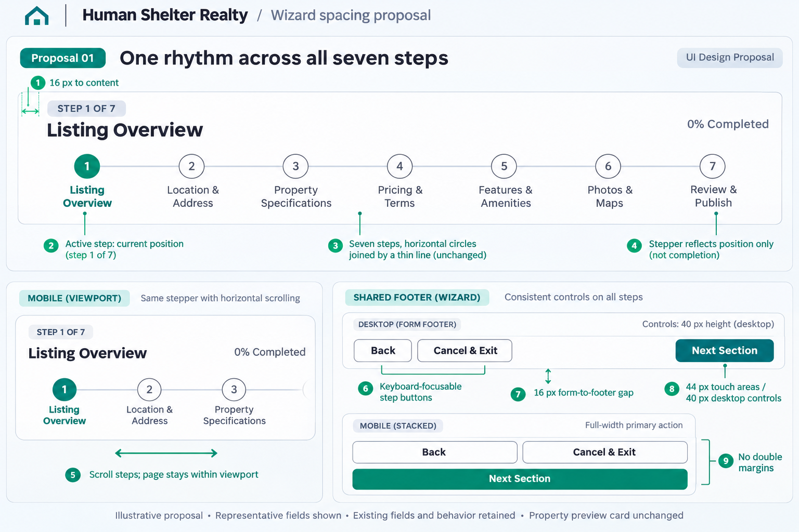
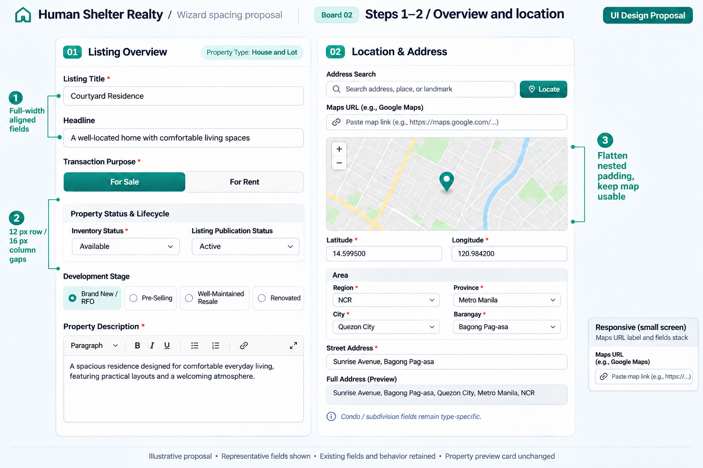
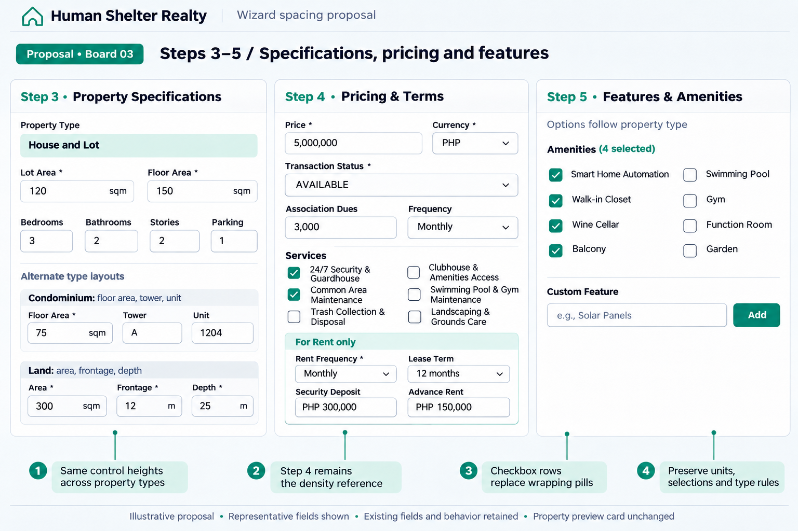
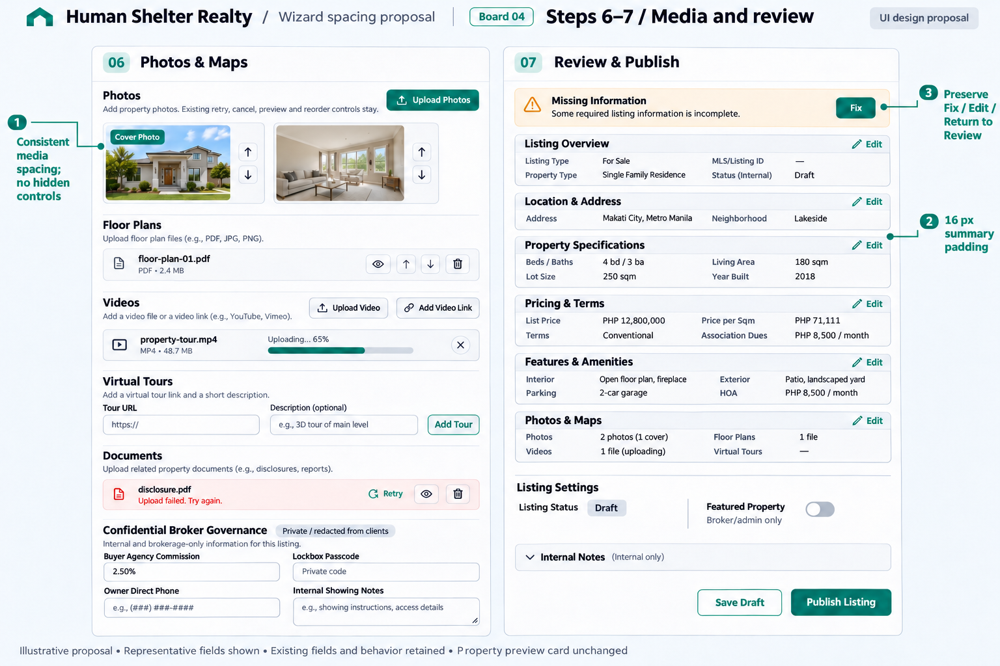

# Wizard spacing proposal

2026-11-05. Four generated proposal boards based on the source review of all seven steps. They illustrate layout intent, not runtime screenshots. Representative controls are shown; no field removal, validation change, or preview-card redesign is proposed. Exact implementation values and acceptance checks are in the [plan](../../docs/superpowers/plans/2026-11-05-listing-wizard-compact-spacing.md).

## 01-navigation

### ImageGen prompt

Create a crisp high-resolution landscape 3:2 UI design proposal board for Human Shelter Realty. White panels on #F8FAFC, slate #1E293B text, #64748B captions, #E2E8F0 borders, teal #0F766E primary actions and selected states; 8px form corners. Inter-like typography; essential field text readable, 14px CSS-equivalent. Show precisely aligned compact broker workspace forms: card padding 16px, label-to-control 8px, field row gap12px, column gap16px, section gap16px, desktop controls40px. Measurements are logical CSS targets. Fine teal numbered annotation lines outside controls with clear breathing room. Header 'Human Shelter Realty / Wizard spacing proposal'. Footer 'Illustrative proposal • Representative fields shown • Existing fields and behavior retained • Property preview card unchanged'. No invented business actions, no real personal data. Do NOT draw or redesign the property preview card, only the form region. No fake before screenshots; clearly call all visuals proposals. Board 01 title 'One rhythm across all seven steps'. Show a wide DESKTOP wizard stepper at top retaining original numbered circles joined by a thin horizontal line, 'STEP 1 OF 7' badge, 'Listing Overview', '0% Completed'. Exact seven labels: 'Listing Overview', 'Location & Address', 'Property Specifications', 'Pricing & Terms', 'Features & Amenities', 'Photos & Maps', 'Review & Publish'. Active1 teal, others outlined; retain horizontal circles, not a new tab design. 16px internal padding and no duplicated exterior margins, annotate '16 px to content'. Below at left show a mobile-width viewport of SAME stepper with horizontal scrolling (visible first 2-3 steps and edge fade hint), badge and active title kept readable. Annotation 'Scroll steps; page stays within viewport'. Below at right show a compact shared footer: Back, Cancel & Exit left and Next Section right; 12px footer padding, 16px form-to-footer gap, mobile stacked footer inset showing full-width Next Section. Annotation '44 px touch areas / 40 px desktop controls', 'Keyboard-focusable step buttons', 'No double margins'. Do not suggest validated completion; stepper progress reflects position only.

## Source-fidelity refinement prompts

### Board 2

Keep the overall layout, annotations, spacing, typography, and panel identities. Correct source fidelity only: Headline is OPTIONAL, remove its red asterisk. Listing Publication Status value must be 'Active', not 'Published'. Development Stage choices must be 'Brand New / RFO', 'Pre-Selling', 'Well-Maintained Resale', 'Renovated'; keep their order and allow wrapping. Do not add required asterisks to development stage or publication status. Keep the existing property type as a noninteractive badge (House and Lot). The full board is illustrative, not field requirements. Keep the form compact and readable.

### Board 3

Keep composition and annotations. Correct source fidelity: Property Type in step3 is a read-only type badge 'House and Lot', NOT a new dropdown, no asterisk. Bedrooms/Bathrooms/Stories/Parking are number input fields, NOT select dropdowns; remove their extra red required stars. Transaction Status in step4 must read 'AVAILABLE', not 'For Sale'. Services must use actual examples '24/7 Security & Guardhouse', 'Common Area Maintenance', 'Trash Collection & Disposal', 'Clubhouse & Amenities Access', 'Swimming Pool & Gym Maintenance', 'Landscaping & Grounds Care', wrapping long labels in the existing two-column list. Security Deposit and Advance Rent are monetary number inputs showing 'PHP 300,000' and 'PHP 150,000', not '2 months'/'1 month' dropdowns; optional, no required stars. Lot/floor units in house example show 'sqm' as suffixes, not newly added unit-select dropdowns. Keep the family alternate layout strips clearly examples. Leave unrelated layout unchanged.

### Board 4

Keep overall two-panel composition, all media sections, six expanded review summary blocks and annotations. Correct source fidelity: replace the invented Publication/Status dropdown with 'Listing Settings' containing a read-only 'Listing Status: Draft' badge and a 'Featured Property' switch labeled 'Broker/admin only'. No Submit for Approval dropdown. Keep Save Draft and Publish Listing for the illustrated broker state. In Pricing & Terms summary remove Buyer Agency Commission (it is confidential) and replace it with 'Association Dues: PHP 8,500 / month'. Use Philippine sample units and currency in review: PHP 12,800,000 price; living area180 sqm and lot area250 sqm; Philippine sample address 'Makati City, Metro Manila', not a US state/county or dollars. In confidential block show Lockbox Passcode as empty text field with placeholder 'Private code', no newly invented reveal-eye action. Keep confidential fields confined to the explicitly Private/redacted group and never in public preview. Other design stays unchanged.

The written plan and existing source take precedence over sample text, asterisks, option values, and fine visual details in generated images. No new field, required constraint, status option, unit conversion, or publication permission is authorized by an image. The boards omit some fields for readability; implementation retains them.

## 02-overview-location

### ImageGen prompt

Create a crisp high-resolution landscape 3:2 UI design proposal board for Human Shelter Realty. White panels on #F8FAFC, slate #1E293B text, #64748B captions, #E2E8F0 borders, teal #0F766E primary actions and selected states; 8px form corners. Inter-like typography; essential field text readable, 14px CSS-equivalent. Show precisely aligned compact broker workspace forms: card padding 16px, label-to-control 8px, field row gap12px, column gap16px, section gap16px, desktop controls40px. Measurements are logical CSS targets. Fine teal numbered annotation lines outside controls with clear breathing room. Header 'Human Shelter Realty / Wizard spacing proposal'. Footer 'Illustrative proposal • Representative fields shown • Existing fields and behavior retained • Property preview card unchanged'. No invented business actions, no real personal data. Do NOT draw or redesign the property preview card, only the form region. No fake before screenshots; clearly call all visuals proposals. Board 02 title 'Steps 1–2 / Overview and location'. Two equal-width tall form panels side by side. Left labeled '01 Listing Overview': full-width Listing Title field ('Courtyard Residence'), full-width Headline field, Transaction Purpose segmented For Sale / For Rent, a compact Property Status & Lifecycle group containing Inventory Status and Listing Publication Status side by side, Development Stage options in a wrapping row, Property Description multiline rich-text editor. Both title and headline align to same right edge; property type badge in header wraps without overlap. Right labeled '02 Location & Address': address search plus Locate button, Maps URL input below with wrapping label, an ordinary usable-height generic map with teal location pin (do not shrink map to decorative strip), latitude/longitude pair, compact Area group with Region, Province, City, Barangay in a two-column grid, Street Address fields, full address preview. A small note 'Condo / subdivision fields remain type-specific'. Show maps URL label and fields stacking on small screen using one little inset. Numbered callouts '1 Full-width aligned fields', '2 12 px row / 16 px column gaps', '3 Flatten nested padding, keep map usable'. Representative fields only; no new workflow.

## 03-specifications-pricing-features

### ImageGen prompt

Create a crisp high-resolution landscape 3:2 UI design proposal board for Human Shelter Realty. White panels on #F8FAFC, slate #1E293B text, #64748B captions, #E2E8F0 borders, teal #0F766E primary actions and selected states; 8px form corners. Inter-like typography; essential field text readable, 14px CSS-equivalent. Show precisely aligned compact broker workspace forms: card padding 16px, label-to-control 8px, field row gap12px, column gap16px, section gap16px, desktop controls40px. Measurements are logical CSS targets. Fine teal numbered annotation lines outside controls with clear breathing room. Header 'Human Shelter Realty / Wizard spacing proposal'. Footer 'Illustrative proposal • Representative fields shown • Existing fields and behavior retained • Property preview card unchanged'. No invented business actions, no real personal data. Do NOT draw or redesign the property preview card, only the form region. No fake before screenshots; clearly call all visuals proposals. Board 03 title 'Steps 3–5 / Specifications, pricing and features'. Three equal vertical panels with neat compact representative form specimens, sufficient font size. Panel03 'Property Specifications' shows House & Lot selected type with Lot Area, Floor Area on same row, Bedrooms Bathrooms Stories Parking fields aligned in a grid; below two small labeled variant strips 'Condominium: floor area, tower, unit' and 'Land: area, frontage, depth'. Do not imply all family fields show simultaneously: label strips 'Alternate type layouts'. Panel04 'Pricing & Terms' shows Price+Currency, Transaction Status, Association Dues, Frequency, and two-column service checkbox rows; small bounded inset labeled 'For Rent only' shows Rent Frequency, Lease Term, Security Deposit, Advance Rent. Panel05 'Features & Amenities' shows compact two-column checkable amenity rows, selected count, and custom feature input plus Add button; keep existing toggle/selected semantics visually evident. Use sample amenity labels 'Smart Home Automation', 'Walk-in Closet', 'Wine Cellar', 'Balcony'; label 'Options follow property type'. Callouts 'Same control heights across property types', 'Step 4 remains the density reference', 'Checkbox rows replace wrapping pills', 'Preserve units, selections and type rules'. No giant empty space, no removal of underlying fields.

## 04-media-review

### ImageGen prompt

Create a crisp high-resolution landscape 3:2 UI design proposal board for Human Shelter Realty. White panels on #F8FAFC, slate #1E293B text, #64748B captions, #E2E8F0 borders, teal #0F766E primary actions and selected states; 8px form corners. Inter-like typography; essential field text readable, 14px CSS-equivalent. Show precisely aligned compact broker workspace forms: card padding 16px, label-to-control 8px, field row gap12px, column gap16px, section gap16px, desktop controls40px. Measurements are logical CSS targets. Fine teal numbered annotation lines outside controls with clear breathing room. Header 'Human Shelter Realty / Wizard spacing proposal'. Footer 'Illustrative proposal • Representative fields shown • Existing fields and behavior retained • Property preview card unchanged'. No invented business actions, no real personal data. Do NOT draw or redesign the property preview card, only the form region. No fake before screenshots; clearly call all visuals proposals. Board 04 title 'Steps 6–7 / Media and review'. Two wide tall panels. Left '06 Photos & Maps' retains vertical groups in order: Photos with Upload Photos button and TWO photo thumbnails, one with Cover Photo badge and reorder arrows; Floor Plans with one compact file row; Videos with file/link controls and a compact file row; Virtual Tours with URL and description fields and Add Tour; Documents with one compact file row; Confidential Broker Governance with Buyer Agency Commission, masked Lockbox Passcode, Owner Direct Phone placeholder, and Internal Showing Notes; label Private / redacted from clients. Show one small upload progress bar, one retryable failed file indicator; note 'Existing retry, cancel, preview and reorder controls stay'. Right '07 Review & Publish' shows Missing Information warning with Fix action, then six compact ALWAYS EXPANDED summary blocks titled Listing Overview, Location & Address, Property Specifications, Pricing & Terms, Features & Amenities, Photos & Maps, each with Edit link and short 2-column details. No accordion/tabs/new collapse behavior. Below publication/status selection, the existing Internal Notes disclosure collapsed, and footer actions Save Draft, Publish Listing. Small note 'Agent actions retain approval workflow'. Numbered callouts '1 Consistent media spacing; no hidden controls', '2 16 px summary padding', '3 Preserve Fix / Edit / Return to Review'. Keep text readable; fields illustrative not schema definition.

