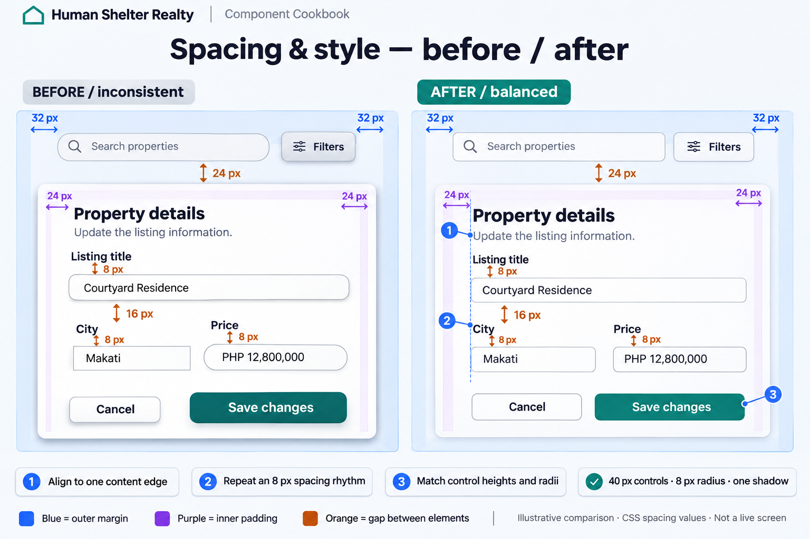

# Human Shelter Realty — Component Cookbook

Shared defaults and recipes for designing consistent React components with fewer decisions.

Updated: 2026-11-05. The user approved the cookbook structure. Design targets below guide new work; the drift table distinguishes them from current implementation. This documentation update does not migrate components or establish runtime compliance.

## 1. Quick start

1. Read the owning module requirements and the component being changed.
2. Choose an existing primitive or domain component from the catalog.
3. Select its supported variant and size; use shared defaults for unspecified details.
4. Compose a recipe, then specify content, actions, relevant states, and mobile changes.
5. Verify the UI using Section 7 and record module-specific behavior in its owning specification.

For UI implementation, read the available `shadcn` skill and applicable project design skills. The historical name `shadcn-ui` does not match the skill provided in this session. Do not reinitialize shadcn or apply a preset for an ordinary component change.

Source order: explicit user requirements and approved scoped exceptions; this guide for shared design rules; owning module requirements for product behavior; existing code for supported APIs. Report conflicts instead of silently changing shared APIs. Historical examples remain reference material.

## 2. Design defaults

These are defaults for new compositions. Reuse primitive styles where practical; inspect callers before changing a primitive. Targets are not claims about all existing screens.

| Decision | Default | Utility / guidance |
|---|---|---|
| Body and headings | Inter with system sans-serif fallback | `font-sans`; already configured |
| Financial values and identifiers | JetBrains Mono | `font-mono tabular-nums`; use the existing formatter |
| Page title | 24/32px bold; 30/36px desktop | `text-2xl leading-8 font-bold md:text-3xl md:leading-9` |
| Section title | 18/28px semibold | `text-lg leading-7 font-semibold` |
| Body and inputs | 14/20px | `text-sm leading-5` |
| Supporting text | 12/16px | `text-xs leading-4`; keep essential information readable |
| Spacing | 8px base; 4px for tight alignment | `gap-2/4/6/8`, `space-y-2/4/6`; `gap-1` for details |
| Page padding | 16px mobile, 24px tablet, 32px desktop | `p-4 md:p-6 lg:p-8` |
| Content width | Existing owning layout; standalone default 1280px | `mx-auto w-full max-w-7xl`; avoid duplicate page shells |
| Card padding | Target 16px mobile, 24px desktop | `p-4 sm:p-6`; existing Card slots use 20/24px |
| Standard radius | Target 8px controls/cards | Current theme: `rounded-md`; see drift table |
| Large radius / pill | 12px / fully rounded | Current theme: `rounded-lg` / `rounded-full` |
| Border | 1px approved border color | `border border-outline` |
| Elevation | Subtle cards; stronger overlays | Prefer existing Card/Dialog styles |
| Control height | Target 40px standard, 48px prominent | Button API currently differs; see drift table |
| Icons | Lucide for new shared controls; 16px inline, 20px standalone | `size-4` / `size-5`; preserve domain icon conventions |
| Motion | 150ms controls, 200ms overlays | `transition-colors duration-150`; honor reduced motion |

Merge classes with `cn` from `@/utils/cn`; do not add another helper. New primitives belong in `frontend/src/components/ui/`. Place domain compositions alongside existing domain components.

### Spacing by purpose

Use compact density for broker/admin forms, tables, and operational workspaces; use balanced density for public discovery pages and editorial content. Choose spacing by the relationship between elements. The table below defines balanced defaults; the compact profile overrides them within its owning workspace.

### Compact workspace profile

| Relationship | Compact default | Tailwind |
|---|---|---|
| Card edge to content | 16px at all widths | `p-4` |
| Label to field / help text | 8px | `flex flex-col gap-2` |
| Related fields | 12px; 16px between columns | `gap-x-4 gap-y-3` |
| Related sections | 16px | `flex flex-col gap-4` |
| Page edge to content | 16px mobile, 24px desktop | `p-4 md:p-6` |
| Workspace columns | 16px | `gap-4` |
| Toolbar to results / form | 16px | `gap-4` on the parent |
| Table cells | 8px vertical, 12px horizontal | `py-2 px-3` |
| Form to action bar | 16px once, owned by the parent | `gap-4`; no extra action-bar top margin |
| Control height | 44px below `md`, 40px at `md` and above | `h-11 md:h-10` |

Repeated service/amenity choices use a one-column mobile / two-column desktop checkbox list with an 8px icon-to-label gap, not large bordered tiles. Make the full label clickable. Rows have content-driven height with a 44px mobile / 32px desktop minimum; allow long labels to wrap. On coarse-pointer devices retain 44px touch areas even at desktop widths. Keep essential form text at 14px; compactness comes from layout, not shrinking type.

New compact compositions explicitly align adjacent controls using local classes; do not change shared Button size defaults globally. Preserve the owning preview's data and actions while shortening its image and internal gaps when needed. Scope a density change to the requested screen or wizard step.

**Listing wizard exception:** the approved [steps 1–7 spacing plan](docs/superpowers/plans/2026-11-05-listing-wizard-compact-spacing.md) applies compact density to the wizard shell, forms, private form children, and navigation. Preserve its listing preview card and public/media previews exactly, including the 28px outer radius, 20px image radius, and 16:11 cover ratio. Shared input, button, card, and map defaults remain unchanged. The shared PageHeader includes an outer margin; override it locally with `mb-0!` so the wizard's parent gap is the sole source of separation.

### Balanced spacing by purpose

| Relationship | Default | Tailwind |
|---|---|---|
| Icon to label | 8px | `gap-2` |
| Label to input; input to help/error | 8px | `flex flex-col gap-2` |
| Related fields | 16px mobile, 24px desktop | `grid gap-4 md:gap-6` |
| Toolbar controls / separate control groups | 8px / 16px | `gap-2` / `gap-4` |
| Card edge to content | 16px mobile, 24px desktop | `p-4 sm:p-6` |
| Card header, body, and footer | 16px between slots | `grid gap-4` on the card, with slot padding removed |
| Cards in a grid | 24px | `gap-6` |
| Toolbar to results or form card | 24px | `flex flex-col gap-6` on their parent |
| Related page sections | 24px mobile, 32px desktop | `flex flex-col gap-6 md:gap-8` |
| Page edge to content | 16/24/32px | `p-4 md:p-6 lg:p-8` |
| Table cells | 12px vertical, 16px horizontal | `py-3 px-4` |

**Ownership rule:** the page shell owns outer padding, the card owns internal padding, and the parent layout owns gaps. Do not add child margins that duplicate those gaps. Choose either card-owned padding with unpadded slots (recipe below) or existing padded slots; do not combine both. Use `gap` for repeated fields so hidden fields do not leave stray margins.

### Annotated example



- **Blue = outer margin:** the example shows the 32px desktop page inset.
- **Purple = internal padding:** the example shows 24px desktop card padding.
- **Orange = separation:** 8px label-to-field, 16px between field groups, and 24px toolbar-to-card.
- **Numbered notes:** align content edges, repeat a spacing rhythm, and match control heights/radii.

This generated image illustrates design intent, not a measured browser rendering. Both panels retain some shared measurements to isolate alignment and style differences. The table and JSX recipes define exact implementation values. The image's 16px field-group gap demonstrates the smaller spacing step; use the responsive 16/24px field rule above for new forms. Its 40px controls illustrate desktop height; mobile controls need at least 44px touch areas.

### Consistent styling

Use the same content edge for headings, labels, inputs, and footer actions. Keep Inter and the approved palette; distinguish titles with size/weight rather than giving each component a new font. Use 8px corners for new controls/cards (`rounded-md` in the current theme), 12px for overlays (`rounded-lg`), and pills for badges. Existing overlay primitives differ; a scoped composition can override the radius without changing shared defaults.

Use one subtle surface shadow, not separate heavy shadows on every input and button. Align adjacent controls to matching heights: 40px desktop and at least 44px mobile in the recipes below. These are local composition overrides; the shared Button size API remains unchanged. Retain focus rings, readable error styling, and disabled/loading behavior when overriding appearance.

### Known design/code differences

Source inspection on 2026-11-04. This is a migration checklist, not authorization to restyle the application.

| Area | Design rule | Current code | Guidance |
|---|---|---|---|
| Button heights | 40/48px | `button.jsx`: 38px default, 32px small, 44px large | New compositions may override height locally to match adjacent controls; shared sizes require an intentional migration |
| Radius | 8px standard | Theme: `rounded-md` = 8px, `rounded-lg` = 12px; Card/Input use `rounded-lg` | Do not assume a utility name implies a pixel value |
| Secondary | Teal `#14B8A6` | Theme secondary is coral; Button secondary is teal with white text | Avoid `bg-secondary` as a teal shortcut; check contrast |
| Buttons | Default API for new shared controls | `ui/button.jsx` and `ui/core/Button.jsx` have different APIs | Prefer direct imports from `@/components/ui/button` for new shared controls |
| Barrel imports | Predictable names | Primitive exported as `ShadcnButton` | Recipes use direct imports |
| shadcn setup | Follow installed configuration | `base-luma`, neutral, Lucide, JSX | Historical default/slate/Tabler examples are not active config |
| Colors | Semantic utilities | Several primitives still hardcode colors | Use available semantic utilities in compositions; migration is separate |

## 3. Color roles

These exact hex values preserve the approved palette. Utility names refer to the current `@theme` in [index.css](frontend/src/index.css), not all similarly named CSS properties elsewhere in that file.

| Role | Value | Use / current utility |
|---|---|---|
| Primary | `#0F766E` | Main actions and focus; `bg-primary`, `text-primary` |
| Primary hover | `#115E59` | `hover:bg-primary-hover` |
| Secondary teal | `#14B8A6` | Supporting emphasis; no matching secondary utility currently |
| Coral accent | `#FF6B6B` | Conversion actions; `bg-accent text-on-accent` |
| Canvas | `#F8FAFC` | `bg-background` |
| Surface | `#FFFFFF` | `bg-surface` |
| Primary text | `#1E293B` | `text-on-surface` |
| Muted text | `#64748B` | `text-on-surface-variant`; check actual background |
| Border | `#E2E8F0` | `border-outline` |
| Success | `#10B981` | Status cue with label/icon; use Badge success for text treatment |
| Warning | `#F59E0B` | Status cue with label/icon; use Badge warning for text treatment |
| Error | `#DC2626` | Destructive actions and errors; existing destructive variants |

Approved coral pairing (2026-10-27): coral background with slate `#1E293B` text and icons. Icons inherit the foreground. Do not use white text on coral. Check hover, focus, disabled, and selected states independently. Do not use conversion coral for deletion. Semantic colors do not automatically establish accessible text/background pairs.

## 4. Component catalog

Paths are relative to `frontend/src/components/ui/`; import from `@/components/ui/<path-without-extension>`. APIs were inspected in source; visual behavior still needs verification.

| Component / path | Supported API / composition | Use |
|---|---|---|
| Button — `button.jsx` | `variant`: default, coral, secondary, outline, ghost, destructive; `size`: default, sm, lg, icon; `loading`, `disabled`, `asChild` | Actions; loading disables native button and sets aria-busy |
| Input — `input.jsx` | Native props, ref, className; 40px height | Labeled field; owning form handles validation |
| Label — `label.jsx`; Textarea — `textarea.jsx` | Labels, descriptions, errors, native field props | Accessible field composition |
| Card — `card.jsx` | CardHeader, CardTitle, CardDescription, CardContent, CardFooter | Content grouping; no variant prop |
| Badge — `badge.jsx` | `variant`: default, primary, coral, secondary, outline, success, warning, destructive | Short status; renders a div, not an action |
| Alert — `alert.jsx` | `variant`: default, warning, destructive, teal; AlertTitle, AlertDescription | Actionable alerts; default role=alert, not routine decorative copy |
| Table — `table.jsx` | Header, body, row, head, cell, caption, footer exports | Semantic markup with overflow wrapper; no automatic sorting/pagination |
| Dialog — `dialog.jsx` | Root, Trigger, Content, Header, Title, Description, Footer, Close | Forms/details; controlled via open/onOpenChange |
| AlertDialog — `alert-dialog.jsx` | Root, Trigger, Content, Header, Title, Description, Footer, Cancel, Action | Destructive confirmation; Action closes by default |
| Skeleton — `skeleton.jsx` | className defines geometry | Match eventual content dimensions |
| Spinner — `spinner.jsx` | `size`: sm, default, lg, xl; text, centered | Use text or centered for status wrapper; bare icon has no status announcement |
| Domain components | `cards/`, `modals/`, `search/`, `map/`, `sections/` | Read data contracts and dependencies before reuse |

Checkbox, Tabs, Sheet, Drawer, and DropdownMenu also exist. Read local exports before composing them; do not assume APIs from another preset. Use existing props rather than inventing unsupported variants.

## 5. Composition recipes

Examples are JSX fragments inside an existing React component. Named values and handlers belong to its real data flow; no endpoint, permission, or route is implied.

### Labeled field

```jsx
import { Input } from "@/components/ui/input";
import { Label } from "@/components/ui/label";

// title, setTitle, titleError come from the owning form.
<div className="flex flex-col gap-2">
  <Label htmlFor="listing-title">Listing title</Label>
  <Input id="listing-title" className="h-11 rounded-md shadow-none sm:h-10" value={title}
    onChange={(event) => setTitle(event.target.value)}
    aria-invalid={Boolean(titleError)}
    aria-describedby={titleError ? "listing-title-error" : undefined} />
  {titleError && <p id="listing-title-error" className="text-sm text-red-700">{titleError}</p>}
</div>
```

IDs must be unique when repeated; use the existing ID convention or React useId. Required fields need real validation and visible required indication. Preserve values after server failure.

### Form card with coordinated padding

```jsx
import { Card, CardHeader, CardTitle, CardDescription, CardContent, CardFooter } from "@/components/ui/card";
import { Button } from "@/components/ui/button";
import { Input } from "@/components/ui/input";
import { Label } from "@/components/ui/label";

// title, setTitle, saving, handleSubmit, and onCancel belong to the owning form.
// handleSubmit handles validation, prevents native navigation, and awaits persistence.
<form onSubmit={handleSubmit}>
  <Card className="grid gap-4 rounded-md p-4 sm:p-6">
    <CardHeader className="space-y-2 p-0 sm:p-0">
      <CardTitle>Property details</CardTitle>
      <CardDescription>Update the listing information.</CardDescription>
    </CardHeader>
    <CardContent className="grid gap-4 p-0 sm:p-0 md:gap-6">
      <div className="flex flex-col gap-2">
        <Label htmlFor="property-card-title">Listing title</Label>
        <Input id="property-card-title" className="h-11 rounded-md shadow-none sm:h-10"
          value={title} onChange={(event) => setTitle(event.target.value)} />
      </div>
    </CardContent>
    <CardFooter className="flex flex-col gap-2 p-0 sm:flex-row sm:justify-end sm:p-0">
      <Button type="button" variant="outline" disabled={saving} onClick={onCancel}
        className="h-11 w-full shadow-none sm:h-10 sm:w-auto">Cancel</Button>
      <Button type="submit" loading={saving}
        className="h-11 w-full shadow-none sm:h-10 sm:w-auto">Save changes</Button>
    </CardFooter>
  </Card>
</form>
```

This is the balanced card recipe: the card owns its 16/24px padding; every slot removes both default and `sm` padding. Parent `gap-4` supplies 16px slot separation. For compact workspaces, use `p-4` without `sm:p-6`, replace the content's responsive gap with `gap-x-4 gap-y-3`, and use `h-11 md:h-10` controls. Add fields with `grid-cols-1 md:grid-cols-2` for related pairs and `md:col-span-2` for full-width fields. Apply the labeled-field error recipe when validation is required. Repeated forms need unique field IDs. Footer actions stack on mobile and align right on desktop; long labels need `h-auto min-h-11 whitespace-normal py-2 md:min-h-10`, replacing fixed-height classes rather than merely enabling wrapping.

### Search/filter toolbar

```jsx
import { Button } from "@/components/ui/button";
import { Input } from "@/components/ui/input";

// query, setQuery, openFilters come from the listing view.
<div className="flex flex-col gap-2 sm:flex-row sm:items-end">
  <div className="flex min-w-0 flex-1 flex-col gap-2">
    <label htmlFor="property-query" className="text-sm font-medium">Search properties</label>
    <Input id="property-query" className="h-11 rounded-md shadow-none sm:h-10" type="search" value={query}
      onChange={(event) => setQuery(event.target.value)} />
  </div>
  <Button type="button" variant="outline" onClick={openFilters}
    className="h-11 w-full shadow-none sm:h-10 sm:w-auto">Filters</Button>
</div>
```

Prefer `search/UnifiedSearchBar.jsx` when its existing contract matches. Preserve the owning screen's submission/debounce behavior. Put toolbar and results/card inside a parent with `flex flex-col gap-6`; do not add another bottom margin to the toolbar. Additional action groups use `flex flex-wrap gap-2`, with 16px between groups.

### Property grid

```jsx
import PropertyCard from "@/components/ui/cards/PropertyCard";

// properties uses the existing listing contract and stable IDs.
<div className="grid grid-cols-1 gap-6 md:grid-cols-2 xl:grid-cols-3">
  {properties.map((property) => <PropertyCard key={property.id} property={property} />)}
</div>
```

Render in the existing router/viewing-list environment. Read PropertyCard's field normalization before adapting data. Add loading, no-results, and failure states around the grid; preserve its navigation and saved-list behavior.

### Metric card

```jsx
import { Card, CardHeader, CardDescription, CardContent } from "@/components/ui/card";

// label and formattedValue represent a confirmed metric.
<Card className="grid gap-4 rounded-md p-4 sm:p-6">
  <CardHeader className="p-0 sm:p-0"><CardDescription>{label}</CardDescription></CardHeader>
  <CardContent className="p-0 sm:p-0"><p className="font-mono text-2xl font-semibold tabular-nums">{formattedValue}</p></CardContent>
</Card>
```

Use the existing locale/currency formatter. Missing values are not zero. `cards/AnalyticsMetricCard.jsx` is a richer dark, animated component; reuse only where its API and visual profile fit.

### Data table

```jsx
import { Table, TableCaption, TableHeader, TableBody, TableRow, TableHead, TableCell } from "@/components/ui/table";

<Table>
  <TableCaption>Properties in the current results</TableCaption>
  <TableHeader><TableRow><TableHead scope="col" className="px-4 py-3">Property</TableHead><TableHead scope="col" className="px-4 py-3">Status</TableHead></TableRow></TableHeader>
  <TableBody>{properties.map((property) => (
    <TableRow key={property.id}><TableCell className="px-4 py-3">{property.title}</TableCell><TableCell className="px-4 py-3">{property.status}</TableCell></TableRow>
  ))}</TableBody>
</Table>
```

Adapt fields to the screen contract. Prefer the existing [dashboard DataTable](frontend/src/components/dashboard/DataTable.jsx) when its sorting, selection, or pagination fits. Table itself only supplies markup/styles. Provide a labeled overflow region if keyboard scrolling is needed and keep essential actions discoverable on mobile.

### Confirmation dialog

Use AlertDialog for destructive confirmation. For synchronous confirmation, compose Trigger with asChild around Button, then Content with Title, Description, Cancel, and Action. Use a specific action label and explain the actual consequence.

For a server mutation, prefer the existing domain modal, such as [DeletePropertyModal](frontend/src/components/ui/modals/DeletePropertyModal.jsx), after reading its contract. Keep a controlled dialog open while saving and on failure; show the error, prevent duplicate submission, and close only after confirmed success. AlertDialogAction closes by default: attaching an asynchronous callback does not make it wait. Preserve focus behavior. Add `data-lenis-prevent="true"` to scrollable overlay content where needed; DialogContent includes it, AlertDialogContent does not.

For navigation, compose Button with asChild around a React Router Link to an existing route. Do not nest interactive elements. Keep loading mutations as native buttons: an asChild link does not gain native disabled behavior from the disabled prop.

## 6. States and behavior

| State | Default |
|---|---|
| Loading data | Geometry-matched Skeleton and one accessible announcement; no fabricated values |
| Submitting | Button loading, meaningful action label, duplicate submission prevented, input retained |
| Empty collection | Explain missing content and offer an authorized next action |
| No results | Preserve query/filters and offer reset; distinguish from an empty collection |
| Error | Explain failure, retain input, allow safe retry; no raw server details |
| Success | Confirm persistence before announcing success; update existing data flow |
| Disabled | Explain an unclear prerequisite; opacity alone is insufficient |
| Selected | Native/primitive selected state plus visible cue beyond color |
| Validation | Associate errors with inputs; follow form contract and focus first invalid field on submit |

Mark irrelevant states N/A in the brief. UI visibility does not replace server authorization. Do not invent permissions, business rules, endpoints, persisted fields, or mock data to complete a recipe.

## 7. Responsive, accessibility, and verification

- Check shared content edges, one owner for each padding/gap, matching adjacent control heights, and one surface shadow. Use the annotated example for intent and the spacing table for exact values.
- Start single-column. Cookbook breakpoint targets: sm 640px, md 768px, lg 1024px, xl 1280px; confirm any project overrides before implementation.
- Use min-w-0, wrapping, and overflow handling for long addresses/identifiers. Keep complete meaningful values available when truncating.
- Target at least 44 × 44px touch areas on mobile. Existing small/icon Button sizes require explicit consideration; their dimensions do not establish compliance.
- Give fields visible labels and icon-only buttons accessible names. Hide decorative icons from assistive technology. Maintain heading order.
- Verify Tab, Shift+Tab, Enter/Space, Escape, visible focus, and focus return from overlays. Reuse headless primitives for keyboard/focus behavior.
- Check actual contrast, including state colors, against WCAG 2.2 AA. Use text/icons as well as color. Honor zoom, reflow, and reduced motion.
- Check at 375px, 768px, and 1280px widths, plus long content and applicable loading, empty, error, and submitting states.
- For code changes, run relevant existing tests and production build. Add a focused behavior check for nontrivial new logic; do not add tests merely mirroring styling. Report actual results and gaps. These documentation recipes were checked against source, not rendered as a gallery.

## 8. New-component brief and module documentation

Copy this for routine work. Unspecified styling follows shared defaults.

```markdown
### Component: [Name]
- Purpose and owning module:
- Existing components/imports to reuse:
- Content, data source, and actions:
- Variants needed:
- Loading / empty / error behavior (or N/A):
- Mobile changes:
- Acceptance checks:
- Exceptions to shared defaults (or none):
```

For screens/substantial workflows, use `docs/modules/<module>/ui-specification.md` and register it in the module INDEX.md. Preserve requirement IDs. Record roles, routes, validation, state transitions, data contracts, acceptance criteria, and verification evidence there. Link cross-module journeys to one owning specification. Backend-only modules may record UI applicability: None with a reason; folder existence does not imply a screen.

After UI changes, update affected module revision history and dated change/verification records using the existing naming convention. Dated records require YAML fields module, date, status, affected_files, and an INDEX link. Distinguish proposed, approved, implemented, and verified status.

### References

- [Balanced versus compact Pricing & Terms example](artifacts/component-cookbook-mockup/balanced-vs-compact.png): illustrative density comparison, not a runtime screenshot or business-rule specification.
- [Previous specification and supplied technical appendix](docs/design-reference/ui-design-specification-2026-11-04.md): preserved historical snapshot with full screen/module templates. Numbered references describe that version. Its original relative links retain repository-root context; resolve them from the original root location where necessary. Use this cookbook for current shared guidance.
- [Current shadcn configuration](frontend/components.json): installed setup, not a preset to reapply.
- [Current theme](frontend/src/index.css) and [canonical class helper](frontend/src/utils/cn.js).
- [Earlier agent workflow](docs/ai-workflow/DESIGN_MD_FLOW.md): historical context; check skill names, old section references, and verification claims against current sources.

## Change record

2026-11-05: Added a compact workspace profile for broker/admin forms, compact service-option rows, local control-height rules, and safe wrapping guidance. Balanced defaults remain available for public/editorial layouts. Application of the profile is scoped to the requested Pricing & Terms step.

2026-11-05: Added the annotated before/after example, purpose-based spacing rules, padding ownership, coordinated Card composition, and consistent recipe control heights. Kept application code and the archived specification unchanged. Image measurements are illustrative CSS targets, not browser verification.

2026-11-04: Reorganized root guide into the approved component cookbook. Preserved prior specification separately; added defaults, source-based APIs, recipes, and design/code differences. No component code, theme, routes, permissions, or backend behavior changed.
