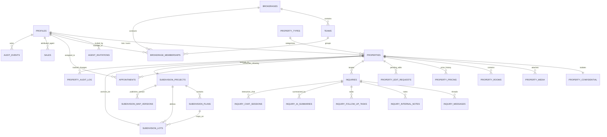

# Human Shelter Realty — Master Database Schema Specification

> **Document Type:** Single Living System Database & Entity Schema Document  
> **Classification:** Production PostgreSQL DDL / Supabase Master Schema  
> **Status:** Active / Living Document  
> **Source Directory:** `backend/src/models/*.sql`  
> **Maintenance Rule:** All future schema additions, table updates, and migration references must be updated in this file.

---

## 1. Revision & Schema Update History

| Version | Date (UTC) | Author / Role | Affected Modules | Summary of Changes |
| :---: | :---: | :--- | :--- | :--- |
| `1.4.0` | `2026-10-29` | Data Architect | Module 01 (User Management) | Extended `public.profiles` with `ui_preferences` JSONB (default `'{"font_size": "standard"}'`); registered `user_profiles_ui_preferences_migration.sql`. |
| `1.3.0` | `2026-10-29` | Data Architect | Module 02 (Subdivision Maps) | Created tables `subdivision_projects`, `subdivision_plans`, `subdivision_lots`, `subdivision_map_versions`; linked `properties` via `subdivision_project_id` and `subdivision_lot_id`; registered indexes, constraints, and RLS policies. |
| `1.2.0` | `2026-10-28` | Data Architect | Module 01 (User Management) | Extended `public.profiles` with `preferred_location`, `investment_budget`, `firm_name`, and `notification_preferences` JSONB; registered migration and RLS policies. |
| `1.1.0` | `2026-10-28` | Data Architect | Module 06 (Audit Module) | Detailed exact column definitions for `audit_events`, `property_audit_log`, `agent_audit_events`, and `inquiry_assignment_audit`; registered their immutable RLS policies in Section 4. |
| `1.0.0` | `2026-10-28` | Data Architect | Modules 01–08 | Comprehensive baseline documentation of all active PostgreSQL tables, columns, relations, and RLS policies. |

---

## 2. High-Level Entity Relationship Diagram (ERD)

---

## 3. Module Schema Catalog

### Module 01: User Management & Authentication

#### Table: `public.profiles`
*Extends Supabase `auth.users` with user roles, contact metadata, and professional real estate accreditation.*

| Column Name | Data Type | Nullable | Default | Constraints / Foreign Keys | Description |
| :--- | :--- | :---: | :--- | :--- | :--- |
| `id` | `UUID` | No | — | `PRIMARY KEY`, `REFERENCES auth.users(id) ON DELETE CASCADE` | Auth user ID |
| `email` | `TEXT` | No | — | — | User email address |
| `full_name` | `TEXT` | Yes | `NULL` | — | Full legal name |
| `avatar_url` | `TEXT` | Yes | `NULL` | — | Profile picture storage URL |
| `role` | `TEXT` | No | `'agent'` | `CHECK (role IN ('admin', 'broker', 'agent', 'client'))` | RBAC role |
| `phone` | `TEXT` | Yes | `NULL` | — | Contact telephone number |
| `prc_license_no` | `TEXT` | Yes | `NULL` | — | PRC Real Estate Broker / Salesperson License |
| `prc_validity` | `DATE` | Yes | `NULL` | — | Expiration date of PRC license |
| `dhsud_accreditation_no` | `TEXT` | Yes | `NULL` | — | DHSUD accreditation number |
| `dhsud_validity` | `DATE` | Yes | `NULL` | — | Expiration date of DHSUD registration |
| `verification_status` | `VARCHAR(20)` | No | `'VERIFIED'` | `CHECK (verification_status IN ('PENDING', 'VERIFIED', 'REJECTED', 'SUSPENDED'))` | Verification state |
| `supporting_documents` | `JSONB` | Yes | `'[]'::jsonb` | — | Uploaded license certificates |
| `rejection_remarks` | `TEXT` | Yes | `NULL` | — | Admin remarks if verification rejected |
| `experience_years` | `INTEGER` | Yes | `0` | — | Years in professional practice |
| `firm_name` | `TEXT` | Yes | `NULL` | — | Brokerage operating entity / firm name |
| `bio` | `TEXT` | Yes | `NULL` | — | Public broker/agent professional bio |
| `preferred_location` | `TEXT` | Yes | `NULL` | — | Client preferred acquisition location / enclaves |
| `investment_budget` | `TEXT` | Yes | `NULL` | — | Client target property investment budget range |
| `notification_preferences` | `JSONB` | Yes | `'{"email": true, "sms": true, "priceDrops": true}'::jsonb` | — | Multi-channel communication notification flags |
| `ui_preferences` | `JSONB` | Yes | `'{"font_size": "standard"}'::jsonb` | — | Dashboard UI customization preferences (font size, display density) |
| `created_at` | `TIMESTAMPTZ` | No | `timezone('utc', now())` | — | Creation timestamp |
| `updated_at` | `TIMESTAMPTZ` | No | `timezone('utc', now())` | — | Last update timestamp |

#### Table: `public.user_sessions` & `public.auth_sessions`
*Tracks active user login tokens, IP addresses, and inactivity timestamps for session protection.*

| Column Name | Data Type | Nullable | Default | Constraints / Foreign Keys | Description |
| :--- | :--- | :---: | :--- | :--- | :--- |
| `id` | `UUID` | No | `gen_random_uuid()` | `PRIMARY KEY` | Session ID |
| `user_id` | `UUID` | No | — | `REFERENCES auth.users(id) ON DELETE CASCADE` | User owning session |
| `session_token` | `TEXT` | No | — | `UNIQUE` | Hashed session authentication token |
| `ip_address` | `INET` | Yes | `NULL` | — | Client IP address |
| `user_agent` | `TEXT` | Yes | `NULL` | — | Client browser / device |
| `last_active_at` | `TIMESTAMPTZ` | No | `timezone('utc', now())` | — | Timestamp for 15-minute inactivity timeout |
| `expires_at` | `TIMESTAMPTZ` | No | — | — | Hard expiration boundary |
| `is_revoked` | `BOOLEAN` | No | `false` | — | Revocation flag for logout/ban |

---

### Module 02: Property Listing Module

#### Table: `public.properties`
*Master property listings adhering to RESO (Real Estate Standards Organization) standards.*

| Column Name | Data Type | Nullable | Default | Constraints / Foreign Keys | Description |
| :--- | :--- | :---: | :--- | :--- | :--- |
| `id` | `UUID` | No | `gen_random_uuid()` | `PRIMARY KEY` | Property listing UUID |
| `listing_key` | `VARCHAR(64)` | Yes | `NULL` | `UNIQUE` | RESO ListingKey |
| `listing_id` | `VARCHAR(32)` | Yes | `NULL` | `UNIQUE` | Human-friendly MLS identifier |
| `title` | `TEXT` | No | — | — | Headline title of listing |
| `tagline` | `TEXT` | Yes | `NULL` | — | Architectural brief tagline |
| `price` | `NUMERIC(15,2)` | No | — | — | Asking price in PHP (₱) |
| `formatted_price`| `TEXT` | Yes | `NULL` | — | Display price (e.g. `₱185,000,000`) |
| `address` | `TEXT` | No | — | — | Street address line |
| `city` | `TEXT` | No | — | — | City name |
| `state` | `TEXT` | Yes | `NULL` | — | Province / State |
| `latitude` | `DOUBLE PRECISION`| Yes| `NULL` | — | GPS Latitude coordinate |
| `longitude` | `DOUBLE PRECISION`| Yes| `NULL` | — | GPS Longitude coordinate |
| `beds` | `INTEGER` | No | `1` | — | Bed count |
| `baths` | `INTEGER` | No | `1` | — | Bath count |
| `sqft` | `NUMERIC(10,2)` | No | — | — | Living floor area |
| `standard_status`| `VARCHAR(32)` | No | `'Draft'` | — | RESO StandardStatus (`Draft`, `Active`, `Pending`, `Closed`) |
| `status` | `TEXT` | No | `'available'` | `CHECK (status IN ('available', 'pending', 'sold'))` | Legacy status flag |
| `property_type_id`| `BIGINT` | No | `1` | `REFERENCES public.property_types(id)` | Architectural category |
| `list_agent_key` | `UUID` | Yes | `NULL` | `REFERENCES public.profiles(id)` | Assigned listing agent |
| `created_by` | `UUID` | Yes | `NULL` | `REFERENCES auth.users(id) ON DELETE SET NULL` | Creator user ID |
| `custom_reso_attributes`| `JSONB` | Yes | `'{}'::jsonb` | — | Additional RESO fields |
| `is_featured` | `BOOLEAN` | Yes | `false` | — | Curated feature flag |
| `subdivision_project_id`| `UUID` | Yes | `NULL` | `REFERENCES public.subdivision_projects(id) ON DELETE SET NULL` | Linked subdivision project |
| `subdivision_lot_id` | `UUID` | Yes | `NULL` | `REFERENCES public.subdivision_lots(id) ON DELETE SET NULL` | Linked lot boundary record |
| `created_at` | `TIMESTAMPTZ` | No | `timezone('utc', now())` | — | Creation timestamp |
| `updated_at` | `TIMESTAMPTZ` | No | `timezone('utc', now())` | — | Modification timestamp |

#### Table: `public.property_confidential`
*Isolates private remarks, lockbox combinations, and seller direct information behind strict agent/broker RLS.*

| Column Name | Data Type | Nullable | Constraints / Foreign Keys | Description |
| :--- | :--- | :---: | :--- | :--- |
| `property_id` | `UUID` | No | `PRIMARY KEY`, `REFERENCES public.properties(id) ON DELETE CASCADE` | Associated listing |
| `private_remarks`| `TEXT` | Yes | — | Confidential broker notes |
| `showing_instructions`| `TEXT` | Yes | — | Showing instructions & gate passes |
| `lockbox_code` | `TEXT` | Yes | — | Physical/smart lockbox access code |
| `seller_direct_phone` | `VARCHAR(32)` | Yes | — | Owner direct contact phone |
| `seller_direct_email` | `VARCHAR(128)` | Yes | — | Owner direct contact email |
| `buyer_agency_compensation` | `VARCHAR(64)` | Yes | — | Agreed commission percentage/split |

#### Table: `public.property_media`
*Ordered gallery of high-resolution architectural photography, floor plans, and virtual tours.*

| Column Name | Data Type | Nullable | Default | Constraints / Foreign Keys | Description |
| :--- | :--- | :---: | :--- | :--- | :--- |
| `id` | `UUID` | No | `gen_random_uuid()` | `PRIMARY KEY` | Media item UUID |
| `property_id` | `UUID` | No | — | `REFERENCES public.properties(id) ON DELETE CASCADE` | Associated listing |
| `media_key` | `VARCHAR(64)` | No | `'MED-' || uuid` | `UNIQUE` | Media key |
| `media_url` | `TEXT` | No | — | — | Storage CDN URL |
| `media_category` | `VARCHAR(32)` | No | `'Photo'` | `CHECK (media_category IN ('Photo', 'FloorPlan', 'Video', 'VirtualTour', 'Document'))` | Media type |
| `order_index` | `INTEGER` | No | `0` | — | Display sorting order |
| `short_description`| `VARCHAR(255)`| Yes| `NULL` | — | Caption / label |

#### Table: `public.property_rooms`
*Detailed room dimension specifications.*

| Column Name | Data Type | Nullable | Default | Constraints / Foreign Keys | Description |
| :--- | :--- | :---: | :--- | :--- | :--- |
| `id` | `UUID` | No | `gen_random_uuid()` | `PRIMARY KEY` | Room record UUID |
| `property_id` | `UUID` | No | — | `REFERENCES public.properties(id) ON DELETE CASCADE` | Property listing |
| `room_type` | `VARCHAR(64)` | No | — | `CHECK (room_type IN ('Primary Bedroom', 'Bedroom', 'Bathroom', 'Living Room', 'Dining Room', 'Kitchen', 'Home Office', 'Balcony', 'Laundry'))` | Room classification |
| `room_level` | `VARCHAR(32)` | Yes | `'Main'` | `CHECK (room_level IN ('Main', 'Second', 'Third', 'Basement', 'Penthouse', 'Upper', 'Lower'))` | Floor level |
| `room_length` | `NUMERIC(6,2)`| Yes | `NULL` | — | Length in meters/feet |
| `room_width` | `NUMERIC(6,2)`| Yes | `NULL` | — | Width in meters/feet |
| `room_features` | `TEXT[]` | Yes | `'{}'` | — | Array of features (e.g. En-suite, Walk-in closet) |

#### Table: `public.subdivision_projects`
*Subdivision development entities with geo-location and development lifecycle states (FR-001).*

| Column Name | Data Type | Nullable | Default | Constraints / Foreign Keys | Description |
| :--- | :--- | :---: | :--- | :--- | :--- |
| `id` | `UUID` | No | `gen_random_uuid()` | `PRIMARY KEY` | Subdivision project UUID |
| `name` | `VARCHAR(255)` | No | — | — | Project / estate commercial name |
| `developer_name` | `VARCHAR(255)` | Yes | `NULL` | — | Real estate developer / corporation |
| `location_address`| `TEXT` | No | — | — | Street address or enclave route |
| `city` | `VARCHAR(100)` | No | — | — | City or municipality |
| `province_state` | `VARCHAR(100)` | Yes | `NULL` | — | Province or state |
| `latitude` | `DOUBLE PRECISION`| Yes| `NULL` | — | Master GPS latitude coordinate |
| `longitude` | `DOUBLE PRECISION`| Yes| `NULL` | — | Master GPS longitude coordinate |
| `status` | `VARCHAR(30)` | No | `'Active'` | `CHECK (status IN ('Planning', 'Active', 'SoldOut', 'Archived'))` | Development lifecycle state |
| `created_by` | `UUID` | Yes | `NULL` | `REFERENCES auth.users(id) ON DELETE SET NULL` | Creator user ID |
| `created_at` | `TIMESTAMPTZ` | No | `timezone('utc', now())` | — | Record creation timestamp |
| `updated_at` | `TIMESTAMPTZ` | No | `timezone('utc', now())` | — | Record update timestamp |

#### Table: `public.subdivision_plans`
*Master subdivision graphics, cadastral blueprints, and dimensional metadata (FR-002–FR-005).*

| Column Name | Data Type | Nullable | Default | Constraints / Foreign Keys | Description |
| :--- | :--- | :---: | :--- | :--- | :--- |
| `id` | `UUID` | No | `gen_random_uuid()` | `PRIMARY KEY` | Master plan document UUID |
| `project_id` | `UUID` | No | — | `REFERENCES public.subdivision_projects(id) ON DELETE CASCADE` | Associated subdivision |
| `plan_title` | `VARCHAR(255)` | No | — | — | Document title (e.g. "Phase 1 Master Site Map") |
| `image_url` | `TEXT` | No | — | — | Storage CDN URL for plan image |
| `file_name` | `VARCHAR(255)` | Yes | `NULL` | — | Original uploaded file name |
| `file_size_bytes` | `BIGINT` | Yes | `NULL` | — | File size in bytes (max 15MB) |
| `image_width` | `INTEGER` | No | — | — | Native image pixel width |
| `image_height` | `INTEGER` | No | — | — | Native image pixel height |
| `aspect_ratio` | `NUMERIC(10,4)`| Yes | `NULL` | — | Calculated aspect ratio (width/height) |
| `is_active` | `BOOLEAN` | No | `true` | — | Whether plan is current active canvas |
| `created_by` | `UUID` | Yes | `NULL` | `REFERENCES auth.users(id) ON DELETE SET NULL` | Creator user ID |
| `created_at` | `TIMESTAMPTZ` | No | `timezone('utc', now())` | — | Creation timestamp |
| `updated_at` | `TIMESTAMPTZ` | No | `timezone('utc', now())` | — | Last update timestamp |

#### Table: `public.subdivision_lots`
*Interactive vector polygon boundaries, cadastral identifiers, and availability records (FR-006–FR-030).*

| Column Name | Data Type | Nullable | Default | Constraints / Foreign Keys | Description |
| :--- | :--- | :---: | :--- | :--- | :--- |
| `id` | `UUID` | No | `gen_random_uuid()` | `PRIMARY KEY` | Lot boundary record UUID |
| `project_id` | `UUID` | No | — | `REFERENCES public.subdivision_projects(id) ON DELETE CASCADE` | Associated subdivision |
| `plan_id` | `UUID` | No | — | `REFERENCES public.subdivision_plans(id) ON DELETE CASCADE` | Traced master plan |
| `block_number` | `VARCHAR(50)` | No | — | — | Cadastral block number |
| `lot_number` | `VARCHAR(50)` | No | — | — | Cadastral lot number |
| `boundary_type` | `VARCHAR(50)` | No | `'SaleableLot'` | `CHECK (boundary_type IN ('SaleableLot', 'Road', 'Park', 'Facility', 'Waterway', 'Other'))` | Feature classification |
| `availability_status`| `VARCHAR(30)`| No | `'Available'` | `CHECK (availability_status IN ('Available', 'Reserved', 'Sold', 'Unavailable'))` | Commercial availability |
| `verified_area_sqm`| `NUMERIC(10,2)`| No | — | — | Verified land area in square meters |
| `price` | `NUMERIC(15,2)`| Yes | `NULL` | — | Asking lot price in PHP (₱) |
| `description` | `TEXT` | Yes | `NULL` | — | Lot orientation/topography notes |
| `coordinates` | `JSONB` | No | — | — | Ordered array of vertex points `[{x, y}, ...]` |
| `is_verified` | `BOOLEAN` | No | `false` | — | Human verification gate for AI suggestions |
| `created_by` | `UUID` | Yes | `NULL` | `REFERENCES auth.users(id) ON DELETE SET NULL` | Creator user ID |
| `updated_by` | `UUID` | Yes | `NULL` | `REFERENCES auth.users(id) ON DELETE SET NULL` | Last editor user ID |
| `created_at` | `TIMESTAMPTZ` | No | `timezone('utc', now())` | — | Creation timestamp |
| `updated_at` | `TIMESTAMPTZ` | No | `timezone('utc', now())` | — | Last update timestamp |
| — | — | — | — | `UNIQUE (project_id, block_number, lot_number)` | Unique block + lot constraint |

#### Table: `public.subdivision_map_versions`
*Immutable published map snapshots supporting instantaneous audit and 1-click version rollbacks (FR-035–FR-037).*

| Column Name | Data Type | Nullable | Default | Constraints / Foreign Keys | Description |
| :--- | :--- | :---: | :--- | :--- | :--- |
| `id` | `UUID` | No | `gen_random_uuid()` | `PRIMARY KEY` | Map version UUID |
| `project_id` | `UUID` | No | — | `REFERENCES public.subdivision_projects(id) ON DELETE CASCADE` | Associated subdivision |
| `plan_id` | `UUID` | No | — | `REFERENCES public.subdivision_plans(id) ON DELETE CASCADE` | Associated master plan |
| `version_number` | `INTEGER` | No | — | — | Monotonically incrementing version |
| `snapshot_data` | `JSONB` | No | — | — | Immutable frozen JSON array of lots & vectors |
| `published_by` | `UUID` | No | — | `REFERENCES auth.users(id) ON DELETE RESTRICT` | Publishing administrator/broker |
| `published_at` | `TIMESTAMPTZ` | No | `timezone('utc', now())` | — | Publication timestamp |
| `restored_from_version`| `INTEGER` | Yes | `NULL` | — | Originating version if rolled back |
| `notes` | `TEXT` | Yes | `NULL` | — | Release / change remarks |
| — | — | — | — | `UNIQUE (project_id, version_number)` | Version sequence uniqueness |

---

### Module 03: Agent Management Module

#### Table: `public.agent_invitations`
*Closed, single-use invitation pipeline for onboarding accredited agents.*

| Column Name | Data Type | Nullable | Default | Constraints / Foreign Keys | Description |
| :--- | :--- | :---: | :--- | :--- | :--- |
| `id` | `UUID` | No | `gen_random_uuid()` | `PRIMARY KEY` | Invitation UUID |
| `email` | `TEXT` | No | — | — | Recipient email |
| `token` | `VARCHAR(64)` | No | `encode(gen_random_bytes(32), 'hex')` | `UNIQUE` | Cryptographic claim token |
| `status` | `VARCHAR(20)` | No | `'pending'` | `CHECK (status IN ('pending', 'used', 'revoked', 'expired'))` | Token status |
| `expires_at` | `TIMESTAMPTZ` | No | `now() + interval '72 hours'` | — | Token expiration cutoff |
| `invited_by` | `UUID` | Yes | `NULL` | `REFERENCES auth.users(id) ON DELETE SET NULL` | Inviting broker ID |

#### Tables: `public.brokerages`, `public.teams`, `public.brokerage_memberships`
*Multi-tier brokerage hierarchy, team rosters, and agent membership contracts.*

| Table | Column Name | Data Type | Constraints / Relations | Description |
| :--- | :--- | :--- | :--- | :--- |
| `brokerages` | `id`, `name`, `license_number`, `created_at` | UUID, TEXT, TEXT, TIMESTAMPTZ | `PRIMARY KEY (id)` | Brokerage firm entity |
| `teams` | `id`, `brokerage_id`, `name`, `team_lead_id` | UUID, UUID, TEXT, UUID | `FK -> brokerages(id)`, `FK -> profiles(id)` | Specialized sales units |
| `brokerage_memberships` | `id`, `brokerage_id`, `agent_id`, `role`, `status` | UUID, UUID, UUID, VARCHAR, VARCHAR | `FK -> brokerages(id)`, `FK -> profiles(id)` | Active membership contract |

---

### Module 04: Sales and Reports Module

#### Table: `public.sales`
*Closed transactions, sale amounts, and broker/agent deal attribution.*

| Column Name | Data Type | Nullable | Default | Constraints / Foreign Keys | Description |
| :--- | :--- | :---: | :--- | :--- | :--- |
| `id` | `TEXT` | No | — | `PRIMARY KEY` | Sale transaction identifier |
| `property_id` | `TEXT` | No | — | — | Transacted property reference |
| `property_title`| `TEXT` | No | — | — | Recorded property name |
| `client_name` | `TEXT` | No | — | — | Buyer legal name |
| `agent_id` | `TEXT` | No | — | — | Attributed closing agent |
| `agent_name` | `TEXT` | No | — | — | Agent name at close |
| `sale_date` | `TEXT` | No | — | — | ISO date of closing |
| `property_value`| `NUMERIC(15,2)`| No | — | — | Final deed of sale amount |
| `status` | `TEXT` | No | `'PENDING'` | `CHECK (status IN ('COMPLETED', 'PENDING', 'CANCELLED'))` | Conveyance status |
| `notes` | `TEXT` | Yes | `''` | — | Transaction notes |

---

### Module 05: Database Functions, Triggers & Reference Data

#### Core Database Triggers & Functions
| Function Name | Return Type | Trigger Event / Table | Purpose |
| :--- | :--- | :--- | :--- |
| `handle_new_user()` | `TRIGGER` | `AFTER INSERT ON auth.users` | Synchronizes Supabase auth users into `public.profiles`. |
| `sync_property_media_to_images()` | `TRIGGER` | `AFTER INSERT OR UPDATE OR DELETE ON public.property_media` | Aggregates media photos into the legacy `properties.images` array. |
| `enforce_property_status_lifecycle()` | `TRIGGER` | `BEFORE UPDATE OF standard_status ON public.properties` | Ensures only `broker` and `admin` roles can set status to `'Active'`. |

---

### Module 06: Audit Module

#### Tables: `public.audit_events`, `public.property_audit_log`, `public.agent_audit_events`, `public.inquiry_assignment_audit`
*Append-only logs capturing security events, listing mutations, agent lifecycle actions, and lead delegations.*

| Table | Key Columns | Purpose |
| :--- | :--- | :--- |
| `audit_events` | `id`, `event_type`, `actor_id`, `actor_name`, `actor_type`, `actor_role`, `brokerage_id`, `inquiry_id`, `target_type`, `target_id`, `outcome`, `reason`, `correlation_id`, `previous_values`, `new_values`, `created_at` | Administrative, session, and access security audit trail |
| `property_audit_log` | `id`, `property_id`, `request_id`, `actor_id`, `action_type`, `changed_fields`, `previous_data`, `new_data`, `audit_notes`, `created_at` | Full field-level old/new JSON diff of all listing modifications |
| `agent_audit_events` | `id`, `actor_id`, `target_id`, `prior_status`, `new_status`, `reason`, `changed_fields`, `created_at` | License updates, onboarding, status changes, and portfolio transfers |
| `inquiry_assignment_audit` | `id`, `inquiry_id`, `assigned_by`, `assigned_to`, `previous_agent_id`, `notes`, `created_at` | Historical triage, reassignment, and advisor delegation records |

---

### Module 07: Inquiry & Communication Module

#### Tables: `public.inquiries`, `public.inquiry_messages`, `public.appointments`, `public.notifications`
*Lead capture pipeline, appointment bookings, and notification distribution.*

| Table | Key Columns | Purpose |
| :--- | :--- | :--- |
| `inquiries` | `id`, `property_id`, `name`, `email`, `phone`, `message`, `type`, `status`, `created_at` | Client lead submissions |
| `inquiry_messages` | `id`, `inquiry_id`, `sender_id`, `sender_type`, `body`, `created_at` | Communication message history |
| `appointments` | `id`, `property_id`, `agent_id`, `client_name`, `appointment_time`, `status`, `notes` | Private showing schedules |
| `notifications` | `id`, `user_id`, `title`, `message`, `type`, `related_record`, `is_read`, `created_at` | In-app user notifications |

---

### Module 08: AI Inquiry Assisted Module

#### Table: `public.inquiry_ai_summaries` & `public.inquiry_chat_sessions`
*AI concierge conversation threads and automated buyer preference summarization.*

| Table | Key Columns | Purpose |
| :--- | :--- | :--- |
| `inquiry_chat_sessions` | `id`, `inquiry_id`, `session_token`, `context_data`, `created_at` | Active conversational session tracking |
| `inquiry_ai_summaries` | `id`, `inquiry_id`, `summary_text`, `detected_budget`, `buyer_intent_score`, `created_at` | AI-extracted leads and preference digests |

---

## 4. Row-Level Security (RLS) Policy Registry

| Table | Policy Name | Permitted Commands | Roles / Target | Rule Definition |
| :--- | :--- | :---: | :--- | :--- |
| `profiles` | Public profiles viewable | `SELECT` | `public` | `true` |
| `profiles` | Users can update own profile | `UPDATE` | `authenticated` | `auth.uid() = id OR is_admin()` |
| `profiles` | Users update own preferences | `UPDATE` | `authenticated` | `auth.uid() = id` |
| `properties` | Public active listings | `SELECT` | `public` | `standard_status = 'Active' OR is_creator_or_broker()` |
| `properties` | Authenticated insertion | `INSERT` | `authenticated` | `auth.uid() IS NOT NULL` |
| `property_confidential` | Deny all public access | `SELECT` | `authenticated` | `role IN ('agent', 'broker', 'admin')` |
| `property_media` | Media viewable by everyone | `SELECT` | `public` | `true` |
| `agent_invitations` | Broker/Admin management | `ALL` | `authenticated` | `role IN ('admin', 'broker')` |
| `agent_invitations` | Public token lookup | `SELECT` | `anon` | `status = 'pending' AND expires_at > now()` |
| `inquiries` | Public submission | `INSERT` | `anon`, `auth` | `true` |
| `inquiries` | Authorized inquiry view | `SELECT` | `authenticated` | `role IN ('agent', 'broker', 'admin')` |
| `appointments` | View assigned appointments | `SELECT` | `authenticated` | `agent_id = auth.uid() OR is_broker()` |
| `audit_events` | Brokers and admins view audit events | `SELECT` | `authenticated` | `role IN ('broker', 'admin')` |
| `audit_events` | Hardened immutability | `UPDATE, DELETE` | `authenticated, anon, public` | `REVOKED (Append-only / Service role only)` |
| `property_audit_log` | Authorized role change log view | `SELECT` | `authenticated` | `role IN ('admin', 'broker') OR list_agent_key = auth.uid()` |
| `agent_audit_events` | Brokers and Admins view audit events | `SELECT` | `authenticated` | `role IN ('broker', 'admin')` |
| `agent_audit_events` | Immutability protection | `UPDATE, DELETE` | `authenticated, anon, public` | `REVOKED (Append-only / Service role only)` |
| `inquiry_assignment_audit` | Staff can view assignment audit | `SELECT` | `authenticated` | `role IN ('agent', 'broker', 'admin')` |
| `subdivision_projects` | Public and users view active projects | `SELECT` | `public, authenticated` | `true` |
| `subdivision_projects` | Brokers and Admins manage projects | `ALL` | `authenticated` | `role IN ('broker', 'admin')` |
| `subdivision_plans` | Public and users view plans | `SELECT` | `public, authenticated` | `true` |
| `subdivision_plans` | Brokers and Admins manage plans | `ALL` | `authenticated` | `role IN ('broker', 'admin')` |
| `subdivision_lots` | Public and users view lots | `SELECT` | `public, authenticated` | `true` |
| `subdivision_lots` | Brokers and Admins manage lots | `ALL` | `authenticated` | `role IN ('broker', 'admin')` |
| `subdivision_map_versions` | Public and users view versions | `SELECT` | `public, authenticated` | `true` |
| `subdivision_map_versions` | Brokers and Admins publish versions | `ALL` | `authenticated` | `role IN ('broker', 'admin')` |

---

## 5. Migration File Traceability Index

| Migration File Path | Primary Modules | Tables & Entities Defined |
| :--- | :---: | :--- |
| `backend/src/models/supabase_schema.sql` | 01, 02, 07 | `profiles`, `properties`, `property_types`, `property_confidential`, `property_media`, `property_rooms`, `inquiries`, `appointments`, `notifications`, `sales` |
| `backend/src/models/user_sessions_migration.sql` | 01 | `user_sessions` |
| `backend/src/models/agent_invitations_migration.sql` | 03 | `agent_invitations` |
| `backend/src/models/agent_management_v2_migration.sql` | 03 | `brokerages`, `teams`, `brokerage_memberships`, `agent_availability_schedules`, `agent_responsibility_transfers` |
| `backend/src/models/agent_credential_documents_migration.sql` | 03 | `agent_credential_documents` |
| `backend/src/models/property_pricing_migration.sql` | 02 | `property_pricing` |
| `backend/src/models/property_edit_approval_migration.sql` | 02 | `property_edit_requests`, `property_audit_log` |
| `backend/src/models/inquiries_module_migration.sql` | 07 | `inquiry_messages`, `inquiry_internal_notes`, `inquiry_assignment_audit` |
| `backend/src/models/communication_audit_session_migration.sql` | 06, 07, 08 | `inquiry_chat_sessions`, `inquiry_follow_up_tasks`, `inquiry_ai_summaries`, `audit_events`, `notification_jobs` |
| `backend/src/models/agent_audit_events_migration.sql` | 03, 06 | `agent_audit_events` |
| `backend/src/models/user_profiles_preferences_migration.sql` | 01 | `profiles` (extended with `preferred_location`, `investment_budget`, `firm_name`, `notification_preferences`) |
| `backend/src/models/user_profiles_ui_preferences_migration.sql` | 01 | `profiles` (extended with `ui_preferences` for font size & display density) |
| `backend/src/models/subdivision_map_tables_migration.sql` | 02 | `subdivision_projects`, `subdivision_plans`, `subdivision_lots`, `subdivision_map_versions`, `properties` FKs |

---

## 6. Schema Maintenance Guidelines

When adding or altering schema objects:
1. **Never edit deployed SQL tables directly without a migration file.**
2. **Create a corresponding migration file** under `backend/src/models/` using descriptive naming.
3. **Update this document:**
   - Add/edit column definitions in Section 3 under the appropriate module.
   - Add new RLS policies to the Section 4 registry.
   - Register the migration file in Section 5.
   - Append a line to the Section 1 Revision History table.
