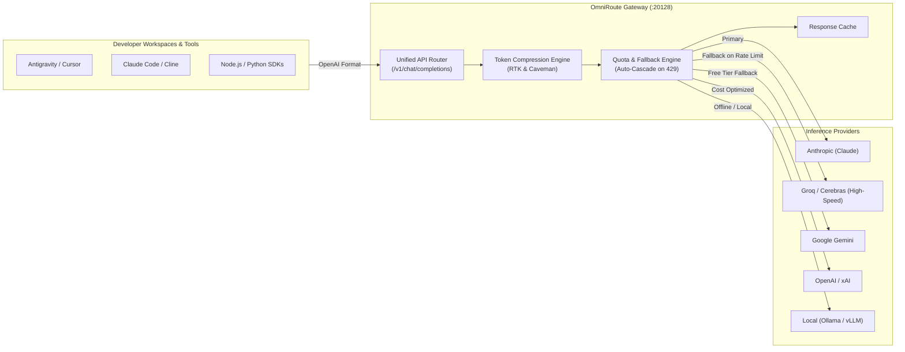

# OmniRoute Comprehensive User Guide

> **Gateway Version:** Latest  
> **Source Repository:** [`cheaper-inference/OmniRoute`](https://github.com/cheaper-inference/OmniRoute)  
> **Default Port:** `20128`  
> **Web UI Console:** [http://localhost:20128](http://localhost:20128)  
> **API Proxy Endpoint:** `http://localhost:20128/v1` (OpenAI-compatible)

---

## 1. System Overview & Architecture

**OmniRoute** is an open-source AI routing and proxy gateway designed to sit between developer workflows (IDEs, autonomous agents, CLI tools) and external AI inference providers.



---

## 2. Managing the OmniRoute Service

### Starting OmniRoute
In your PowerShell or terminal:
```powershell
omniroute
```
When launched, OmniRoute will:
1. Boot the HTTP API proxy server on port `20128`.
2. Launch the Web UI dashboard on `http://localhost:20128`.
3. Display system startup telemetry and default access links.

### Headless or Automated Mode
For automated environments, Docker, or background terminal jobs where interactive prompts should be bypassed:
```powershell
omniroute setup --non-interactive
```

### Checking Version & Status
```powershell
omniroute --version
omniroute --help
```

---

## 3. Web Dashboard Walkthrough

### 3.1 First Launch & Authentication
1. Open [http://localhost:20128](http://localhost:20128) in your browser.
2. If prompted for an initial administrator password:
   - Check the terminal output from where `omniroute` was launched.
   - Alternatively, you can set an initial password in your environment before launching:
     ```powershell
     $env:INITIAL_PASSWORD="your-secure-password"
     omniroute
     ```

### 3.2 Adding Providers & API Keys
Navigate to the **Providers** section in the web console:
1. Click **Add Provider**.
2. Select your provider from the list:
   - **Groq:** Fast inference (Llama 3.3, DeepSeek)
   - **Google Gemini:** Large context windows & multimodal
   - **Anthropic:** Claude 3.5 Sonnet / Haiku
   - **OpenAI:** GPT-4o / o1
   - **xAI:** Grok 2
   - **Ollama:** Self-hosted local models (`http://localhost:11434`)
3. Paste your API key and click **Save**.

### 3.3 Configuring Automatic Fallback Cascades
In the **Routing & Models** tab:
- Set up fallback rules for when an API hits HTTP 429 (Rate Limit) or HTTP 500 (Outage).
- Example cascade rule:
  1. **Primary:** Claude 3.5 Sonnet (Direct Anthropic)
  2. **Secondary:** DeepSeek-R1 (Groq)
  3. **Tertiary:** Gemini 2.0 Flash (Free Tier Google)
- If your primary account runs out of tokens or hits a tier quota, OmniRoute seamlessly routes the prompt to the secondary provider without breaking your coding session.

### 3.4 Prompt Token Compression
OmniRoute includes built-in stacked prompt compression:
- **RTK (Real-Time Reduction):** Strips redundant whitespace, repetitive tokens, and low-information syntactic filler.
- **Caveman Mode:** Trims verbose assistant framing while preserving full code context.
- Enable compression under **Settings > Optimization** to save up to 20–40% on token billing.

---

## 4. Connecting Your Developer Tools & IDEs

OmniRoute exposes a universal OpenAI-compatible endpoint. Any tool that supports custom API endpoints can be connected instantly.

### 4. Connecting Your Developer Tools & IDEs

OmniRoute exposes a universal OpenAI-compatible endpoint. Furthermore, the CLI includes built-in 1-click configurators for all major AI coding tools:

```powershell
# Auto-configure your favorite assistant:
omniroute setup-cursor     # Print Cursor setup steps and endpoints
omniroute setup-cline      # Auto-configure Cline (~/.cline/data)
omniroute setup-claude     # Auto-configure Claude Code profiles
omniroute setup-codex      # Auto-configure Codex CLI profiles
omniroute setup-roo        # Auto-configure Roo Code
omniroute setup-opencode   # Auto-configure OpenCode (~/.config/opencode/opencode.json)
omniroute setup-aider      # Auto-configure Aider (~/.aider.conf.yml)
```

### 4.1 Connecting Cursor / Cline / Roo Code (Manual)
In the extension or IDE settings:
- **API Provider:** `OpenAI-Compatible`
- **Base URL:** `http://localhost:20128/v1`
- **API Key:** Any string or your OmniRoute Master Key
- **Model:** `auto` *(recommended: lets OmniRoute handle quota-aware routing)* or enter a specific model alias (e.g. `claude-3-5-sonnet`, `llama-3.3-70b`).

### 4.2 Connecting Claude Code CLI
```bash
export ANTHROPIC_BASE_URL="http://localhost:20128/v1"
claude
```

### 4.3 Node.js / TypeScript Integration
```typescript
import OpenAI from 'openai';

const client = new OpenAI({
  baseURL: 'http://localhost:20128/v1',
  apiKey: process.env.OMNIROUTE_API_KEY || 'omniroute-local',
});

async function run() {
  const response = await client.chat.completions.create({
    model: 'auto', // Or 'claude-3-5-sonnet', 'groq/llama-3.3-70b'
    messages: [
      { role: 'system', content: 'You are an expert engineer.' },
      { role: 'user', content: 'Explain architectural boundaries.' },
    ],
  });

  console.log(response.choices[0].message.content);
}

run();
```

### 4.4 Python Integration
```python
from openai import OpenAI

client = OpenAI(
    base_url="http://localhost:20128/v1",
    api_key="omniroute-local"
)

response = client.chat.completions.create(
    model="auto",
    messages=[{"role": "user", "content": "Hello via OmniRoute!"}]
)

print(response.choices[0].message.content)
```

---

## 5. Troubleshooting & Maintenance

| Symptom | Cause | Solution |
| :--- | :--- | :--- |
| **`EADDRINUSE: port 20128`** | Another instance of OmniRoute or process is using port 20128. | Kill the existing process: `Stop-Process -Id (Get-NetTCPConnection -LocalPort 20128).OwningProcess -Force` |
| **`401 Unauthorized` on `/v1`** | Master gateway API key mismatch. | Check the API Keys tab in the dashboard and copy the exact master access token into your IDE. |
| **`All providers exhausted`** | All configured providers in the cascade hit rate limits or ran out of credits. | Add a free-tier fallback provider (e.g. Google Gemini or Groq Free) in the dashboard. |
| **Updating OmniRoute** | New version available on npm. | Run `npm install -g omniroute@latest` to upgrade. |
