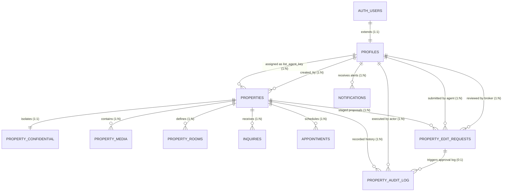

# Phase 1: Database Inspection and Schema Design Report

**Project:** Human Shelter Realty  
**Module:** Property Listing Management  
**Specification Reference:** `docs/Property_listings/01-database-schema-design.md`  
**Execution Phase:** Phase 1 (Analysis and Design Only — No Code/Database Alterations)  
**Status:** COMPLETE (Pending User Approval)  
**Report Date:** 2026-10-14  

---

## 1. Existing Database Inspection Summary

An in-depth, read-only inspection of the codebase, Supabase database DDL definitions, migrations, models, services, and UI components was conducted.

### 1.1 Source Files Inspected
- **Database DDL & Migrations:**
  - `backend/src/models/supabase_schema.sql` (Canonical production DDL with RESO Data Dictionary 2.0 definitions, triggers, and RLS)
  - `backend/src/models/agent_invitations_migration.sql` (Invitations pipeline & profile verification extensions)
  - `backend/src/models/supabase_seed.sql` (Luxury architectural property records and seed fixtures)
  - `DATABASE_SCHEMA.md` (System entity-relationship documentation)
- **Backend API Layer:**
  - `backend/src/routes/property.routes.ts` (Express routing & RBAC middleware)
  - `backend/src/controllers/property.controller.ts` (HTTP handler and request validation)
  - `backend/src/services/property.service.ts` (Data access layer, Supabase queries, local state fallback)
  - `backend/src/models/property.model.ts` (TypeScript interfaces and data structures)
- **Frontend Presentation Layer:**
  - `frontend/src/App.jsx` (Portal routing table and route guards)
  - `frontend/src/services/propertyService.js` (Frontend API client, payload adapter, normalization)
  - `frontend/src/pages/portals/broker/BrokerCreateListings.jsx` (Broker 7-section listing studio)
  - `frontend/src/pages/portals/broker/BrokerProperties.jsx` (Broker inventory table & inline approval)
  - `frontend/src/pages/portals/agent/AgentProperties.jsx` (Agent inventory table)
  - `frontend/src/pages/portals/agent/AgentPropertyCreate.jsx` (Agent property creation form)
  - `frontend/src/pages/portals/agent/AgentPropertyDetail.jsx` (Agent property view & direct edit modal)

### 1.2 Existing Database Tables & Structures

| Table Name | Primary Key | Key Relationships | RLS Enabled | Core Responsibility |
| :--- | :--- | :--- | :---: | :--- |
| `public.profiles` | `id` (UUID) | References `auth.users(id)` ON DELETE CASCADE | **YES** | Mirrors Supabase auth, stores roles (`admin`, `broker`, `agent`, `client`), licenses (`prc_license_no`, `dhsud_accreditation_no`), and verification statuses. |
| `public.properties` | `id` (UUID) | `created_by` -> `auth.users(id)`<br>`list_agent_key` -> `public.profiles(id)` | **YES** | Authoritative master registry for real estate listings conforming to RESO 2.0. |
| `public.property_confidential` | `property_id` (UUID) | References `public.properties(id)` ON DELETE CASCADE | **YES** | 1-to-1 secure isolation for private broker remarks, showing instructions, lockbox codes, seller contact info, and commission splits. |
| `public.property_media` | `id` (UUID) | References `public.properties(id)` ON DELETE CASCADE | **YES** | 1-to-Many RESO media resource assets synced to `properties.images`. |
| `public.property_rooms` | `id` (UUID) | References `public.properties(id)` ON DELETE CASCADE | **YES** | 1-to-Many room dimensions, levels, and finishes. |
| `public.inquiries` | `id` (UUID) | References `public.properties(id)` ON DELETE SET NULL | **YES** | Client lead capture and private tour inquiries. |
| `public.appointments` | `id` (UUID) | References `public.properties(id)` ON DELETE CASCADE<br>`agent_id` -> `public.profiles(id)` | **YES** | Calendar showings and viewing appointments. |
| `public.sales` | `id` (TEXT) | Loose reference to `property_id` | **YES** | Transaction conveyance ledger for closed sales. |
| `public.notifications` | `id` (TEXT) | References `auth.users(id)` | **YES** | In-app alerts for inquiries, verifications, status changes. |

### 1.3 Existing Triggers and Database Functions
1. `trg_enforce_property_status` on `public.properties`:
   - Fires `BEFORE UPDATE OF standard_status`.
   - Function `public.enforce_property_status_lifecycle()` verifies caller has `broker` or `admin` role before transitioning to `'Active'`.
2. `trg_sync_property_media` on `public.property_media`:
   - Fires `AFTER INSERT OR UPDATE OR DELETE`.
   - Function `public.sync_property_media_to_images()` aggregates `'Photo'` category URLs into `properties.images` array.
3. `on_auth_user_created` on `auth.users`:
   - Fires `AFTER INSERT`.
   - Function `public.handle_new_user()` auto-provisions profile record.

---

## 2. Current Schema Assessment

### 2.1 Analysis of Overlapping & Duplicate Fields in `public.properties`
The inspection revealed several historical and standard-alignment duplicate fields in `public.properties`:

| Overlapping Pair | Column 1 (Legacy / UI) | Column 2 (RESO 2.0 Standard) | Current System Usage | Architectural Assessment & Recommendation |
| :--- | :--- | :--- | :--- | :--- |
| **Bedrooms** | `beds` (`INTEGER NOT NULL DEFAULT 1`) | `bedrooms_total` (`SMALLINT DEFAULT 1`) | `beds` is consumed by legacy cards and search filters; `bedrooms_total` is RESO formal spec. | **Preserve both.** Synchronize bidirectionally via DB trigger / service layer. Do NOT drop either column. |
| **Bathrooms** | `baths` (`INTEGER NOT NULL DEFAULT 1`) | `bathrooms_total_integer` (`SMALLINT DEFAULT 1`), `bathrooms_full`, `bathrooms_half` | `baths` is simple count; RESO provides granular full/half bath breakdown. | **Preserve all.** `baths` remains standard UI display; granular columns preserve RESO compliance. |
| **Floor Area** | `sqft` (`NUMERIC(10, 2) NOT NULL`) | `living_area` (`NUMERIC(10, 2)`), `living_area_units` (`VARCHAR(20) DEFAULT 'Square Meters'`) | `sqft` stores numeric area value; `living_area` pairs with explicit metric units (`Square Meters`). | **Preserve both.** Continue mapping `living_area` to `sqft` in data adapters to avoid breaking legacy widgets. |
| **Province / State** | `state` (`TEXT`) | `state_or_province` (`VARCHAR(64)`) | Both store "Metro Manila", "Cavite", etc. | **Preserve both.** Coalesce values in queries: `COALESCE(state_or_province, state)`. |
| **Listing Status** | `status` (`TEXT CHECK ('available', 'pending', 'sold')`) | `standard_status` (`VARCHAR(32) CHECK ('Draft', 'Pending Approval', 'Active', 'Active Under Contract', 'Pending', 'Closed', 'Canceled', 'Expired')`) | `status` is a high-level 3-state badge; `standard_status` is the formal MLS lifecycle governing visibility and approvals. | **Preserve both.** Maintain automated state mapping: `'Active'` <-> `'available'`, `'Closed'` <-> `'sold'`, `'Pending Approval'` <-> `'pending'`. |

### 2.2 Field Exclusions Assessment (Add Property Form)
Confirmed requirements require excluding 4 fields from the Add Property form:
- `original_list_price`
- `association_fee`
- `tax_annual_amount`
- `list_price_currency`

**Schema Integrity Findings:**
- All 4 columns currently exist in `public.properties`.
- None of these 4 columns are marked `NOT NULL` without a default. `list_price_currency` has `DEFAULT 'PHP'`, and `association_fee` has `DEFAULT 0.00`. `tax_annual_amount` and `original_list_price` are nullable.
- **Conclusion:** Omitting these 4 inputs from the frontend Add Property form (`BrokerCreateListings.jsx`) introduces **zero database constraint violations**. The columns will remain 100% intact in the database table to protect historical data and downstream analytics.

### 2.3 Existing RLS Policies on `public.properties`
The current RLS policies in `backend/src/models/supabase_schema.sql` expose critical authorization gaps:
- **SELECT Policy:** Public can view active listings; creators, assigned agents, and brokers can view unapproved listings. *(Appropriate)*
- **INSERT Policy:** `WITH CHECK (auth.uid() IS NOT NULL)`  
  🔴 **Critical Defect:** Any authenticated user — including agents — can execute direct SQL inserts into `public.properties`.
- **UPDATE Policy:** `USING (auth.uid() = created_by OR EXISTS (SELECT 1 FROM public.profiles WHERE id = auth.uid() AND role IN ('admin', 'broker')))`  
  🔴 **Critical Defect:** If an agent is the `created_by` or listing creator, they have direct UPDATE privileges over the approved live listing row.

---

## 3. Requirements Compliance Matrix

| # | Confirmed Requirement | Existing Implementation | Compliance Status | Identified Gap | Recommended Solution | Affected Tables | Affected Components |
|---|---|---|:---:|---|---|---|---|
| **R1** | **Agents cannot create property listings** | `POST /api/properties` permits `role: 'agent'`.<br>`App.jsx` maps `/agent/properties/create`.<br>`AgentProperties.jsx` renders `+ Add Listing`.<br>`AgentPropertyCreate.jsx` exists and posts to API.<br>Supabase RLS allows authenticated `INSERT`. | ❌ **Non-Compliant** | Multiple entry points allow agents to create listings. | • Restrict `POST /api/properties` to `broker` and `admin`.<br>• Update Supabase RLS `INSERT` on `properties` to `broker`/`admin` only.<br>• Remove `/agent/properties/create` route.<br>• Remove "+ Add Listing" button from agent view. | `public.properties`, `public.profiles` | `property.routes.ts`, `property.controller.ts`, `App.jsx`, `AgentProperties.jsx`, `AgentPropertyCreate.jsx` |
| **R2** | **Agents may propose edits to assigned listings** | `AgentPropertyDetail.jsx` has "Edit Listing" modal directly updating `price` & `status`, and toggle publishing button directly flipping `is_published`. | ❌ **Non-Compliant** | No proposal staging mechanism exists; edits either bypass approval or fail backend validation. | • Create `public.property_edit_requests` table.<br>• Add `POST /api/properties/:id/edit-requests` endpoint.<br>• Convert agent modal to "Propose Changes" drawer. | `public.properties`, `public.property_edit_requests` | `property.routes.ts`, `property.controller.ts`, `property.service.ts`, `AgentPropertyDetail.jsx` |
| **R3** | **Broker/Admin approval required for agent edits** | No approval queue or broker review interface exists for field updates. | ❌ **Non-Compliant** | Brokers have no mechanism to view or act upon field-level proposals. | • Implement `apply_property_edit_request` and `reject_property_edit_request` stored procedures.<br>• Add review drawer to `BrokerProperties.jsx`. | `public.property_edit_requests`, `public.properties`, `public.notifications` | `property.controller.ts`, `propertyService.js`, `BrokerProperties.jsx` |
| **R4** | **Pending edits must not alter approved listings** | Direct mutations currently update `public.properties` immediately. | ❌ **Non-Compliant** | No shadow or staging table exists; mutations hit the live row. | • Store proposed changes in `proposed_changes` (JSONB) in `property_edit_requests`.<br>• Leave `public.properties` untouched until broker approval. | `public.properties`, `public.property_edit_requests` | `property.service.ts`, `propertyService.js` |
| **R5** | **Approved edits applied securely with audit trail** | No audit trail table exists in database. | ❌ **Non-Compliant** | Zero change tracking or compliance ledger. | • Create `public.property_audit_log` table.<br>• Stored procedure records previous vs new data snapshot atomically upon approval. | `public.property_audit_log`, `public.properties` | `supabase_schema.sql`, `property.service.ts` |
| **R6** | **Exclude 4 fields from Add Property form** | `BrokerCreateListings.jsx` Section 4 renders inputs for `associationFee`, `associationFeeFrequency`, `taxAnnualAmount`, and tracks `originalListPrice`. | ⚠️ **Partial Alignment** | Inputs are visible in the broker listing creation form. | • Omit/remove these 4 input fields from `BrokerCreateListings.jsx`.<br>• Default values in API payload. | None (Frontend Form Only) | `BrokerCreateListings.jsx`, `propertyService.js` |
| **R7** | **Preserve existing database columns** | Columns exist in `public.properties` schema. | ✅ **Compliant** | None. | • Maintain all existing columns non-destructively in PostgreSQL DDL. | `public.properties` | `supabase_schema.sql` |
| **R8** | **Protect system-managed fields** | Handled partially in TypeScript service, but not enforced in RLS or stored procedures. | ⚠️ **Partial Alignment** | `id`, `created_by`, `created_at`, `updated_at` could be targeted in raw JSON updates. | • Explicit whitelist extraction in approval stored procedure.<br>• Strip system keys from `proposed_changes`. | `public.properties`, `public.property_edit_requests` | Stored Procedure, `property.service.ts` |

---

## 4. Proposed Database Improvements & Tables

### 4.1 Reused Existing Tables
- `public.properties`: Remains authoritative master table. No columns dropped or altered.
- `public.profiles`: Reused for agent and broker identities, authorization, and assignment verification.
- `public.notifications`: Reused to alert agents of proposal approvals or rejections.

### 4.2 Proposed New Table: `public.property_edit_requests`
Designed specifically to fulfill Section 4.2 of `01-database-schema-design.md`:

```sql
-- ==============================================================================
-- TABLE: public.property_edit_requests
-- Staged proposal ledger for agent-initiated listing changes
-- ==============================================================================
CREATE TABLE IF NOT EXISTS public.property_edit_requests (
  id UUID DEFAULT gen_random_uuid() PRIMARY KEY,
  property_id UUID NOT NULL REFERENCES public.properties(id) ON DELETE CASCADE,
  agent_id UUID NOT NULL REFERENCES public.profiles(id) ON DELETE CASCADE,
  request_status VARCHAR(32) NOT NULL DEFAULT 'PENDING' 
    CHECK (request_status IN ('PENDING', 'APPROVED', 'REJECTED', 'CANCELLED', 'CONFLICT')),
  proposed_changes JSONB NOT NULL,
  original_snapshot JSONB NOT NULL,
  base_version INTEGER NOT NULL DEFAULT 1,
  agent_notes TEXT,
  reviewed_by UUID REFERENCES public.profiles(id) ON DELETE SET NULL,
  reviewed_at TIMESTAMPTZ,
  review_notes TEXT,
  created_at TIMESTAMPTZ NOT NULL DEFAULT timezone('utc'::text, now()),
  updated_at TIMESTAMPTZ NOT NULL DEFAULT timezone('utc'::text, now())
);

-- Concurrency Control: Exactly ONE pending edit request per property
CREATE UNIQUE INDEX IF NOT EXISTS idx_single_pending_request_per_property 
  ON public.property_edit_requests(property_id) 
  WHERE request_status = 'PENDING';

-- Performance Indexes
CREATE INDEX IF NOT EXISTS idx_property_edit_requests_property_id 
  ON public.property_edit_requests(property_id);
CREATE INDEX IF NOT EXISTS idx_property_edit_requests_agent_id 
  ON public.property_edit_requests(agent_id);
CREATE INDEX IF NOT EXISTS idx_property_edit_requests_status 
  ON public.property_edit_requests(request_status);
CREATE INDEX IF NOT EXISTS idx_property_edit_requests_created_at 
  ON public.property_edit_requests(created_at DESC);
```

### 4.3 Proposed New Table: `public.property_audit_log`
Designed specifically to fulfill Section 4.3 of `01-database-schema-design.md`:

```sql
-- ==============================================================================
-- TABLE: public.property_audit_log
-- Immutable audit ledger for property updates and lifecycle transitions
-- ==============================================================================
CREATE TABLE IF NOT EXISTS public.property_audit_log (
  id UUID DEFAULT gen_random_uuid() PRIMARY KEY,
  property_id UUID NOT NULL REFERENCES public.properties(id) ON DELETE CASCADE,
  request_id UUID REFERENCES public.property_edit_requests(id) ON DELETE SET NULL,
  actor_id UUID REFERENCES public.profiles(id) ON DELETE SET NULL,
  action_type VARCHAR(32) NOT NULL 
    CHECK (action_type IN ('CREATED', 'EDIT_APPROVED', 'DIRECT_UPDATE', 'STATUS_CHANGE', 'MEDIA_UPDATE', 'DELETED')),
  changed_fields TEXT[] NOT NULL DEFAULT '{}',
  previous_data JSONB NOT NULL,
  new_data JSONB NOT NULL,
  created_at TIMESTAMPTZ NOT NULL DEFAULT timezone('utc'::text, now())
);

-- Performance Indexes
CREATE INDEX IF NOT EXISTS idx_property_audit_log_property_id 
  ON public.property_audit_log(property_id, created_at DESC);
CREATE INDEX IF NOT EXISTS idx_property_audit_log_actor_id 
  ON public.property_audit_log(actor_id);
CREATE INDEX IF NOT EXISTS idx_property_audit_log_action_type 
  ON public.property_audit_log(action_type);
```

---

## 5. Entity Relationship Diagram (ERD)



---

## 6. Database Security Considerations & Proposed RLS Policies

### 6.1 Database-Level Authorization Guards

1. **Restricting Listing Creation:**
   - Drop the permissive `WITH CHECK (auth.uid() IS NOT NULL)` policy on `public.properties`.
   - Apply a restrictive policy: only authenticated users whose `public.profiles.role IN ('broker', 'admin')` may insert rows.

2. **Preventing Direct Agent Updates:**
   - Drop the legacy update policy allowing `created_by = auth.uid()`.
   - Apply strict policy: only `broker` and `admin` roles can execute direct `UPDATE` queries on `public.properties`.

3. **Restricting Edit Proposal Submissions:**
   - Agents can insert into `public.property_edit_requests` **only if** they are assigned to the target property:
     `auth.uid() = agent_id AND EXISTS (SELECT 1 FROM public.properties WHERE id = property_id AND list_agent_key = auth.uid())`.
   - This database-level check unconditionally blocks BOLA / IDOR attacks.

4. **Immutable Audit Trail:**
   - No direct `INSERT`, `UPDATE`, or `DELETE` policies are granted on `public.property_audit_log` to normal authenticated or anonymous users.
   - Audit records are written exclusively via `SECURITY DEFINER` stored procedures.

### 6.2 Proposed Row Level Security Policies (Draft)

```sql
-- 1. HARDEN PROPERTIES TABLE
DROP POLICY IF EXISTS "Authenticated users can insert new properties." ON public.properties;
CREATE POLICY "Only brokers and admins can insert properties"
  ON public.properties FOR INSERT
  TO authenticated
  WITH CHECK (
    EXISTS (
      SELECT 1 FROM public.profiles 
      WHERE id = auth.uid() AND role IN ('broker', 'admin')
    )
  );

DROP POLICY IF EXISTS "Property creators or admins can update properties." ON public.properties;
CREATE POLICY "Only brokers and admins can update properties"
  ON public.properties FOR UPDATE
  TO authenticated
  USING (
    EXISTS (
      SELECT 1 FROM public.profiles 
      WHERE id = auth.uid() AND role IN ('broker', 'admin')
    )
  );

-- 2. SECURE PROPERTY EDIT REQUESTS
ALTER TABLE public.property_edit_requests ENABLE ROW LEVEL SECURITY;

CREATE POLICY "Agents can view own edit requests; brokers view all"
  ON public.property_edit_requests FOR SELECT
  TO authenticated
  USING (
    agent_id = auth.uid() OR
    EXISTS (SELECT 1 FROM public.profiles WHERE id = auth.uid() AND role IN ('broker', 'admin'))
  );

CREATE POLICY "Assigned agents can submit edit requests"
  ON public.property_edit_requests FOR INSERT
  TO authenticated
  WITH CHECK (
    auth.uid() = agent_id AND
    EXISTS (
      SELECT 1 FROM public.properties 
      WHERE id = property_id AND list_agent_key = auth.uid()
    )
  );

CREATE POLICY "Agents can cancel own pending requests; brokers update review"
  ON public.property_edit_requests FOR UPDATE
  TO authenticated
  USING (
    (agent_id = auth.uid() AND request_status = 'PENDING') OR
    EXISTS (SELECT 1 FROM public.profiles WHERE id = auth.uid() AND role IN ('broker', 'admin'))
  );

-- 3. SECURE PROPERTY AUDIT LOG
ALTER TABLE public.property_audit_log ENABLE ROW LEVEL SECURITY;

CREATE POLICY "Brokers view all audit logs; agents view assigned"
  ON public.property_audit_log FOR SELECT
  TO authenticated
  USING (
    EXISTS (SELECT 1 FROM public.profiles WHERE id = auth.uid() AND role IN ('broker', 'admin')) OR
    EXISTS (SELECT 1 FROM public.properties WHERE id = property_id AND list_agent_key = auth.uid())
  );
```

### 6.3 Secure Stored Procedure: `public.apply_property_edit_request`
Executes atomically within a transaction using `SECURITY DEFINER`:

```sql
CREATE OR REPLACE FUNCTION public.apply_property_edit_request(
  p_request_id UUID,
  p_broker_id UUID,
  p_review_notes TEXT DEFAULT NULL
)
RETURNS JSONB
LANGUAGE plpgsql
SECURITY DEFINER
SET search_path = public, pg_temp
AS $$
DECLARE
  v_broker_role TEXT;
  v_req RECORD;
  v_prop RECORD;
  v_previous JSONB;
  v_new JSONB;
  v_changed_keys TEXT[] := '{}';
  v_key TEXT;
  v_val JSONB;
BEGIN
  -- Verify reviewer privilege
  SELECT role INTO v_broker_role FROM public.profiles WHERE id = p_broker_id;
  IF v_broker_role NOT IN ('broker', 'admin') THEN
    RAISE EXCEPTION 'Access Denied: Only brokers and administrators can approve edit requests.';
  END IF;

  -- Lock edit request
  SELECT * INTO v_req FROM public.property_edit_requests WHERE id = p_request_id FOR UPDATE;
  IF NOT FOUND THEN
    RAISE EXCEPTION 'Edit request % not found.', p_request_id;
  END IF;

  IF v_req.request_status <> 'PENDING' THEN
    RAISE EXCEPTION 'Cannot approve request: status is %.', v_req.request_status;
  END IF;

  -- Lock property row
  SELECT * INTO v_prop FROM public.properties WHERE id = v_req.property_id FOR UPDATE;
  IF NOT FOUND THEN
    RAISE EXCEPTION 'Target property % does not exist.', v_req.property_id;
  END IF;

  v_previous := to_jsonb(v_prop);

  -- Apply whitelisted business fields only (System fields id, created_by, created_at protected)
  UPDATE public.properties
  SET
    title = COALESCE((v_req.proposed_changes->>'title'), title),
    tagline = COALESCE((v_req.proposed_changes->>'tagline'), tagline),
    price = COALESCE((v_req.proposed_changes->>'price')::NUMERIC(15, 2), price),
    formatted_price = COALESCE((v_req.proposed_changes->>'formatted_price'), formatted_price),
    property_type = COALESCE((v_req.proposed_changes->>'property_type'), property_type),
    property_sub_type = COALESCE((v_req.proposed_changes->>'property_sub_type'), property_sub_type),
    property_condition = COALESCE((v_req.proposed_changes->>'property_condition'), property_condition),
    transaction_type = COALESCE((v_req.proposed_changes->>'transaction_type'), transaction_type),
    address = COALESCE((v_req.proposed_changes->>'address'), address),
    unparsed_address = COALESCE((v_req.proposed_changes->>'unparsed_address'), unparsed_address),
    subdivision_name = COALESCE((v_req.proposed_changes->>'subdivision_name'), subdivision_name),
    city = COALESCE((v_req.proposed_changes->>'city'), city),
    state_or_province = COALESCE((v_req.proposed_changes->>'state_or_province'), state_or_province),
    postal_code = COALESCE((v_req.proposed_changes->>'postal_code'), postal_code),
    latitude = COALESCE((v_req.proposed_changes->>'latitude')::DOUBLE PRECISION, latitude),
    longitude = COALESCE((v_req.proposed_changes->>'longitude')::DOUBLE PRECISION, longitude),
    beds = COALESCE((v_req.proposed_changes->>'beds')::INTEGER, beds),
    baths = COALESCE((v_req.proposed_changes->>'baths')::INTEGER, baths),
    bedrooms_total = COALESCE((v_req.proposed_changes->>'bedrooms_total')::SMALLINT, bedrooms_total),
    bathrooms_total_integer = COALESCE((v_req.proposed_changes->>'bathrooms_total_integer')::SMALLINT, bathrooms_total_integer),
    sqft = COALESCE((v_req.proposed_changes->>'sqft')::NUMERIC(10, 2), sqft),
    living_area = COALESCE((v_req.proposed_changes->>'living_area')::NUMERIC(10, 2), living_area),
    living_area_units = COALESCE((v_req.proposed_changes->>'living_area_units'), living_area_units),
    lot_size_area = COALESCE((v_req.proposed_changes->>'lot_size_area')::NUMERIC(12, 2), lot_size_area),
    lot_size_units = COALESCE((v_req.proposed_changes->>'lot_size_units'), lot_size_units),
    year_built = COALESCE((v_req.proposed_changes->>'year_built')::INTEGER, year_built),
    parking_total = COALESCE((v_req.proposed_changes->>'parking_total')::SMALLINT, parking_total),
    architectural_style = COALESCE((v_req.proposed_changes->>'architectural_style'), architectural_style),
    public_remarks = COALESCE((v_req.proposed_changes->>'public_remarks'), public_remarks),
    features = CASE 
      WHEN v_req.proposed_changes ? 'features' 
      THEN ARRAY(SELECT jsonb_array_elements_text(v_req.proposed_changes->'features'))
      ELSE features 
    END,
    interior_features = CASE 
      WHEN v_req.proposed_changes ? 'interior_features' 
      THEN ARRAY(SELECT jsonb_array_elements_text(v_req.proposed_changes->'interior_features'))
      ELSE interior_features 
    END,
    exterior_features = CASE 
      WHEN v_req.proposed_changes ? 'exterior_features' 
      THEN ARRAY(SELECT jsonb_array_elements_text(v_req.proposed_changes->'exterior_features'))
      ELSE exterior_features 
    END,
    updated_at = timezone('utc'::text, now())
  WHERE id = v_req.property_id
  RETURNING to_jsonb(public.properties.*) INTO v_new;

  -- Mark edit request as APPROVED
  UPDATE public.property_edit_requests
  SET 
    request_status = 'APPROVED',
    reviewed_by = p_broker_id,
    reviewed_at = timezone('utc'::text, now()),
    review_notes = p_review_notes,
    updated_at = timezone('utc'::text, now())
  WHERE id = p_request_id;

  -- Identify modified keys
  FOR v_key, v_val IN SELECT * FROM jsonb_each(v_req.proposed_changes)
  LOOP
    v_changed_keys := array_append(v_changed_keys, v_key);
  END LOOP;

  -- Record audit log entry
  INSERT INTO public.property_audit_log (
    property_id,
    request_id,
    actor_id,
    action_type,
    changed_fields,
    previous_data,
    new_data
  ) VALUES (
    v_req.property_id,
    p_request_id,
    p_broker_id,
    'EDIT_APPROVED',
    v_changed_keys,
    v_previous,
    v_new
  );

  -- Dispatch notification to agent
  INSERT INTO public.notifications (
    id,
    title,
    message,
    type,
    related_record,
    role,
    user_id
  ) VALUES (
    'notif-' || gen_random_uuid()::text,
    'Listing Edit Approved',
    'Your proposed modifications to property listing have been approved and published.',
    'property',
    v_req.property_id::text,
    'agent',
    v_req.agent_id
  );

  RETURN jsonb_build_object(
    'success', true,
    'request_id', p_request_id,
    'property_id', v_req.property_id,
    'status', 'APPROVED',
    'applied_at', now()
  );
END;
$$;
```

---

## 7. Migration Dependencies

```
┌────────────────────────────────────────────────────────────────────────┐
│ 1. DDL Script Execution (Zero-Downtime)                                │
│    • Deploy public.property_edit_requests                              │
│    • Deploy public.property_audit_log                                  │
│    • Deploy unique partial index & foreign keys                        │
├────────────────────────────────────────────────────────────────────────┤
│ 2. Database Functions & Procedures Deployment                          │
│    • Deploy public.apply_property_edit_request                         │
│    • Deploy public.reject_property_edit_request                        │
├────────────────────────────────────────────────────────────────────────┤
│ 3. Row Level Security Hardening                                        │
│    • Enable RLS on new tables & configure role policies                │
│    • Restrict INSERT & UPDATE on public.properties to broker/admin     │
├────────────────────────────────────────────────────────────────────────┤
│ 4. Backend Service Updates                                             │
│    • Add POST /api/properties/:id/edit-requests                        │
│    • Add GET /api/properties/edit-requests (Broker Queue)              │
│    • Add POST /api/properties/edit-requests/:requestId/approve         │
│    • Add POST /api/properties/edit-requests/:requestId/reject          │
│    • Restrict POST /api/properties and PUT /api/properties/:id         │
├────────────────────────────────────────────────────────────────────────┤
│ 5. Frontend Alignment                                                  │
│    • Exclude the 4 fields from BrokerCreateListings.jsx                │
│    • Remove /agent/properties/create route and buttons                 │
│    • Integrate Proposed Edits review queue in BrokerProperties.jsx     │
│    • Convert AgentPropertyDetail.jsx edit modal to proposal workflow   │
└────────────────────────────────────────────────────────────────────────┘
```

---

## 8. Risk Assessment

| Risk | Likelihood | Impact | Severity | Mitigation Strategy |
| :--- | :---: | :---: | :---: | :--- |
| **1. Agent Workflow Breakage during phased rollout** | High | High | **CRITICAL** | If DB RLS is locked down before the frontend proposal submission UI is active, agent edits will fail with raw 403 errors. **Mitigation:** Deploy backend proposal endpoints and frontend UI first; enable strict DB RLS lockdown last. |
| **2. BOLA / IDOR (Cross-Agent Proposal Tampering)** | Medium | High | **HIGH** | Agent attempts to submit edit proposals for properties assigned to other agents. **Mitigation:** Enforced at database engine level via RLS check: `EXISTS (SELECT 1 FROM public.properties WHERE id = property_id AND list_agent_key = auth.uid())`. |
| **3. Stale Request / Concurrent Conflict** | Medium | Medium | **MEDIUM** | Broker modifies a listing directly while an agent edit request is pending. When the proposal is subsequently approved, it could revert the broker's changes. **Mitigation:** `base_version` and `original_snapshot` comparison. The broker UI highlights diverged fields as conflicts before applying. |
| **4. JSONB System Field Injection** | Medium | High | **HIGH** | Agent payload attempts to alter system-controlled columns (`id`, `created_by`, `created_at`). **Mitigation:** Stored procedure extracts only whitelisted business fields, ignoring system keys. |
| **5. Confidential Data Leakage** | Low | High | **HIGH** | Lockbox or seller contact data exposed in public requests. **Mitigation:** `property_edit_requests` has zero anonymous access grant; viewable only by authenticated assigned agents and brokers. |
| **6. Duplicate Competing Proposals** | High | Medium | **MEDIUM** | Agent submits 5 rapid conflicting edit proposals for the same property. **Mitigation:** Enforced by partial unique index `idx_single_pending_request_per_property` on `(property_id)` WHERE `request_status = 'PENDING'`. |

---

## 9. Recommended Implementation Sequence

Upon user approval of this Phase 1 Report, execution will proceed strictly through the following sequential phases:

### Phase 2: Database Schema & Migration Execution
1. Create `public.property_edit_requests` and `public.property_audit_log` with indexes and constraints.
2. Deploy `public.apply_property_edit_request` and `public.reject_property_edit_request` functions.
3. Apply RLS policies for edit requests and audit logging.
4. Verify database DDL integrity via test assertions.

### Phase 3: Backend API Endpoints & RBAC Hardening
1. Remove `agent` role from `POST /api/properties` in `backend/src/routes/property.routes.ts`.
2. Restrict `PUT /api/properties/:id` in `backend/src/routes/property.routes.ts` to `broker` and `admin`.
3. Implement `PropertyService.createEditRequest()` and endpoint `POST /api/properties/:id/edit-requests`.
4. Implement `PropertyService.getEditRequests()`, `approveEditRequest()`, and `rejectEditRequest()`.
5. Update Supabase RLS on `public.properties` to restrict INSERT/UPDATE to `broker`/`admin`.

### Phase 4: Frontend Alignment & UI/UX Integration
1. Remove the 4 excluded inputs (`original_list_price`, `association_fee`, `tax_annual_amount`, `list_price_currency`) from `BrokerCreateListings.jsx`.
2. Remove route `/agent/properties/create` and `+ Add Listing` button from `AgentProperties.jsx`.
3. In `AgentPropertyDetail.jsx`, replace direct price/status update modal with "Propose Changes" drawer sending proposals to `POST /api/properties/:id/edit-requests`.
4. In `BrokerProperties.jsx`, add "Proposed Edits" tab/drawer showing field diffs with "Approve" and "Reject" buttons.

### Phase 5: Verification & End-to-End Testing
1. Run automated unit and integration tests (`npx vitest run`).
2. Verify production build compile (`npm run build`).
3. Validate complete Agent Propose -> Broker Review -> Stored Procedure Apply -> Audit Log round-trip.

---

## 10. Confirmed Requirements vs Assumptions & Recommendations

### Confirmed Requirements (Strict Mandate)
- [x] Agents cannot create property listings.
- [x] Agents may propose edits to all business-related fields of their assigned listings.
- [x] Agent changes require broker or administrator approval.
- [x] Pending edits must not alter approved property records.
- [x] Approved edits must be applied securely and recorded in the audit trail.
- [x] Exclude `original_list_price`, `association_fee`, `tax_annual_amount`, and `list_price_currency` from the Add Property form.
- [x] Preserve existing database columns in `public.properties` without deletion.
- [x] Protect system-managed fields (`id`, `created_by`, `created_at`, `updated_at`).

### Assumptions & Engineering Recommendations (Submitted for Human Confirmation)
1. **Single Pending Proposal Rule:** Only 1 active `PENDING` request per property is allowed at a time (enforced via partial unique index).
2. **Agent Self-Cancel Privilege:** An agent may cancel their own `PENDING` proposal before a broker reviews it.
3. **Optimistic Version Check:** Stale requests where `properties.updated_at > request.created_at` flag a warning in the broker review UI rather than failing silently.
4. **Broker In-Place Review UI:** Proposals will be reviewed directly inside `BrokerProperties.jsx` with visual side-by-side comparison.

---

## 11. Completion Status & Stop Gate

In strict accordance with Section 10 and 11 of `docs/Property_listings/01-database-schema-design.md`:
- **Analysis and design are complete.**
- **No database migrations have been executed.**
- **No existing tables or columns have been modified or deleted.**
- **No application pages or code files have been altered.**
- **Execution has stopped to await user review and approval before proceeding to Phase 2.**
