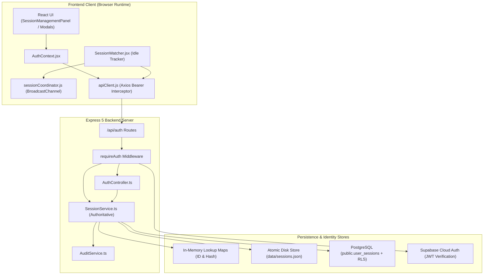
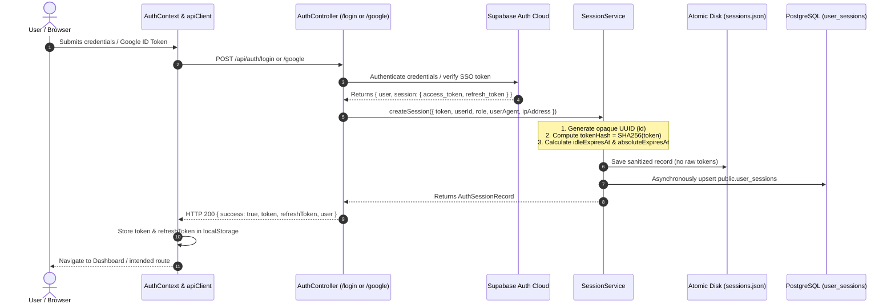
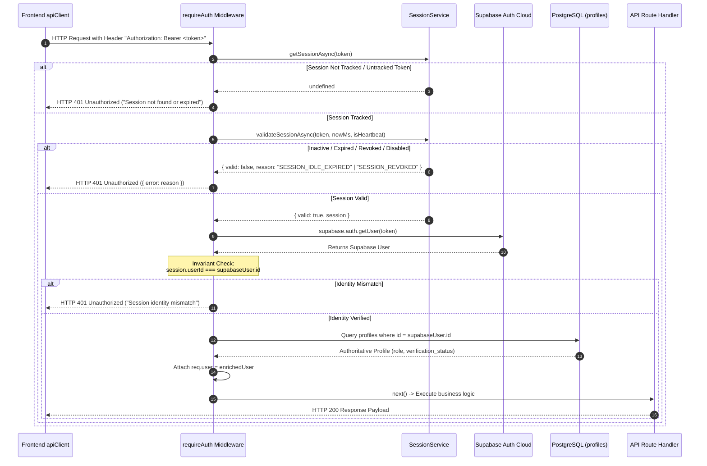
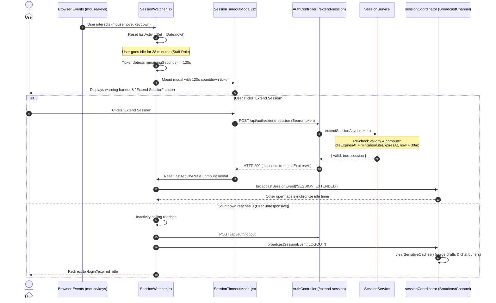
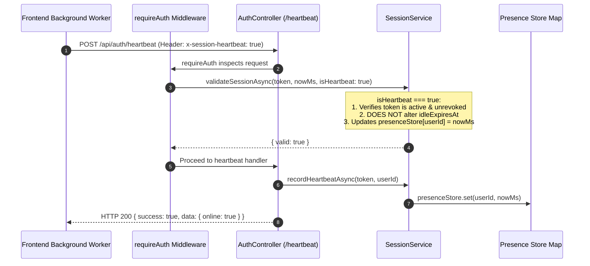
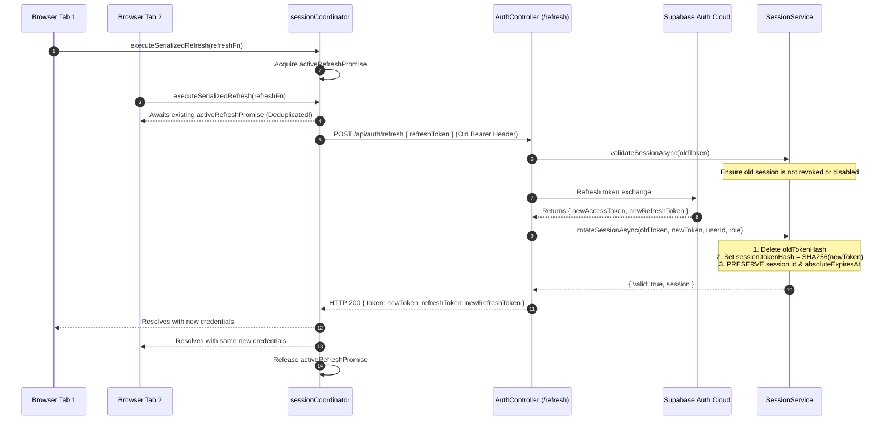
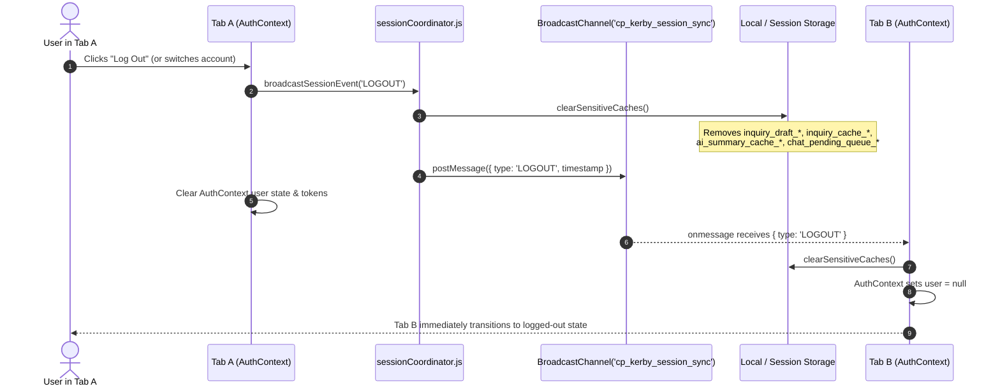
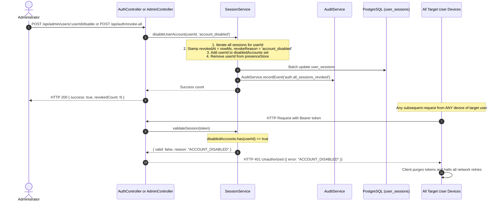

# Session Management Technical Specification & Architecture Report

**Platform:** Human Shelter Realty (`CP_kerby`)  
**Document Type:** Comprehensive Architectural & Functional Specification  
**Scope:** Dual-Layer Authentication & Authoritative Session Lifecycle Management  
**Stack:** React 19 (Vite), Express 5 (Node.js), Supabase Cloud Auth & PostgreSQL  
**Status:** Implemented & Verified in Production Baseline  

---

## 1. System Description & Architectural Overview

The **Session Management Subsystem** in Human Shelter Realty operates a hardened **hybrid dual-layer architecture**. It couples stateless identity verification via **Supabase Cloud Auth (JWTs)** with an authoritative, stateful application layer managed by the Express backend (`SessionService`), synchronized with PostgreSQL (`public.user_sessions`) and local atomic disk persistence (`backend/data/sessions.json`).

### 1.1 Architectural Rationale

While Supabase Auth provides secure password hashing, OAuth identity brokering, and cryptographic JWT issuance, standard JWTs are inherently stateless and cannot be revoked instantly without complex distributed blacklists. Furthermore, luxury real estate platforms require strict regulatory compliance, tenant confidentiality, immediate role revocation, idle inactivity termination, and cross-device session transparency.

To resolve these requirements without compromising performance, the platform enforces:
1. **Stateless Identity Brokering:** Supabase handles identity proofing, password hashing, and token issuance.
2. **Stateful Session Authority:** The Express backend tracks every active session record with strict idle and absolute ceilings. Requests without an active, non-revoked session record are rejected with `401 Unauthorized`, even if the JWT cryptographic signature remains mathematically valid.
3. **Zero Plaintext Credential Exposure at Rest (SF-01):** Raw Bearer tokens and JWTs are never written to disk or the database. Instead, sessions are indexed via high-speed, non-reversible **SHA-256 token hashes** (`token_hash`).
4. **Opaque Client Identifiers:** Clients only receive and view random UUIDs (`id`), preventing token interception or session hijacking via device inspection.
5. **Cross-Tab & Sensitive Cache Coordination:** The browser runtime utilizes `BroadcastChannel` to synchronize logouts, role changes, and account switches in real time, wiping sensitive inquiry drafts and AI caches instantly.



---

## 2. Functions & Component Inventory

### 2.1 Backend Core Services: `SessionService.ts`

Location: [`backend/src/services/session.service.ts`](file:///c:/Users/Win11x64/Desktop/My%20code%20space/CP_kerby/backend/src/services/session.service.ts)

| Function / Method | Signature & Arguments | Return Type | Description & Guarantees |
|---|---|---|---|
| `hashToken` | `(token: string): string` | `string` | Computes a SHA-256 hexadecimal hash of the raw token. Ensures raw Bearer credentials are never stored or exposed in logs. |
| `createSession` / `createSessionAsync` | `(params: { sessionId?, token?, userId, role, nowMs?, userAgent?, ipAddress? })` | `AuthSessionRecord` | Instantiates an authoritative session record with an opaque UUID, registers timestamps, computes `idleExpiresAt` and `absoluteExpiresAt` by role, updates memory maps, writes atomic disk snapshot, and syncs to DB. |
| `getSession` / `getSessionAsync` | `(identifier: string)` | `AuthSessionRecord \| undefined` | Resolves a session by either opaque UUID, exact token hash, or raw token (hashed on-the-fly). Falls back to disk hydration on cache miss. |
| `validateSession` / `validateSessionAsync` | `(identifier: string, nowMs = Date.now(), isHeartbeat = false)` | `{ valid: boolean, reason?: string, session?: AuthSessionRecord }` | Validates session existence, account status, revocation state, absolute ceiling, and idle inactivity. **Extends `idleExpiresAt` only if `isHeartbeat === false`**. |
| `extendSession` / `extendSessionAsync` | `(identifier: string, nowMs = Date.now())` | `{ valid: boolean, reason?: string, session?: AuthSessionRecord }` | Server-confirmed session extension ("Stay signed in"). Re-evaluates validity and pushes `idleExpiresAt` forward up to the `absoluteExpiresAt` ceiling. |
| `rotateSession` / `rotateSessionAsync` | `(oldToken, newToken, userId, role, nowMs?, recordActivity = false)` | `{ valid: boolean, session?, reason? }` | Rotates the `tokenHash` during token refresh while strictly preserving original session UUID, `createdAt`, and `absoluteExpiresAt`. |
| `getUserSessions` / `getUserSessionsAsync` | `(userId: string, currentToken?: string, nowMs = Date.now())` | `SessionListDTO[]` | Retrieves safe session metadata for the calling user. Strips raw tokens, hashes, and sensitive internal fields; flags `isCurrent` for the caller's active device. |
| `recordHeartbeat` / `recordHeartbeatAsync` | `(identifier: string, userId: string, nowMs = Date.now())` | `boolean` | Validates session ownership and records informational presence in `presenceStore` and `session.lastHeartbeatAt` without altering idle deadline. |
| `isUserOnline` | `(userId: string, nowMs = Date.now()): boolean` | `boolean` | Checks if a user has sent a valid heartbeat or request within the 60-second presence TTL window (`PRESENCE_TTL_MS`). |
| `revokeSession` / `revokeSessionAsync` | `(sessionIdOrOptions, requestingUserId?, reason?, nowMs?)` | `boolean` | Revokes a session with strict server-side ownership enforcement. Monotonic: once revoked, the timestamp and reason cannot be overwritten or undone. |
| `revokeAllUserSessions` / `revokeAllUserSessionsAsync` | `(userId: string, reason?: RevokeReason, nowMs?)` | `number` | Terminates all active sessions across all devices for a given user, clears presence, and records an audit log event. |
| `disableUserAccount` / `disableUserAccountAsync` | `(userId: string, reason?: RevokeReason)` | `void` | Revokes all active sessions and blacklists the user ID in memory and persistence, rejecting all subsequent requests. |
| `saveToPersistence` / `reloadFromPersistence` | `()` | `void` | Atomic write/read via temporary file rename to prevent disk race conditions and restore state after server reboots. |
| `syncSessionToDatabase` | `(record: AuthSessionRecord)` | `Promise<void>` | Asynchronously upserts session records into PostgreSQL `public.user_sessions` with graceful local-only fallback. |

---

### 2.2 Backend Middleware & API Endpoints

Locations: [`backend/src/middleware/auth.middleware.ts`](file:///c:/Users/Win11x64/Desktop/My%20code%20space/CP_kerby/backend/src/middleware/auth.middleware.ts), [`backend/src/controllers/auth.controller.ts`](file:///c:/Users/Win11x64/Desktop/My%20code%20space/CP_kerby/backend/src/controllers/auth.controller.ts), [`backend/src/routes/auth.routes.ts`](file:///c:/Users/Win11x64/Desktop/My%20code%20space/CP_kerby/backend/src/routes/auth.routes.ts)

| Endpoint / Middleware | HTTP Method & Route | Auth Required | Function & Security Responsibility |
|---|---|---|---|
| `requireAuth` | *Middleware* | Yes | Extracts Bearer token; validates against `SessionService`; rejects untracked, revoked, or expired sessions; verifies Supabase JWT signature; enforces session-user ID match; injects authoritative profile into `req.user`. |
| `optionalAuth` | *Middleware* | No (Optional) | Attaches user identity if a valid token exists; gracefully proceeds as guest if absent or invalid. |
| `login` | `POST /api/auth/login` | No | Validates email/password via Supabase Auth; registers new authoritative session record via `SessionService.createSession`. |
| `googleAuth` | `POST /api/auth/google` | No | Verifies Google ID token via Supabase SSO; provisions profile; registers session record via `SessionService.createSession`. |
| `logout` | `POST /api/auth/logout` | Optional | Revokes session record with reason `user_logout` and executes Supabase `signOut`. |
| `heartbeat` | `POST /api/auth/heartbeat` | Yes | Validates session and records active presence; returns `{ online: true }`; does NOT extend idle timeout. |
| `extendSession` | `POST /api/auth/extend-session` | Yes | Explicit user confirmation ("Stay signed in") resetting idle timeout up to absolute ceiling. |
| `refreshSession` | `POST /api/auth/refresh` | No | Rotates access token via Supabase Auth and updates `token_hash` in `SessionService.rotateSession`. |
| `listSessions` | `GET /api/auth/sessions` | Yes | Lists active sessions belonging to `req.user.id`, flagging the current session. |
| `revokeSession` | `DELETE /api/auth/sessions/:sessionId` | Yes | Allows user to remotely revoke a specific session on another device. |
| `revokeAllSessions`| `POST /api/auth/revoke-all` | Yes | Revokes all active devices for the authenticated user. |

---

### 2.3 Database Layer: `public.user_sessions` Table & RLS

Location: [`backend/src/models/user_sessions_migration.sql`](file:///c:/Users/Win11x64/Desktop/My%20code%20space/CP_kerby/backend/src/models/user_sessions_migration.sql)

- **Columns:** `id (UUID PK)`, `user_id (UUID FK)`, `role (TEXT)`, `token_hash (TEXT UNIQUE)`, `created_at`, `last_active_at`, `idle_expires_at`, `absolute_expires_at`, `revoked_at`, `revoke_reason`, `last_heartbeat_at`, `user_agent`, `ip_address`, `updated_at`.
- **Row Level Security (RLS) Policies:**
  - `Service role manages all user sessions`: Full CRUD access for the backend Express server via `service_role`.
  - `Users can view their own sessions`: Authenticated clients can only execute `SELECT` queries on records where `user_id = auth.uid()`.
  - **Direct Mutation Lockdown:** `INSERT`, `UPDATE`, `DELETE` are revoked for `authenticated` and `anon` roles. Client-side mutations must go through backend endpoints or the `revoke_user_session` stored procedure.
- **Stored Procedure:** `public.revoke_user_session(p_session_id UUID, p_reason TEXT)`: Secure `SECURITY DEFINER` function allowing users to revoke only their own active sessions monotonically.

---

### 2.4 Frontend Services & Context

Locations: [`frontend/src/services/sessionCoordinator.js`](file:///c:/Users/Win11x64/Desktop/My%20code%20space/CP_kerby/frontend/src/services/sessionCoordinator.js), [`frontend/src/services/authService.js`](file:///c:/Users/Win11x64/Desktop/My%20code%20space/CP_kerby/frontend/src/services/authService.js), [`frontend/src/context/AuthContext.jsx`](file:///c:/Users/Win11x64/Desktop/My%20code%20space/CP_kerby/frontend/src/context/AuthContext.jsx)

| Function / Component | Location | Role & Purpose |
|---|---|---|
| `validateReturnTo` | `sessionCoordinator.js` | Prevents open redirect attacks (SESSION-03). Validates return paths, ensuring they start with `/` and reject `//`, `://`, or `/\\`. |
| `clearSensitiveCaches` | `sessionCoordinator.js` | Wipes sensitive localStorage and sessionStorage keys (inquiry drafts, chat queues, AI summary caches) upon logout or role revocation (SESSION-02). |
| `executeSerializedRefresh` | `sessionCoordinator.js` | Serializes token refresh calls across multiple concurrent UI triggers/tabs to prevent double-refresh token invalidation races. |
| `broadcastSessionEvent` / `subscribeSessionEvents` | `sessionCoordinator.js` | Broadcasts cross-tab session events (`LOGOUT`, `ACCOUNT_SWITCH`, `ROLE_REVOKED`, `SESSION_EXTENDED`) via `BroadcastChannel`. |
| `authService.validateSession` | `authService.js` | Calls `GET /api/auth/me` to verify active session on app startup and hydration. |
| `authService.extendSession` | `authService.js` | Dispatches `POST /api/auth/extend-session` to confirm user presence. |
| `SessionWatcher` | `SessionWatcher.jsx` | React component mounted at root. Monitors mouse, keyboard, touch, and scroll; calculates idle time; handles visibility change; displays timeout warning. |
| `SessionTimeoutModal` | `SessionTimeoutModal.jsx` | Accessible modal displayed during warning window with live countdown and "Extend Session" / "Log Out" actions. |
| `SessionManagementPanel` | `SessionManagementPanel.jsx` | Device management UI in user settings. Lists active sessions and provides one-click remote device revocation. |

---

## 3. Policy Conditions, Invariants & Security Rules

### 3.1 Role-Based Session Policy Matrix

| Policy Dimension | Client Role | Staff Roles (`agent`, `broker`, `admin`) | Enforcement Mechanism |
|---|---|---|---|
| **Inactivity / Idle Timeout** | **60 minutes** (`3,600,000 ms`) | **30 minutes** (`1,800,000 ms`) | Enforced server-side in `SessionService.validateSession` on every non-heartbeat request. |
| **Absolute Session Ceiling** | **24 hours** (`86,400,000 ms`) | **12 hours** (`43,200,000 ms`) | Hard ceiling stamped at login; strictly preserved across server restarts and token refresh rotations. |
| **Warning Lead-Time Window** | **300 seconds** (5 minutes) | **120 seconds** (2 minutes) | `SessionWatcher.jsx` mounts `SessionTimeoutModal.jsx` when remaining idle time drops below threshold. |
| **Presence TTL Window** | **60 seconds** (`60,000 ms`) | **60 seconds** (`60,000 ms`) | `isUserOnline(userId)` returns `true` if heartbeat timestamp is within 60s. |
| **Idle Clock Reset via Heartbeat** | **Strictly Forbidden** | **Strictly Forbidden** | `POST /api/auth/heartbeat` with `x-session-heartbeat: true` leaves `idleExpiresAt` untouched. |
| **Server-Confirmed Extension** | +60 min (capped at 24h) | +30 min (capped at 12h) | `POST /api/auth/extend-session` recalculates `idleExpiresAt = min(absoluteExpiresAt, now + limit)`. |

---

### 3.2 Authoritative Validation Invariant Rules

When any request reaches `requireAuth` or `SessionService.validateSession(token, nowMs, isHeartbeat)`, the following conditions are evaluated strictly in sequence:

```
[Incoming Request]
       │
       ▼
 1. Header Check: Authorization starts with "Bearer <token>"?
       ├─ No  ──► HTTP 401: "Missing or malformed Bearer token"
       └─ Yes
          │
          ▼
 2. Token Tracking Check: Token exists in SessionService map/disk?
       ├─ No  ──► HTTP 401: "Session not found or expired. Please log in again"
       └─ Yes
          │
          ▼
 3. Account Disabled Check: userId in disabledAccounts?
       ├─ Yes ──► HTTP 401: "ACCOUNT_DISABLED"
       └─ No
          │
          ▼
 4. Revocation Check: session.revokedAt != null?
       ├─ Yes ──► HTTP 401: "SESSION_REVOKED" (Reason recorded)
       └─ No
          │
          ▼
 5. Absolute Ceiling Check: nowMs >= session.absoluteExpiresAt?
       ├─ Yes ──► HTTP 401: "SESSION_ABSOLUTE_EXPIRED"
       └─ No
          │
          ▼
 6. Idle Inactivity Check: nowMs >= session.idleExpiresAt?
       ├─ Yes ──► HTTP 401: "SESSION_IDLE_EXPIRED"
       └─ No
          │
          ▼
 7. Supabase Cryptographic Validation: supabase.auth.getUser(token)
       ├─ Invalid ──► HTTP 401: "Invalid or expired session"
       └─ Valid
          │
          ▼
 8. Identity Ownership Invariant: session.userId === supabaseUser.id?
       ├─ No  ──► HTTP 401: "Session identity mismatch"
       └─ Yes
          │
          ▼
 9. Authoritative Profile Load: profiles table lookup
       ├─ Failed ─► HTTP 503: "Unable to load authoritative profile"
       └─ Success
          │
          ▼
10. Idle Clock Update:
       ├─ If isHeartbeat == true  ──► Do NOT update idleExpiresAt (record heartbeat only)
       └─ If isHeartbeat == false ──► idleExpiresAt = min(absoluteExpiresAt, now + idleLimit)
          │
          ▼
     [Proceed to Route Handler]
```

---

### 3.3 Revocation & Monotonicity Rules

- **Allowed Revocation Reasons:**
  - `user_logout`: User clicked "Log Out" on the active client.
  - `user_manual_revoke`: User clicked "Revoke" on a specific remote device.
  - `password_reset`: Automated revocation triggered by credential change.
  - `inactivity_timeout`: Server or client detected idle expiry.
  - `absolute_timeout`: Hard ceiling elapsed.
  - `all_device_revocation`: User invoked "Revoke All Devices".
  - `account_disabled`: Administrator suspended or banned the account.
  - `admin_action`: Individual session terminated via admin moderation console.
- **Ownership Verification:** A user can only revoke sessions where `session.userId === requestingUserId`. Mismatches return `403 Forbidden`.
- **Monotonic Immutability:** Once `revokedAt` is populated, the record cannot be un-revoked, re-activated, or have its `revokeReason` overwritten.

---

## 4. End-to-End System Flows

### Flow 1: Authentication & Session Creation Flow

Handles user sign-in via credentials or Google OAuth SSO, establishing both Supabase JWTs and backend session records.



---

### Flow 2: Authenticated API Request Validation Pipeline

Demonstrates the 10-step security evaluation for every protected request hitting Express.



---

### Flow 3: Client Inactivity, Countdown Warning & Server Session Extension

Illustrates how `SessionWatcher` monitors idle time, triggers the warning modal, and executes server-confirmed session extensions.



---

### Flow 4: Informational Presence Heartbeat Flow

Shows how background client heartbeats maintain online status without resetting or corrupting the idle session timer.



---

### Flow 5: Serialized Token Refresh Rotation with Ceiling Preservation

Demonstrates race-free token rotation that prevents duplicate refresh requests across multiple tabs while maintaining the original session ceiling.



---

### Flow 6: Multi-Device Inspection & Remote Device Revocation

Demonstrates how users view their active logins and securely terminate remote sessions.

```mermaid
sequenceDiagram
    autonumber
    actor User as User (Laptop Client)
    participant PANEL as SessionManagementPanel.jsx
    participant API as AuthController (/sessions)
    participant SESS as SessionService
    participant DB as PostgreSQL (public.user_sessions)
    participant Phone as User's Mobile Device

    User->>PANEL: Navigates to Security / Active Sessions
    PANEL->>API: GET /api/auth/sessions (Bearer laptop_token)
    API->>SESS: getUserSessionsAsync(userId, currentToken)
    Note over SESS: Filters active sessions for userId;<br/>flags isCurrent = true for laptop_token;<br/>strips raw credentials & hashes
    SESS-->>API: SessionListDTO[] (Laptop + Mobile Phone)
    API-->>PANEL: HTTP 200 { sessions: [ { id: "uuid-laptop", isCurrent: true }, { id: "uuid-phone", isCurrent: false } ] }
    PANEL-->>User: Renders device list with "Revoke" button on Mobile Phone

    User->>PANEL: Clicks "Revoke" on Mobile Phone session
    PANEL->>API: DELETE /api/auth/sessions/uuid-phone
    API->>SESS: revokeSessionAsync({ sessionId: "uuid-phone", requestingUserId, reason: 'user_manual_revoke' })
    Note over SESS: 1. Verify session exists<br/>2. Verify session.userId === requestingUserId<br/>3. Monotonically stamp revokedAt & revokeReason
    SESS->>DB: Sync revocation to database
    SESS-->>API: true (Revocation confirmed)
    API-->>PANEL: HTTP 200 { success: true }
    PANEL->>PANEL: Remove Mobile Phone from active UI list

    Note over Phone: Next request from Mobile Phone
    Phone->>API: GET /api/properties (Bearer phone_token)
    API->>SESS: validateSessionAsync(phone_token)
    SESS-->>API: { valid: false, reason: "SESSION_REVOKED" }
    API-->>Phone: HTTP 401 Unauthorized ("SESSION_REVOKED")
    Phone->>Phone: Mobile client clears tokens and redirects to login
```

---

### Flow 7: Cross-Tab Session Synchronization & Sensitive Cache Sanitization

Covers how cross-tab broadcast channels synchronize auth state changes and purge confidential drafts.



---

### Flow 8: All-Device Revocation & Account Disablement

Details administrative suspension or global account protection workflows.



---

## 5. Security Summary & Quality Checklist

| Security Control | Implementation Detail | Status |
|---|---|---|
| **Zero Credential Exposure (SF-01)** | Tokens hashed with SHA-256 before storage; no raw tokens in logs or persistent files. | Verified |
| **Server-Authoritative Lifecycles (SF-02)** | All session expiration and revocation decisions are verified server-side. | Verified |
| **Inactivity Isolation (SF-03)** | Token refresh does not falsely extend idle inactivity clocks. | Verified |
| **Presence Heartbeat Isolation (SF-04)** | Presence pings never postpone idle timeout deadlines. | Verified |
| **PostgreSQL RLS Lockdown (SF-05)** | Direct client `INSERT`/`UPDATE`/`DELETE` revoked on `user_sessions`. | Verified |
| **Strict Revocation Contracts (SF-06)** | Monotonic revocation with caller ownership checks and valid reason enums. | Verified |
| **Open Redirect Defense (SESSION-03)** | `validateReturnTo` rejects all external protocol and backslash manipulations. | Verified |
| **Cache Sanitization (SESSION-02)** | Sensitive draft inquiries and AI caches purged on session termination. | Verified |
