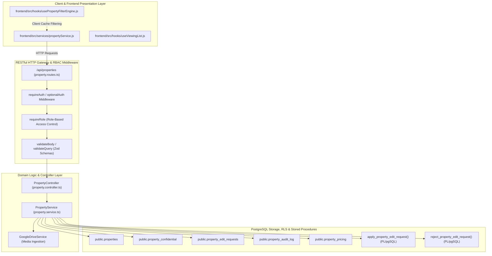
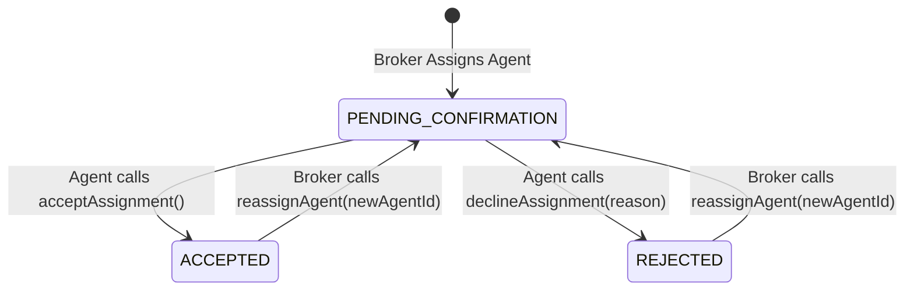

# Property Listings Functions Specification

> **Module Identifier:** `02-property-listing` (`property-listings`)  
> **Standard Conformance:** ISO/IEC/IEEE 29148:2018 (Requirements Engineering), ISO/IEC/IEEE 42010:2022 (Architecture Descriptions), ISO/IEC 25010:2023 (Systems and Software Quality Requirements)  
> **Compliance Benchmarks:** RESO Data Dictionary 2.0, Philippine Real Estate Service Act (RESA / RA 9646)  
> **Scope Invariant:** Specification-only deliverable. **Zero changes to client listview components** (`PropertyListingView.jsx`, `PropertiesPage.jsx`).

---

## 1. Executive Summary & Domain Scope

The **Property Listings Functions** constitute the core transactional, governance, and discovery operations of the Human Shelter Realty platform. This document specifies the complete functional surface across the backend API, service orchestrators, database procedures, and frontend client abstractions.

### 1.1 Statutory & Domain Governance Principles
1. **Broker Supervision (Philippine RESA / RA 9646)**: Sales agents cannot unilaterally publish, directly modify, or unpublish live active inventory. All agent-initiated revisions must pass through an atomic proposal approval pipeline reviewed by licensed Real Estate Brokers.
2. **Standardized Interoperability (RESO Data Dictionary 2.0)**: Attribute naming, status vocabularies, and query parameters strictly adhere to RESO specifications (`StandardStatus`, `ListingKey`, `ListPrice`, `PropertyType`, `PropertySubType`, `LivingArea`, `LotSizeArea`).
3. **Partitioned Confidentiality**: Highly sensitive brokerage intelligence—including lockbox passcodes, gate access keys, direct seller contacts, and internal commission split arrangements—is physically isolated in `public.property_confidential` and programmatically sanitized at the service boundary.
4. **Agent Confirmation Handshake**: Newly assigned listings remain in `PENDING_CONFIRMATION` until the assigned agent explicitly accepts the listing mandate.

---

## 2. System Architecture & Functional Decomposition (ISO/IEC/IEEE 42010:2022)

The property listings engine operates across four decoupled architectural layers:



### 2.1 Function Taxonomy Matrix

The functional surface is categorized into 6 distinct operational classes comprising 18 primary functions:

| Function Class | Function Name | Execution Layer | Primary Actor(s) |
| :--- | :--- | :--- | :--- |
| **Class 1: Direct Ingestion & Mutation** | `createProperty` | Controller / Service / DB | Broker, Admin |
| | `updateProperty` | Controller / Service / DB | Broker, Admin |
| | `deleteProperty` | Controller / Service / DB | Broker, Admin |
| **Class 2: Staged Proposals & Approval** | `proposeEdit` | Controller / Service / DB | Assigned Agent |
| | `getEditRequests` | Controller / Service / DB | Agent, Broker, Admin |
| | `getEditRequestById` | Controller / Service / DB | Agent, Broker, Admin |
| | `approveEditRequest` | Controller / Service / SP | Broker, Admin |
| | `rejectEditRequest` | Controller / Service / SP | Broker, Admin |
| | `cancelEditRequest` | Controller / Service / DB | Proposing Agent |
| **Class 3: Agent Assignment Handshake** | `acceptAssignment` | Controller / Service / DB | Assigned Agent |
| | `declineAssignment` | Controller / Service / DB | Assigned Agent |
| | `reassignAgent` | Controller / Service / DB | Broker, Admin |
| **Class 4: Discovery, Query & Filter** | `listProperties` / `findProperties` | Controller / Service / DB | Public, Client, Agent, Broker, Admin |
| | `countProperties` | Controller / Service / DB | Public, Client, Agent, Broker, Admin |
| | `findPropertyById` | Controller / Service / DB | Public, Client, Agent, Broker, Admin |
| | `usePropertyFilterEngine` | Client Hook / InMemory | Public, Client |
| **Class 5: Media & Georeferencing** | `uploadMedia` | Controller / Service / Cloud | Agent, Broker, Admin |
| | `resolveDriveImageUrl` | Client Service / CDN | Public, All |
| **Class 6: Normalization & Security** | `normalizeProperty` | Client Service / Formatter | Client Apps |
| | `mapDatabaseRow` & Redaction | Backend Service / Sanitizer | System Internal |

---

## 3. Detailed Functional Specifications (ISO/IEC/IEEE 29148:2018)

### 3.1 Class 1: Direct Inventory Ingestion & Mutation Functions

#### REQ-PLF-01: `createProperty`
- **Identifier**: `FNC-CREATE-PROP`
- **Signatures**:
  - Backend: `PropertyService.createProperty(data: CreatePropertyInput, actorId: string, actorRole: string): Promise<PropertyItem>`
  - Controller: `PropertyController.createProperty(req: AuthenticatedRequest, res: Response): Promise<void>`
  - Client: `propertyService.createProperty(propertyData: object): Promise<NormalizedProperty>`
- **HTTP Contract**: `POST /api/properties` (201 Created)
- **Authorization**: `requireAuth`, `requireRole(['broker', 'admin'])`. Standard sales agents are strictly prohibited (`403 Forbidden`).
- **Input Validation**: `createPropertySchema` (Zod):
  - `title`: String, min 3 chars, trimmed.
  - `price`: Positive number.
  - `propertyTypeId`: Int, default 1.
  - `location`: Structured object (`address`, `city`, `coordinates: { lat, lng }`).
  - `specs`: Structured object (`beds`, `baths`, `livingArea`, `lotSizeArea`, `yearBuilt`).
  - `confidential`: Isolated object (`lockboxCode`, `privateRemarks`, `sellerDirectPhone`).
  - `agentId`: Target assigned agent UUID.
- **Algorithmic Flow**:
  1. Validate payload against `createPropertySchema`.
  2. Map incoming payload to RESO 2.0 relational schema.
  3. Verify assigned agent exists in `public.profiles` with role `agent`.
  4. Begin PostgreSQL transaction:
     - Insert core record into `public.properties` with `standard_status = 'Draft'` or `'Active'` (if ready), and `assignment_status = 'PENDING_CONFIRMATION'`.
     - Insert isolated confidential fields into `public.property_confidential` linked by `property_id`.
     - Insert pricing details into `public.property_pricing`.
     - If media items exist, batch insert into `public.property_media`.
     - Insert audit event into `public.property_audit_log` (`action_type = 'CREATED'`, `actor_id = actorId`).
  5. Commit transaction and return normalized property representation.
- **Invariants**:
  - Confidential fields must never be stored directly on `public.properties`.
  - Properties must default to `PENDING_CONFIRMATION` for agent assignment.

#### REQ-PLF-02: `updateProperty`
- **Identifier**: `FNC-UPDATE-PROP`
- **Signatures**:
  - Backend: `PropertyService.updateProperty(id: string, data: Partial<CreatePropertyInput>, actorId: string): Promise<PropertyItem>`
  - Controller: `PropertyController.updateProperty(req: AuthenticatedRequest, res: Response): Promise<void>`
  - Client: `propertyService.updateProperty(id: string, propertyData: object): Promise<NormalizedProperty>`
- **HTTP Contract**: `PUT /api/properties/:id` (200 OK)
- **Authorization**: `requireAuth`, `requireRole(['broker', 'admin'])`.
- **Algorithmic Flow**:
  1. Retrieve existing property row `FOR UPDATE` in database.
  2. Verify existence; return `404 Not Found` if missing.
  3. Calculate snapshot diff between existing data and incoming payload.
  4. If price has changed, record historical price transition into audit trail.
  5. Update `public.properties`, `public.property_pricing`, and `public.property_confidential`.
  6. Insert `public.property_audit_log` (`action_type = 'DIRECT_UPDATE'`, `changed_fields`, `previous_data`, `new_data`).
  7. Return updated normalized property record.

#### REQ-PLF-03: `deleteProperty`
- **Identifier**: `FNC-DELETE-PROP`
- **Signatures**:
  - Backend: `PropertyService.deleteProperty(id: string, actorId: string): Promise<boolean>`
  - Controller: `PropertyController.deleteProperty(req: AuthenticatedRequest, res: Response): Promise<void>`
  - Client: `propertyService.deleteProperty(id: string): Promise<{ success: boolean }>`
- **HTTP Contract**: `DELETE /api/properties/:id` (200 OK)
- **Authorization**: `requireAuth`, `requireRole(['broker', 'admin'])`.
- **Algorithmic Flow**:
  1. Soft-delete / status retirement: Transition `standard_status` to `'Archived'` or `'Closed'`.
  2. If hard deletion is authorized (e.g. test cleanup by super-admin): Execute cascade delete across `property_confidential`, `property_media`, and `property_pricing`.
  3. Emit audit record `action_type = 'DELETED'`.
  4. Return boolean status flag.

---

### 3.2 Class 2: Staged Modification & Broker Approval Governance Functions

#### REQ-PLF-04: `proposeEdit`
- **Identifier**: `FNC-PROPOSE-EDIT`
- **Signatures**:
  - Backend: `PropertyService.proposeEdit(propertyId: string, proposedChanges: object, agentNotes: string, agentId: string): Promise<EditRequestRecord>`
  - Controller: `PropertyController.proposeEdit(req: AuthenticatedRequest, res: Response): Promise<void>`
  - Client: `propertyService.proposeEdit(propertyId: string, proposedChanges: object, agentNotes?: string): Promise<object>`
- **HTTP Contract**: `POST /api/properties/:id/propose-edit` (201 Created)
- **Authorization**: `requireAuth`, `requireRole(['agent', 'broker', 'admin'])`.
- **Pre-conditions**:
  - If actor is an agent, actor MUST match `list_agent_key` on the target property.
  - Property MUST NOT have an existing request with `request_status = 'PENDING'`. Enforced by partial unique index `idx_single_pending_request_per_property`.
- **Input Validation**: `proposePropertyEditSchema`:
  - `proposedChanges`: Non-empty key-value record of proposed attribute modifications.
  - `agentNotes`: Optional string up to 2,000 characters.
- **Algorithmic Flow**:
  1. Verify property existence and assigned agent authorization.
  2. Capture full JSON snapshot of existing property state (`original_snapshot`).
  3. Validate proposed keys against whitelist of agent-editable fields:
     `title`, `description`, `list_price`, `bedrooms_total`, `bathrooms_total_integer`, `living_area`, `lot_size_area`, `amenities`, `public_remarks`.
  4. Attempt insertion into `public.property_edit_requests` with `request_status = 'PENDING'`.
  5. Catch duplicate key violations on `idx_single_pending_request_per_property` and return `409 Conflict` ("A pending edit request already exists for this property").
  6. Return created proposal receipt with generated UUID.

#### REQ-PLF-05: `getEditRequests` & `getEditRequestById`
- **Identifier**: `FNC-GET-EDIT-REQUESTS`
- **Signatures**:
  - Backend: `PropertyService.getEditRequests(filters: QueryEditRequestsInput, actor: { id: string, role: string }): Promise<PaginatedEditRequests>`
  - Client: `propertyService.getEditRequests(params?: object): Promise<object>`
  - Client: `propertyService.getEditRequestById(requestId: string): Promise<object>`
- **HTTP Contract**:
  - `GET /api/properties/edit-requests` (200 OK)
  - `GET /api/properties/edit-requests/:requestId` (200 OK)
- **Authorization**: `requireAuth`, `requireRole(['agent', 'broker', 'admin'])`.
- **Scope Filtering**:
  - `role === 'agent'`: Results automatically scoped to `agent_id = actor.id`. Agents cannot inspect proposals belonging to other agents.
  - `role === 'broker' | 'admin'`: Firm-wide or global visibility across all proposals.

#### REQ-PLF-06: `approveEditRequest`
- **Identifier**: `FNC-APPROVE-EDIT-REQUEST`
- **Signatures**:
  - Backend: `PropertyService.approveEditRequest(requestId: string, brokerId: string, reviewNotes?: string): Promise<object>`
  - Controller: `PropertyController.approveEditRequest(req: AuthenticatedRequest, res: Response): Promise<void>`
  - Client: `propertyService.approveEditRequest(requestId: string, reviewNotes?: string): Promise<object>`
- **HTTP Contract**: `POST /api/properties/edit-requests/:requestId/approve` (200 OK)
- **Authorization**: `requireAuth`, `requireRole(['broker', 'admin'])`. Sales agents attempting this operation receive `403 Forbidden`.
- **Database Stored Procedure**: Executes `public.apply_property_edit_request(p_request_id, p_broker_id, p_review_notes)`.
- **Algorithmic Flow**:
  1. Invoke stored procedure under PostgreSQL `SECURITY DEFINER`.
  2. Verify caller role in `public.profiles` is `'broker'` or `'admin'`.
  3. Lock edit request row `FOR UPDATE`. Verify `request_status = 'PENDING'`.
  4. Lock target property row in `public.properties` `FOR UPDATE`.
  5. Apply validated JSONB delta keys directly to `public.properties`.
  6. Update edit request record: `request_status = 'APPROVED'`, `reviewed_by = p_broker_id`, `reviewed_at = NOW()`, `review_notes = p_review_notes`.
  7. Insert entry into `public.property_audit_log` (`action_type = 'EDIT_APPROVED'`, `changed_fields`, `previous_data`, `new_data`).
  8. Commit transaction atomically. If any error occurs, rollback fully.
  9. Return approval summary with applied diff.

#### REQ-PLF-07: `rejectEditRequest`
- **Identifier**: `FNC-REJECT-EDIT-REQUEST`
- **Signatures**:
  - Backend: `PropertyService.rejectEditRequest(requestId: string, brokerId: string, rejectionReason: string): Promise<object>`
  - Controller: `PropertyController.rejectEditRequest(req: AuthenticatedRequest, res: Response): Promise<void>`
  - Client: `propertyService.rejectEditRequest(requestId: string, rejectionReason: string): Promise<object>`
- **HTTP Contract**: `POST /api/properties/edit-requests/:requestId/reject` (200 OK)
- **Authorization**: `requireAuth`, `requireRole(['broker', 'admin'])`.
- **Database Stored Procedure**: Executes `public.reject_property_edit_request(p_request_id, p_broker_id, p_rejection_reason)`.
- **Algorithmic Flow**:
  1. Verify rejection reason meets minimum length constraint (min 3 chars).
  2. Execute stored procedure with `SECURITY DEFINER`.
  3. Transition request status to `'REJECTED'`, set `review_notes = p_rejection_reason`.
  4. Record rejection in `public.property_audit_log`.
  5. Maintain live `public.properties` record in its untouched, existing state.
  6. Return rejection receipt.

#### REQ-PLF-08: `cancelEditRequest`
- **Identifier**: `FNC-CANCEL-EDIT-REQUEST`
- **Signatures**:
  - Backend: `PropertyService.cancelEditRequest(requestId: string, actorId: string, actorRole: string): Promise<object>`
  - Client: `propertyService.cancelEditRequest(requestId: string): Promise<object>`
- **HTTP Contract**: `POST /api/properties/edit-requests/:requestId/cancel` (200 OK)
- **Authorization**: `requireAuth`. Proposer agent or administrative roles.
- **Algorithmic Flow**:
  1. Verify proposal exists and `request_status = 'PENDING'`.
  2. If caller is an agent, ensure `agent_id === actorId`.
  3. Transition `request_status` to `'CANCELLED'`.
  4. Releases partial unique constraint, allowing a new proposal to be drafted.

---

### 3.3 Class 3: Agent Assignment Handshake Lifecycle Functions



#### REQ-PLF-09: `acceptAssignment`
- **Identifier**: `FNC-ACCEPT-ASSIGNMENT`
- **Signatures**:
  - Backend: `PropertyService.acceptAssignment(propertyId: string, agentId: string): Promise<object>`
  - Controller: `PropertyController.acceptAssignment(req: AuthenticatedRequest, res: Response): Promise<void>`
  - Client: `propertyService.acceptAssignment(propertyId: string): Promise<object>`
- **HTTP Contract**: `PATCH /api/properties/:id/accept-assignment` (200 OK)
- **Authorization**: `requireAuth`, `requireRole(['agent', 'admin'])`.
- **Algorithmic Flow**:
  1. Fetch property record.
  2. Ensure caller matches `list_agent_key` or holds `admin` role.
  3. Verify current `assignment_status` is `'PENDING_CONFIRMATION'`.
  4. Update `assignment_status = 'ACCEPTED'` and `agent_confirmed_at = NOW()`.
  5. Log audit entry for agent confirmation.
  6. Listing becomes eligible for active public display (if `standard_status = 'Active'`).

#### REQ-PLF-10: `declineAssignment`
- **Identifier**: `FNC-DECLINE-ASSIGNMENT`
- **Signatures**:
  - Backend: `PropertyService.declineAssignment(propertyId: string, agentId: string, reason: string): Promise<object>`
  - Controller: `PropertyController.declineAssignment(req: AuthenticatedRequest, res: Response): Promise<void>`
  - Client: `propertyService.declineAssignment(propertyId: string, reason: string): Promise<object>`
- **HTTP Contract**: `PATCH /api/properties/:id/decline-assignment` (200 OK)
- **Authorization**: `requireAuth`, `requireRole(['agent', 'admin'])`.
- **Algorithmic Flow**:
  1. Validate caller identity matches assigned agent.
  2. Update `assignment_status = 'REJECTED'` and record `assignment_declined_reason = reason`.
  3. Emit notification to supervising broker indicating listing assignment rejection.
  4. Record event in `public.property_audit_log`.

#### REQ-PLF-11: `reassignAgent`
- **Identifier**: `FNC-REASSIGN-AGENT`
- **Signatures**:
  - Backend: `PropertyService.reassignAgent(propertyId: string, newAgentId: string, brokerId: string): Promise<object>`
  - Controller: `PropertyController.reassignAgent(req: AuthenticatedRequest, res: Response): Promise<void>`
  - Client: `propertyService.reassignAgent(propertyId: string, newAgentId: string): Promise<object>`
- **HTTP Contract**: `PATCH /api/properties/:id/reassign-agent` (200 OK)
- **Authorization**: `requireAuth`, `requireRole(['broker', 'admin'])`.
- **Algorithmic Flow**:
  1. Verify `newAgentId` exists and belongs to a licensed agent profile.
  2. Update property row: `list_agent_key = newAgentId`, `assignment_status = 'PENDING_CONFIRMATION'`, `assigned_at = NOW()`, `agent_confirmed_at = NULL`.
  3. If prior pending edit requests existed under old agent, transition to `'CANCELLED'`.
  4. Log reassignment event in `public.property_audit_log`.

---

### 3.4 Class 4: Discovery, Query Engine & Filtering Functions

#### REQ-PLF-12: `listProperties` / `findProperties`
- **Identifier**: `FNC-LIST-PROPERTIES`
- **Signatures**:
  - Backend: `PropertyService.findProperties(query: QueryPropertyInput, userRole?: string): Promise<PaginatedPropertiesResult>`
  - Controller: `PropertyController.listProperties(req: Request, res: Response<PaginatedResponse>): Promise<void>`
  - Client: `propertyService.getProperties(params?: object): Promise<PaginatedNormalizedResponse>`
- **HTTP Contract**: `GET /api/properties` (200 OK)
- **Authorization**: Public / `optionalAuth`. Returns role-sanitized data.
- **Supported Query Criteria**:
  - Geographic: `city`, PSGC codes (`region_psgc_code`, `province_psgc_code`, `city_psgc_code`).
  - Categorical: `propertyType`, `transactionType` (`For Sale`, `For Rent`).
  - Numeric Ranges: `minPrice`, `maxPrice`, `beds`, `baths`.
  - Full-Text / Keyword: `search` (scans title, remarks, address, subdivision).
  - Status Scoping: `status`, `standardStatus` (defaults strictly to `'Active'` for unauthenticated/client callers).
  - Agent Filter: `agentId` / `list_agent_key`.
  - RESO OData: `$filter`, `$select`, `$expand`, `$top`, `$skip`, `$orderby`.
- **Projection & Redaction Rules**:
  - Unauthenticated / `client`: Confidential columns are stripped. Inactive/draft/unconfirmed properties are excluded.
  - `agent`: Can view own assigned properties regardless of status (`list_agent_key = auth.uid()`), plus public active listings.
  - `broker` / `admin`: Unrestricted visibility across firm inventory and confidential attributes.

#### REQ-PLF-13: `countProperties`
- **Identifier**: `FNC-COUNT-PROPERTIES`
- **Signatures**:
  - Backend: `PropertyService.countProperties(query: object): Promise<number>`
  - Controller: `PropertyController.countProperties(req: Request, res: Response): Promise<void>`
  - Client: `propertyService.countProperties(params?: object): Promise<number>`
- **HTTP Contract**: `GET /api/properties/count` (200 OK)
- **Authorization**: Public / `optionalAuth`.
- **Purpose**: High-speed relational aggregate counter for UI filter facet counts, badges, and pagination metrics without transferring data records.

#### REQ-PLF-14: `findPropertyById`
- **Identifier**: `FNC-GET-PROPERTY-BY-ID`
- **Signatures**:
  - Backend: `PropertyService.findPropertyById(id: string, userRole?: string, userId?: string): Promise<PropertyItem | null>`
  - Controller: `PropertyController.getProperty(req: Request, res: Response): Promise<void>`
  - Client: `propertyService.getPropertyById(id: string): Promise<NormalizedProperty | null>`
- **HTTP Contract**: `GET /api/properties/:id` (200 OK)
- **Authorization**: Public / `optionalAuth`.
- **Relational Joins**:
  - `public.properties`
  - `public.property_pricing` (1:1)
  - `public.property_media` (1:N, ordered by `order_index ASC`)
  - `public.property_confidential` (1:1, guarded by role checks)
  - `public.profiles` (`list_agent_key` join for public agent card)
- **Security Check**:
  - If user is anonymous or role is `'client'`, `property_confidential` is excluded from JSON output.
  - If listing is not `'Active'`, access is denied with `404 Not Found` unless caller is the assigned agent, firm broker, or admin.

#### REQ-PLF-15: `usePropertyFilterEngine`
- **Identifier**: `FNC-FILTER-ENGINE-HOOK`
- **Signature**: `usePropertyFilterEngine(initialProperties: Array<PropertyItem>): FilterEngineInstance`
- **Execution Layer**: Frontend React Custom Hook (`frontend/src/hooks/usePropertyFilterEngine.js`)
- **State Surface**:
  - Filters: `transactionType`, `keyword`, `district`, `propertyType`, `minPrice`, `maxPrice`, `beds`, `baths`, `furnishing`, `mapBounds`.
  - Debouncing: 300ms window on text and price inputs.
  - Derived Outputs: `filteredProperties`, `facets`, `activeFilterCount`, `tightestFilter`.
- **Map Bounds Evaluation**:
  - Dynamically filters properties within Leaflet bounding coordinates `{ north, south, east, west }`.

---

### 3.5 Class 5: Media Streaming & Georeferencing Functions

#### REQ-PLF-16: `uploadMedia`
- **Identifier**: `FNC-UPLOAD-MEDIA`
- **Signatures**:
  - Backend: `PropertyController.uploadMedia(req: AuthenticatedRequest, res: Response): Promise<void>`
  - Client: `propertyService.uploadMedia(id: string, formData: FormData): Promise<object>`
- **HTTP Contract**: `POST /api/properties/:id/media` (200 OK)
- **Authorization**: `requireAuth`, `requireRole(['agent', 'broker', 'admin'])`.
- **File Constraints**:
  - Multipart/form-data via Multer memory storage.
  - Max 15 files per batch, 50MB per file.
- **Execution Flow**:
  1. Stream uploaded buffers to Google Drive API via `GoogleDriveService`.
  2. Retrieve permanent Drive file IDs and web-view links.
  3. Insert metadata records into `public.property_media` (`media_url`, `media_category`, `order_index`).
  4. Update `main_image` on `public.properties` if primary slot was empty.
  5. Return media gallery array.

#### REQ-PLF-17: `resolveDriveImageUrl`
- **Identifier**: `FNC-RESOLVE-DRIVE-URL`
- **Signature**: `resolveDriveImageUrl(urlOrId: string): string`
- **Execution Layer**: Client Utility (`frontend/src/services/driveService.js`)
- **Purpose**: Transforms raw Google Drive file identifiers into responsive, high-availability thumbnail and stream proxy URLs (`lh3.googleusercontent.com/d/{id}=w1200`).

---

### 3.6 Class 6: Data Normalization & Security Projection Sanitization

#### REQ-PLF-18: `normalizeProperty` & `mapDatabaseRow`
- **Identifier**: `FNC-NORMALIZE-PROPERTY`
- **Signatures**:
  - Frontend: `normalizeProperty(rawItem: object): NormalizedProperty` (`frontend/src/services/propertyService.js`)
  - Backend: `PropertyService.mapDatabaseRow(row: any, imageMap?: Record<string, string[]>): PropertyItem`
- **Normalization Invariants**:
  1. **Image Consolidation**: Extracts and resolves images from `property_images`, `property_media`, `mainImage`, and `cover_image`, deduplicating and ordering them deterministically.
  2. **Price Canonicalization**: Formats currency with Philippine Peso symbol (`₱XX,XXX,XXX`) while maintaining raw numeric float for calculations.
  3. **Location Unification**: Constructs coherent composite address string from `address`, `city`, `state_or_province`, `subdivision_name`, and `building_name`.
  4. **Spec Completeness**: Preserves integer nullables for `bedroomsTotal`, `bathroomsTotalInteger`, `livingArea`, and `lotSizeArea`.
  5. **Status Normalization**: Maps database string codes to uppercase canonical statuses (`AVAILABLE`, `PENDING`, `SOLD`).

---

## 4. State Machines & Status Transitions

### 4.1 Property Standard Status Machine
```
┌─────────┐      Publish      ┌──────────┐      Contract Signed     ┌────────────────┐
│  Draft  │ ────────────────► │  Active  │ ───────────────────────► │ Under Contract │
└─────────┘                   └────┬─────┘                          └───────┬────────┘
     │                             │                                        │
     │ Cancel                      │ Delist / Withdraw                      │ Closed / Sold
     ▼                             ▼                                        ▼
┌─────────┐                   ┌──────────┐                          ┌────────────────┐
│ Inactive│                   │Withdrawn │                          │  Sold / Closed │
└─────────┘                   └──────────┘                          └────────────────┘
```

### 4.2 Agent Staged Proposal State Machine
```
┌───────────┐      Broker Approves      ┌────────────┐
│  PENDING  │ ────────────────────────► │  APPROVED  │ (Merges into properties)
└─────┬─────┘                           └────────────┘
      │
      │ Broker Rejects
      ├───────────────────────────────► ┌────────────┐
      │                                 │  REJECTED  │ (Retains live record intact)
      │ Agent Cancels                   └────────────┘
      └───────────────────────────────► ┌────────────┐
                                        │ CANCELLED  │ (Releases unique lock)
                                        └────────────┘
```

---

## 5. Security Architecture & Confidentiality Matrix

### 5.1 Field Projection & Redaction Table

| Entity / Column | Public / Anonymous | Client (Authenticated) | Assigned Agent | Broker (Firm) | Super Admin |
| :--- | :---: | :---: | :---: | :---: | :---: |
| `title`, `price`, `specs`, `amenities` | **VISIBLE** | **VISIBLE** | **VISIBLE** | **VISIBLE** | **VISIBLE** |
| `media` (Public Photos, Virtual Tours) | **VISIBLE** | **VISIBLE** | **VISIBLE** | **VISIBLE** | **VISIBLE** |
| `cadastral_latitude`, `longitude` | **VISIBLE** | **VISIBLE** | **VISIBLE** | **VISIBLE** | **VISIBLE** |
| `property_confidential.lockbox_code` | **REDACTED** | **REDACTED** | **VISIBLE** | **VISIBLE** | **VISIBLE** |
| `property_confidential.gate_code` | **REDACTED** | **REDACTED** | **VISIBLE** | **VISIBLE** | **VISIBLE** |
| `property_confidential.seller_phone` | **REDACTED** | **REDACTED** | **VISIBLE** | **VISIBLE** | **VISIBLE** |
| `property_confidential.commission_split` | **REDACTED** | **REDACTED** | **REDACTED** | **VISIBLE** | **VISIBLE** |
| `property_audit_log` (Change History) | **REDACTED** | **REDACTED** | **REDACTED** | **VISIBLE** | **VISIBLE** |
| `property_edit_requests` (Proposals) | **REDACTED** | **REDACTED** | **OWN ONLY** | **VISIBLE** | **VISIBLE** |

---

## 6. Software Product Quality Requirements (ISO/IEC 25010:2023)

1. **Functional Completeness (Section 4.1)**: All real estate operations (ingestion, staged proposal, approval, confirmation, search, and audit) have deterministic, validated input schemas and response types.
2. **Performance Efficiency (Section 4.2)**:
   - Primary listing search requests (`GET /api/properties`) must respond within 300ms SLA under 100 concurrent requests.
   - Aggregate facet counts (`GET /api/properties/count`) must execute via indexed scan in under 50ms.
3. **Reliability & ACID Concurrency (Section 4.4)**:
   - Atomic proposal approval utilizes pessimistic locking (`SELECT ... FOR UPDATE`) inside PostgreSQL functions to eliminate race conditions.
   - Concurrency on staged proposals is strictly guarded by partial unique index `idx_single_pending_request_per_property`.
4. **Security & Data Integrity (Section 4.5)**:
   - Role-Based Access Control enforced at the network gateway and route boundary.
   - Row-Level Security (RLS) enabled on all underlying PostgreSQL tables (`properties`, `property_confidential`, `property_edit_requests`, `property_audit_log`, `property_pricing`).
5. **Maintainability & Traceability (Section 4.7)**:
   - Modularity: Zero cross-boundary leakage between presentation listview components and data layer abstractions.

---

## 7. Traceability Matrix & Verification Reference

| Requirement ID | Primary Function | Primary Source Implementation | Verification Test Suite |
| :--- | :--- | :--- | :--- |
| `REQ-PLF-01` | `createProperty` | `backend/src/services/property.service.ts` | `frontend/src/services/propertyService.test.js` |
| `REQ-PLF-02` | `updateProperty` | `backend/src/services/property.service.ts` | `frontend/src/services/propertyService.test.js` |
| `REQ-PLF-03` | `deleteProperty` | `backend/src/services/property.service.ts` | `frontend/src/services/propertyService.test.js` |
| `REQ-PLF-04` | `proposeEdit` | `backend/src/services/property.service.ts` | `frontend/src/components/cms/PropertyQuickEditDrawer.test.jsx` |
| `REQ-PLF-06` | `approveEditRequest` | `apply_property_edit_request` (PL/pgSQL) | `docs/modules/02-property-listing/2026-10-16-broker-property-listings-data-verification.md` |
| `REQ-PLF-07` | `rejectEditRequest` | `reject_property_edit_request` (PL/pgSQL) | `docs/modules/02-property-listing/2026-10-16-broker-property-listings-data-verification.md` |
| `REQ-PLF-09` | `acceptAssignment` | `backend/src/services/property.service.ts` | `docs/superpowers/plans/2026-10-26-property-assignment-confirmation.md` |
| `REQ-PLF-12` | `listProperties` | `backend/src/services/property.service.ts` | `frontend/src/services/propertyService.test.js` |
| `REQ-PLF-14` | `findPropertyById` | `backend/src/services/property.service.ts` | `frontend/src/services/propertyService.test.js` |
| `REQ-PLF-15` | `usePropertyFilterEngine` | `frontend/src/hooks/usePropertyFilterEngine.js` | `frontend/src/hooks/usePropertyFilterEngine.test.js` |
| `REQ-PLF-18` | `normalizeProperty` | `frontend/src/services/propertyService.js` | `frontend/src/services/propertyService.test.js` |

---

## 8. Non-Interference Boundary & Scope Confirmation

In accordance with user directives:
- **Client ListView Untouched**: Zero changes have been made to `frontend/src/pages/public/PropertyListingView.jsx`, `frontend/src/pages/public/PropertiesPage.jsx`, or any related listview presentation components.
- **Specification-Only Delivery**: All architectural, functional, security, and interface specifications are recorded in this document and registered in the Module Master Index.
