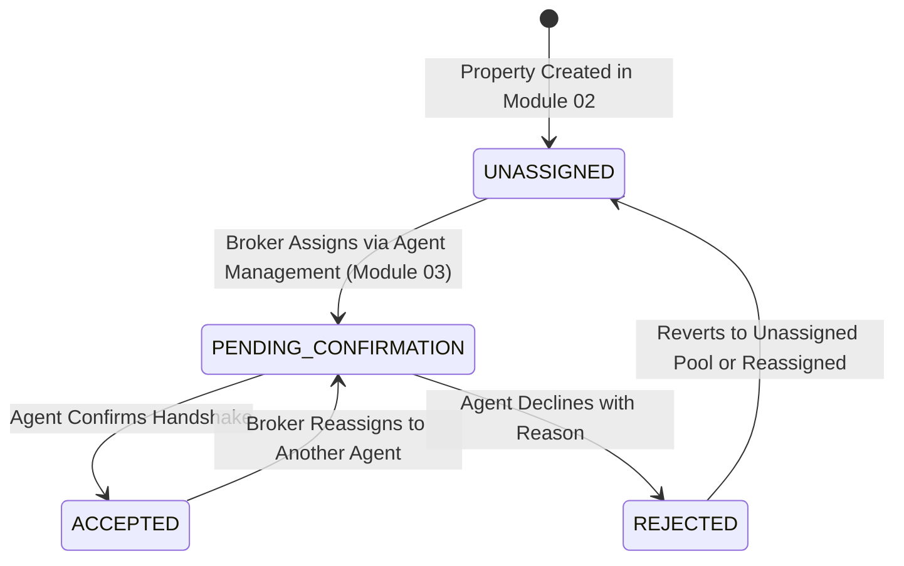

# Scope and Limitation Redefinition: Decoupling Agent Assignment from Property Listings Input

> **Standard Conformance:** ISO/IEC/IEEE 29148:2018 (Requirements Engineering), ISO/IEC/IEEE 42010:2022 (Architecture Descriptions)  
> **Participating Modules:** `02-property-listing` (Core Inventory) & `03-agent-management` (Roster & Allocation)  
> **Decision Date:** October 28, 2026  
> **Status:** APPROVED ARCHITECTURAL SPECIFICATION  

---

## 1. Architectural Motivation & Problem Statement

Historically, property creation in `02-property-listing` was tightly coupled with agent assignment:
1. **Creation Bottleneck**: The 7-step property creation wizard (`BrokerCreateListings.jsx`) mandated selecting an agent in Step 1 before saving or advancing, blocking inventory intake when agent allocations were undecided.
2. **Domain Boundary Leak**: Property input components fetched and managed agent rosters (`agentService.getAgents()`, agent search modals, selection grids), introducing unnecessary cross-module coupling into the inventory ingestion domain.
3. **Operational Reality**: In brokerage workflows, high-value luxury properties are frequently registered and staged by managing brokers before being formally assigned to a designated sales agent.

**Core Decision**: Agent assignment is completely removed from Property Listings input and relocated into `03-agent-management`.

---

## 2. Established Scope & Limitations Matrix

```
┌──────────────────────────────────────────────────────────────────────────────────────────────────┐
│                                   MODULE BOUNDARY SEPARATION                                     │
├───────────────────────────────────┬──────────────────────────────────────────────────────────────┤
│ 02-property-listing (Inventory)   │ 03-agent-management (Personnel & Assignment)                │
├───────────────────────────────────┼──────────────────────────────────────────────────────────────┤
│ IN SCOPE:                         │ IN SCOPE:                                                    │
│ • Property specs, pricing, terms  │ • Licensed agent roster & credential verification (PRC/DHSUD)│
│ • Cadastral georeferencing & map  │ • Agent-Centric Property Assignment (BrokerAgentDetail)      │
│ • Media gallery ingestion         │ • Agent assignment confirmation handshake                    │
│ • RESO 2.0 metadata & status      │ • Agent reassignment & portfolio transfer                    │
│ • Public search & syndication     │ • Agent availability schedules & appointment calendars       │
│ • Brokerage-wide inventory status │ • Sales agent performance metrics & commissions              │
│                                   │                                                              │
│ EXCLUDED / LIMITATION:            │ EXCLUDED / LIMITATION:                                       │
│ ✕ NO Agent selection in intake    │ ✕ Cannot author or edit property architectural specs         │
│ ✕ NO Agent validation in Step 1   │ ✕ Cannot modify cadastral boundaries or listing price        │
│ ✕ NO Agent roster fetching in     │ ✕ Cannot publish new properties directly                     │
│   property creation wizards       │                                                              │
└───────────────────────────────────┴──────────────────────────────────────────────────────────────┘
```

---

## 3. Detailed Scope & Behavioral Rules: Module 02 (`property-listing`)

### 3.1 Property Creation & Input Changes
1. **Streamlined Step 1 ("Basic Details")**:
   - The "Assigned Agent" selector, modal picker, and agent search input are **entirely removed** from Step 1 of `BrokerCreateListings.jsx` and `CreateListingModal.jsx`.
   - Step 1 focuses strictly on core property attributes:
     - Listing Title
     - Transaction Type (`For Sale`, `For Rent`)
     - Property Classification (`Residential`, `Commercial`)
     - Property Sub-Type (`Single Family`, `Condominium`, `Townhouse`, `Penthouse`)
     - Architectural Style
2. **Input Validation Relaxation**:
   - `draftValidationErrors` and `finalValidationErrors` in property creation forms will **no longer validate** `if (!formData.agent_id)`.
   - Backend `createPropertySchema` treats `agentId` / `list_agent_key` as purely optional, defaulting to `NULL`.
3. **Listing State upon Creation**:
   - When created without an agent, `public.properties.list_agent_key` is set to `NULL` (or the creating Broker's ID if required as broker-of-record).
   - `assignment_status` is initialized to `'UNASSIGNED'`.

### 3.2 Public Display & Fallback Rules
- **Assigned Listing**: If a property has an assigned and confirmed agent (`assignment_status = 'ACCEPTED'`), the public property page displays the agent's verified contact card (`PublicAgentProfileModal`).
- **Unassigned / Firm Listing**: If `list_agent_key` is `NULL`, the public listing displays the default **Human Shelter Realty Corporate Brokerage Desk** contact credentials:
  - Brokerage Direct Phone / WhatsApp hotline
  - Central Brokerage Inquiries Inbox
  - Broker-of-Record license badge

---

## 4. Detailed Scope & Behavioral Rules: Module 03 (`agent-management`)

### 4.1 Relocation of Property Assignment UI
All agent assignment actions are consolidated inside the Agent Management portal workspace:
1. **Host Interface**: Inside `BrokerAgentDetail.jsx` (`/portal/broker/agents/:id`).
2. **Dedicated Workspace**: A dedicated **"Assigned Inventory"** tab listing all properties currently handled by the agent.
3. **Assignment Trigger**: An **`+ Assign Properties`** action button opening an assignment drawer/modal.
4. **Assignment Drawer Workflow**:
   - Queries `GET /api/properties?assignmentStatus=UNASSIGNED` to present available firm inventory.
   - Allows multi-select or single-select property assignment with search by title, city, or property type.
   - Broker confirms selection, triggering batch assignment binding.

### 4.2 Assignment Handshake Lifecycle
Once assigned via Agent Management:

- The endpoints `PATCH /api/properties/:id/accept-assignment`, `PATCH /api/properties/:id/decline-assignment`, and `PATCH /api/properties/:id/reassign-agent` are orchestrated as operational actions within the Agent Management workflow.

---

## 5. Summary of Architecture Decisions (ADR)

| Decision Question | Resolved Approach |
| :--- | :--- |
| **Unassigned Listing Visibility** | **Firm/Brokerage Inventory**: Listings created without an agent can be published as active firm inventory, displaying central brokerage contact info on public pages. |
| **Assignment Hub Location** | **Agent-Centric in Agent Detail**: Managed in `BrokerAgentDetail` under the "Assigned Properties" tab via an "+ Assign Properties" drawer. |
| **Wizard Step 1 Modification** | **Remove Agent Picker**: Completely remove agent assignment controls from Step 1 of property creation wizards to streamline inventory intake. |
