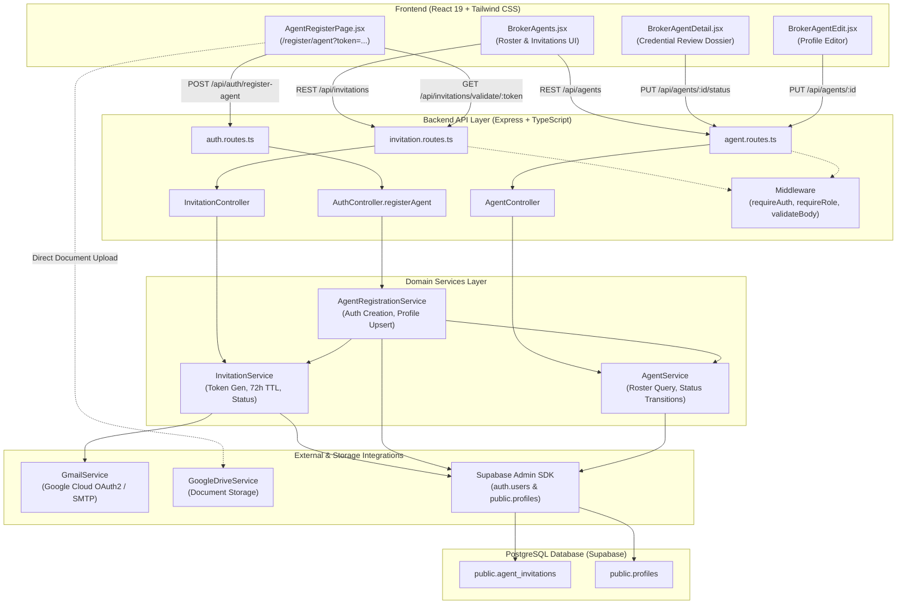

# Agent Management Module — Architecture & Technical Reference

**Document Version:** 1.0.0  
**Status:** Implemented & Verified  
**Scope:** Human Shelter Realty (`CP_kerby`) Brokerage Platform  
**Target File:** [`docs/modules/03-agent-management/2026-10-14-agent-management-overview.md`](file:///c:/Users/Win11x64/Desktop/My%20code%20space/CP_kerby/docs/modules/03-agent-management/2026-10-14-agent-management-overview.md)

---

## 1. Executive Summary & Purpose

The **Agent Management Module** is the core administrative and regulatory compliance engine for managing licensed real estate consultants within the Human Shelter Realty platform.

In luxury real estate operations (specifically under Philippine regulatory standards governed by Republic Act No. 9646 / Real Estate Service Act, the Professional Regulation Commission [PRC], and the Department of Human Settlements and Urban Development [DHSUD]), brokerage firms are legally prohibited from allowing unaccredited or unlicensed agents to represent property inventory or transact with clients.

### 1.1 Problems Solved
1. **Regulated Onboarding Pipeline**: Replaces unauthenticated open registration with an invitation-only, single-use, time-limited (72-hour) cryptographic onboarding workflow.
2. **Credential Verification & Compliance Enforcement**: Enforces collection of PRC license numbers, DHSUD accreditation numbers, validity periods, and document attachments (e.g., digital scans of ID cards and certificates).
3. **Role-Based Listing Gate (RBAC)**: Guarantees that only brokers or verified agents can publish luxury property inventory to the public marketplace.
4. **Supervisory Governance & Audit Trail**: Enables managing brokers to inspect submitted credentials, approve applications, reject dossiers with specific remediation remarks, or suspend accounts for compliance audits.

### 1.2 Out of Scope
To avoid misconceptions, the code explicitly defines the boundaries of this module:
- **No Direct Regulatory API Verification**: The platform collects and stores PRC/DHSUD numbers and validity dates, but does not integrate directly with live government portals (e.g., PRC LERIS). Verification is a supervisory human broker review process.
- **No Automated Round-Robin Lead Assignment**: While inquiries track assigned agent IDs, automatic lead distribution algorithms are handled by concierge/inquiry services rather than this module.
- **No Commission Payroll Disbursement**: Commission splits are recorded in confidential property metadata, but financial payouts and tax withholding are outside the scope of this module.
- **Not an Autonomous AI Agent System**: This module manages human licensed real estate agents and consultants, distinct from LLM concierge services.

---

## 2. Architecture & Component Interaction

The module follows a layered, decoupled service architecture across the React frontend, Express API layer, PostgreSQL/Supabase database, and Google Cloud services.



### Component Responsibilities Table

| Component | File Path | Core Responsibility |
| :--- | :--- | :--- |
| **Invitation Routes & Controller** | [`backend/src/routes/invitation.routes.ts`](file:///c:/Users/Win11x64/Desktop/My%20code%20space/CP_kerby/backend/src/routes/invitation.routes.ts)<br/>[`backend/src/controllers/invitation.controller.ts`](file:///c:/Users/Win11x64/Desktop/My%20code%20space/CP_kerby/backend/src/controllers/invitation.controller.ts) | Exposes endpoints for creating invitations, validating tokens, resending invites, and revoking invitations. |
| **Agent Routes & Controller** | [`backend/src/routes/agent.routes.ts`](file:///c:/Users/Win11x64/Desktop/My%20code%20space/CP_kerby/backend/src/routes/agent.routes.ts)<br/>[`backend/src/controllers/agent.controller.ts`](file:///c:/Users/Win11x64/Desktop/My%20code%20space/CP_kerby/backend/src/controllers/agent.controller.ts) | Exposes directory queries (`GET /api/agents`), single profile lookup, status mutations (`PUT /:id/status`), and profile editing (`PUT /:id`). |
| **Invitation Domain Service** | [`backend/src/services/invitation.service.ts`](file:///c:/Users/Win11x64/Desktop/My%20code%20space/CP_kerby/backend/src/services/invitation.service.ts) | Generates 64-character hexadecimal tokens, enforces 72-hour expiration, manages invite state transitions (`pending`, `used`, `revoked`, `expired`), and triggers invitation emails via `GmailService`. |
| **Agent Registration Service** | [`backend/src/services/agentRegistration.service.ts`](file:///c:/Users/Win11x64/Desktop/My%20code%20space/CP_kerby/backend/src/services/agentRegistration.service.ts) | Validates single-use token, creates Supabase Auth user record, creates profile with `PENDING` verification status, attaches credential documents, and marks token as `used`. |
| **Agent Domain Service** | [`backend/src/services/agent.service.ts`](file:///c:/Users/Win11x64/Desktop/My%20code%20space/CP_kerby/backend/src/services/agent.service.ts) | Queries database profiles, enforces status transitions (`VERIFIED`, `PENDING`, `REJECTED`, `SUSPENDED`), logs audit metadata (`verified_by`, `suspended_by`), and manages profile metadata. |
| **Gmail Notification Service** | [`backend/src/services/gmail.service.ts`](file:///c:/Users/Win11x64/Desktop/My%20code%20space/CP_kerby/backend/src/services/gmail.service.ts) | Dispatches branded HTML onboarding invitations via official Google Cloud Mail API (v1 / OAuth2 Refresh Token) with SMTP fallback. |
| **Broker Agent Console** | [`frontend/src/pages/portals/broker/BrokerAgents.jsx`](file:///c:/Users/Win11x64/Desktop/My%20code%20space/CP_kerby/frontend/src/pages/portals/broker/BrokerAgents.jsx) | Broker dashboard containing active roster, KPI metric plinths, invitations ledger tab, invitation creation modal, and CSV export. |
| **Candidate Onboarding Page** | [`frontend/src/pages/auth/AgentRegisterPage.jsx`](file:///c:/Users/Win11x64/Desktop/My%20code%20space/CP_kerby/frontend/src/pages/auth/AgentRegisterPage.jsx) | Candidate onboarding interface with token validation state machine, locked email field, PRC/DHSUD accreditation forms, and Google Drive document upload. |
| **Credential Review Dossier** | [`frontend/src/pages/portals/broker/BrokerAgentDetail.jsx`](file:///c:/Users/Win11x64/Desktop/My%20code%20space/CP_kerby/frontend/src/pages/portals/broker/BrokerAgentDetail.jsx) | Dedicated review dossier allowing brokers to inspect license numbers, review PDF document links, approve, reject with remarks, or suspend agents. |

---

## 3. Agent Lifecycle

The code implements a state machine governed by two database models: `agent_invitations.status` and `profiles.verification_status`.

```
[ Broker Action ] ──► POST /api/invitations ──► Token Created (status: 'pending', expires_at: now + 72h)
                                                       │
                                                       ▼
[ Candidate ] ────────► GET /api/invitations/validate/:token ──► Valid & Unexpired?
                                                       │
                           ┌───────────────────────────┴───────────────────────────┐
                          YES                                                      NO
                           │                                                       │
                           ▼                                                       ▼
            Candidate Submits Dossier                                  Error Screen Rendered
       POST /api/auth/register-agent                           ('EXPIRED', 'USED', or 'INVALID')
                           │
                           ▼
          Token Marked 'used' in DB
      Profile Created (verification_status: 'PENDING')
      Listing Creation Locked (HTTP 403)
                           │
       ┌───────────────────┴───────────────────┐
       ▼                                       ▼
Broker Approves                        Broker Rejects (with Remarks)
verification_status: 'VERIFIED'        verification_status: 'REJECTED'
Listing Creation Unlocked              rejection_remarks Recorded
       │
       ▼
Broker Suspends (Optional)
verification_status: 'SUSPENDED'
Listing Creation Locked (HTTP 403)
```

### Lifecycle States Defined in Code

1. **`INVITED` (`agent_invitations.status = 'pending'`)**:
   - Triggered when a broker submits candidate email via `POST /api/invitations`.
   - Generates a 64-character hexadecimal token with a 72-hour TTL (`expires_at = now() + interval '72 hours'`).
   - Dispatches transactional invitation email containing link: `/register/agent?token=<token>`.

2. **`PENDING` (`profiles.verification_status = 'PENDING'`)**:
   - Triggered when candidate completes `/register/agent` via `POST /api/auth/register-agent`.
   - The token is transitioned to `used` (single-use guarantee).
   - An account is provisioned in `auth.users`, and a matching record is inserted into `public.profiles`.
   - **Operational Restriction**: The agent is strictly barred from publishing property listings. [`PropertyController.createProperty`](file:///c:/Users/Win11x64/Desktop/My%20code%20space/CP_kerby/backend/src/controllers/property.controller.ts#L158-L179) returns `HTTP 403 Forbidden` (`"Agent credentials are unverified"`).

3. **`VERIFIED` (`profiles.verification_status = 'VERIFIED'`)**:
   - Triggered when a broker or admin clicks **Approve Credentials** in [`BrokerAgentDetail.jsx`](file:///c:/Users/Win11x64/Desktop/My%20code%20space/CP_kerby/frontend/src/pages/portals/broker/BrokerAgentDetail.jsx#L140-L157) (`PUT /api/agents/:id/status` with `verification_status: 'VERIFIED'`).
   - Automatically clears previous `rejection_remarks`.
   - Stamps audit fields: `verified_by = actorId` and `verified_at = now()`.
   - Listing creation permissions are fully enabled.

4. **`REJECTED` (`profiles.verification_status = 'REJECTED'`)**:
   - Triggered when a broker rejects an application (`PUT /api/agents/:id/status` with `verification_status: 'REJECTED'`).
   - Requires and records `rejection_remarks` (e.g., *"PRC License card expired; re-upload current renewal"*).
   - Remains blocked from listing creation.

5. **`SUSPENDED` (`profiles.verification_status = 'SUSPENDED'`)**:
   - Triggered when an active agent account is temporarily disabled (`PUT /api/agents/:id/status` with `verification_status: 'SUSPENDED'`).
   - Stamps audit fields: `suspended_by = actorId`, `suspended_at = now()`, `suspension_reason`, and `suspension_notes`.
   - Immediately revokes listing creation privileges.

---

## 4. Key Workflows & Tracing

### Workflow 1: Broker Issues Onboarding Invitation
- **Entry Point**: UI modal in [`BrokerAgents.jsx`](file:///c:/Users/Win11x64/Desktop/My%20code%20space/CP_kerby/frontend/src/pages/portals/broker/BrokerAgents.jsx#L100-L130) triggers `invitationService.createInvitation()`.
- **API Endpoint**: `POST /api/invitations`
- **Controller**: [`InvitationController.create`](file:///c:/Users/Win11x64/Desktop/My%20code%20space/CP_kerby/backend/src/controllers/invitation.controller.ts#L11-L42)
- **Domain Service Execution**: [`InvitationService.createInvitation`](file:///c:/Users/Win11x64/Desktop/My%20code%20space/CP_kerby/backend/src/services/invitation.service.ts#L54-L151)
  1. Checks for existing active unexpired invitations for the email. Throws error unless `allowReissue: true` is passed (which revokes previous pending tokens).
  2. Generates cryptographic token: `crypto.randomBytes(32).toString('hex')`.
  3. Inserts row into `public.agent_invitations` with `status: 'pending'`, `expires_at: now + 72 hours`.
  4. Calls [`GmailService.sendAgentInvitationEmail`](file:///c:/Users/Win11x64/Desktop/My%20code%20space/CP_kerby/backend/src/services/gmail.service.ts#L203-L222).
- **Output**: Returns HTTP 201 with invitation record; candidate receives branded email with URL.

### Workflow 2: Candidate Validates Token
- **Entry Point**: Candidate opens `/register/agent?token=<token>`. Mount hook triggers `invitationService.validateToken(token)`.
- **API Endpoint**: `GET /api/invitations/validate/:token` (Public route)
- **Controller**: [`InvitationController.validateToken`](file:///c:/Users/Win11x64/Desktop/My%20code%20space/CP_kerby/backend/src/controllers/invitation.controller.ts#L71-L99)
- **Domain Service Execution**: [`InvitationService.validateToken`](file:///c:/Users/Win11x64/Desktop/My%20code%20space/CP_kerby/backend/src/services/invitation.service.ts#L205-L245)
  1. Looks up token in `public.agent_invitations`.
  2. Evaluates state:
     - Not found $\rightarrow$ `{ valid: false, reason: 'NOT_FOUND' }`
     - Status `used` $\rightarrow$ `{ valid: false, reason: 'USED', email }`
     - Status `revoked` $\rightarrow$ `{ valid: false, reason: 'REVOKED', email }`
     - `expires_at < now` $\rightarrow$ `{ valid: false, reason: 'EXPIRED', email }`
     - Active $\rightarrow$ `{ valid: true, email, id }`
- **Output**: Frontend state machine shifts to `VALID` (rendering form with email locked), `EXPIRED` (card showing 72h notice), or `INVALID`.

### Workflow 3: Candidate Submits Onboarding Dossier
- **Entry Point**: Candidate submits registration form on [`AgentRegisterPage.jsx`](file:///c:/Users/Win11x64/Desktop/My%20code%20space/CP_kerby/frontend/src/pages/auth/AgentRegisterPage.jsx#L132-L168).
- **API Endpoint**: `POST /api/auth/register-agent`
- **Middleware**: `authRateLimiter`, `validateBody(registerAgentSchema)`.
- **Controller**: [`AuthController.registerAgent`](file:///c:/Users/Win11x64/Desktop/My%20code%20space/CP_kerby/backend/src/controllers/auth.controller.ts#L112-L129)
- **Domain Service Execution**: [`AgentRegistrationService.registerInvitedAgent`](file:///c:/Users/Win11x64/Desktop/My%20code%20space/CP_kerby/backend/src/services/agentRegistration.service.ts#L26-L136)
  1. Re-validates invitation token.
  2. Creates Supabase Auth user via `supabaseAdmin.auth.admin.createUser({ email, password, role: 'agent' })`.
  3. Upserts profile into `public.profiles` with `verification_status: 'PENDING'`, PRC license, DHSUD accreditation, validity dates, and uploaded Google Drive document metadata.
  4. Consumes token via `InvitationService.markTokenUsed(token)` (`status = 'used'`).
- **Output**: Returns HTTP 201; UI displays success card indicating dossier is in queue for broker review.

### Workflow 4: Broker Vetting & Verification Decision
- **Entry Point**: Broker opens [`BrokerAgentDetail.jsx`](file:///c:/Users/Win11x64/Desktop/My%20code%20space/CP_kerby/frontend/src/pages/portals/broker/BrokerAgentDetail.jsx) (`/broker/agents/:id`).
- **Inspection**: Broker inspects candidate's PRC card, validity dates, and supporting document links.
- **API Endpoint**: `PUT /api/agents/:id/status`
- **Middleware**: `requireAuth`, `requireRole(['broker', 'admin'])`, `validateBody(updateAgentStatusSchema)`.
- **Domain Service Execution**: [`AgentService.updateAgentStatus`](file:///c:/Users/Win11x64/Desktop/My%20code%20space/CP_kerby/backend/src/services/agent.service.ts#L166-L229)
  - Updates `verification_status` to `VERIFIED`, `REJECTED`, or `SUSPENDED`.
  - St হওয়ায় audit trail (`verified_by`, `verified_at` or `suspended_by`, `suspended_at`).
- **Output**: Returns HTTP 200 with updated profile; table and badges immediately update.

### Workflow 5: Enforced Listing RBAC Gate
- **Entry Point**: User attempts to create listing via `POST /api/properties`.
- **Gating Logic in [`PropertyController.createProperty`](file:///c:/Users/Win11x64/Desktop/My%20code%20space/CP_kerby/backend/src/controllers/property.controller.ts#L158-L179)**:
  ```typescript
  if (userRole === 'agent') {
    const agentProfile = await AgentService.getAgentById(userId);
    if (agentProfile && agentProfile.verification_status !== 'VERIFIED') {
      res.status(403).json({
        success: false,
        error: 'Agent credentials are unverified. Please await broker review before creating listings.',
        timestamp: new Date().toISOString(),
      });
      return;
    }
  }
  ```
- **Output**: Unverified agents receive HTTP 403 Forbidden.

---

## 5. Interfaces and Data Contracts

### 5.1 REST API Contracts

| Method | Endpoint | Access Control | Purpose | Request Body / Query | Success Response |
| :--- | :--- | :--- | :--- | :--- | :--- |
| `POST` | `/api/invitations` | Broker, Admin | Issue new invitation | `{ email, fullName?, phone?, role?, brokerAgency?, message?, allowReissue? }` | `201 Created` |
| `GET` | `/api/invitations` | Broker, Admin | List invitations | Query: `?status=ALL\|pending\|used\|revoked\|expired` | `200 OK` (Array) |
| `GET` | `/api/invitations/validate/:token` | Public | Validate token & fetch locked email | Path parameter `:token` | `200 OK` `{ valid: true, email, id }` |
| `POST` | `/api/invitations/:id/resend` | Broker, Admin | Refresh 72h TTL & resend email | Path parameter `:id` | `200 OK` (Updated invitation) |
| `DELETE`| `/api/invitations/:id` | Broker, Admin | Revoke active invitation | Path parameter `:id` | `200 OK` (Revoked invitation) |
| `POST` | `/api/auth/register-agent` | Public (Rate-limited) | Register invited agent dossier | See `RegisterAgentInput` contract below | `201 Created` |
| `GET` | `/api/agents` | Authenticated | List agent directory | Query: `?status=...&search=...` | `200 OK` (Array) |
| `GET` | `/api/agents/:id` | Authenticated | Fetch single agent dossier | Path parameter `:id` | `200 OK` (Agent object) |
| `PUT` | `/api/agents/:id/status` | Broker, Admin | Update verification status | `{ verification_status, rejection_remarks?, suspension_reason?, suspension_notes? }` | `200 OK` |
| `PUT` | `/api/agents/:id` | Broker, Admin | Update agent profile metadata | `{ name?, phone?, bio?, avatar?, prc_license_no?, prc_validity?, dhsud_accreditation_no?, dhsud_validity?, experience_years? }` | `200 OK` |

### 5.2 Zod Validation Schemas

Defined in [`backend/src/schemas/auth.schema.ts`](file:///c:/Users/Win11x64/Desktop/My%20code%20space/CP_kerby/backend/src/schemas/auth.schema.ts#L51-L76) and [`backend/src/schemas/agent.schema.ts`](file:///c:/Users/Win11x64/Desktop/My%20code%20space/CP_kerby/backend/src/schemas/agent.schema.ts):

```typescript
export const registerAgentSchema = z.object({
  token: z.string().min(16, 'Valid invitation token is required.'),
  password: z
    .string()
    .min(8, 'Password must be at least 8 characters long.')
    .regex(/[A-Z]/, 'Password must contain at least one uppercase letter.')
    .regex(/[0-9]/, 'Password must contain at least one number.')
    .regex(/[^A-Za-z0-9]/, 'Password must contain at least one special character.'),
  fullName: z.string().min(2, 'Full name is required.').max(100).trim(),
  phone: z.string().min(7, 'Valid contact number is required.').max(20).trim(),
  prcLicenseNo: z.string().min(5, 'PRC license number is required.').trim(),
  prcValidity: z.string().min(4, 'PRC validity date is required.'),
  dhsudAccreditationNo: z.string().min(5, 'DHSUD accreditation number is required.').trim(),
  dhsudValidity: z.string().min(4, 'DHSUD validity date is required.'),
  documents: z
    .array(
      z.object({
        name: z.string(),
        fileId: z.string().optional(),
        webViewLink: z.string().optional(),
        mimeType: z.string().optional(),
      })
    )
    .optional()
    .default([]),
});

export const updateAgentStatusSchema = z.object({
  verification_status: z.enum(['VERIFIED', 'PENDING', 'REJECTED', 'SUSPENDED']),
  rejection_remarks: z.string().optional(),
  suspension_reason: z.string().optional(),
  suspension_notes: z.string().optional(),
  notes: z.string().optional(),
});
```

### 5.3 Database Schema & Persistence

Documented in [`backend/src/models/agent_invitations_migration.sql`](file:///c:/Users/Win11x64/Desktop/My%20code%20space/CP_kerby/backend/src/models/agent_invitations_migration.sql):

#### Table: `public.agent_invitations`
```sql
CREATE TABLE IF NOT EXISTS public.agent_invitations (
  id UUID DEFAULT gen_random_uuid() PRIMARY KEY,
  email TEXT NOT NULL,
  token VARCHAR(64) UNIQUE NOT NULL DEFAULT encode(gen_random_bytes(32), 'hex'),
  status VARCHAR(20) NOT NULL DEFAULT 'pending' 
    CHECK (status IN ('pending', 'used', 'revoked', 'expired')),
  expires_at TIMESTAMPTZ NOT NULL DEFAULT (now() + interval '72 hours'),
  invited_by UUID REFERENCES auth.users(id) ON DELETE SET NULL,
  full_name TEXT,
  phone TEXT,
  role TEXT DEFAULT 'agent',
  broker_agency TEXT,
  message TEXT,
  created_at TIMESTAMPTZ NOT NULL DEFAULT timezone('utc'::text, now()),
  updated_at TIMESTAMPTZ NOT NULL DEFAULT timezone('utc'::text, now())
);

CREATE INDEX idx_agent_invitations_token ON public.agent_invitations(token);
CREATE INDEX idx_agent_invitations_email ON public.agent_invitations(email);
```

#### Row Level Security (RLS) Policies on `public.agent_invitations`
1. **Admins and Brokers Policy**: Allows authenticated brokers and admins full CRUD operations:
   ```sql
   CREATE POLICY "Admins and brokers can manage invitations"
     ON public.agent_invitations FOR ALL
     TO authenticated
     USING (
       EXISTS (
         SELECT 1 FROM public.profiles 
         WHERE id = auth.uid() AND role IN ('admin', 'broker')
       )
     );
   ```
2. **Public Token Validation Policy**: Allows unauthenticated prospective candidates to validate active tokens:
   ```sql
   CREATE POLICY "Public token validation for active invitations"
     ON public.agent_invitations FOR SELECT
     TO anon
     USING (status = 'pending' AND expires_at > now());
   ```

#### Extended Agent Compliance Columns on `public.profiles`
- `prc_license_no` (`TEXT`): Official PRC Real Estate Broker license registration.
- `prc_validity` (`DATE`): License validity expiration date.
- `dhsud_accreditation_no` (`TEXT`): Department of Human Settlements accreditation number.
- `dhsud_validity` (`DATE`): DHSUD accreditation validity expiration date.
- `verification_status` (`VARCHAR(20)`): `'VERIFIED'`, `'PENDING'`, `'REJECTED'`, or `'SUSPENDED'`.
- `supporting_documents` (`JSONB`): Array of `{ name, fileId, webViewLink, size }` references stored in Google Drive.
- `rejection_remarks` (`TEXT`): Remediation guidance when an application is rejected.
- `suspension_reason` (`TEXT`): Formal categorization of suspension.
- `suspension_notes` (`TEXT`): Detailed audit notes regarding account deactivation.
- `verified_by` (`UUID` REFERENCES `auth.users`): Principal broker who approved the credentials.
- `verified_at` (`TIMESTAMPTZ`): Timestamp of verification approval.
- `suspended_by` (`UUID` REFERENCES `auth.users`): Broker/admin who enacted suspension.
- `suspended_at` (`TIMESTAMPTZ`): Timestamp of suspension.

---

## 6. Dependencies & External Integrations

1. **Supabase Auth & Database (`@supabase/supabase-js`)**:
   - Primary data persistence for `profiles` and `agent_invitations`.
   - Uses `supabaseAdmin` (Service Role Key) on the backend to bypass RLS for administrative user provisioning (`createUser`), while frontend client queries respect RLS.

2. **Google Mail Cloud API (`googleapis` v1)**:
   - Primary email engine configured via OAuth 2.0 (`GMAIL_REFRESH_TOKEN`, `GOOGLE_CLIENT_ID`, `GOOGLE_CLIENT_SECRET`).
   - Connects to Google Cloud API `https://www.googleapis.com/auth/gmail.send` to dispatch RFC 2822 compliant MIME messages with URL-safe base64 encoding.
   - Includes SMTP fallback (`nodemailer`) and dev-mode console logging.

3. **Google Drive Cloud Storage (`GoogleDriveService`)**:
   - Used by the candidate onboarding uploader (`driveService.uploadFile`) to store PRC ID scans, DHSUD certificates, and government IDs in a designated folder (`agent-credentials`).
   - Returns a `fileId` and `webViewLink` that are stored in the agent's `supporting_documents` JSONB array.

---

## 7. Failure Handling & Operational Behavior

### 7.1 Single-Use Guarantee & Replay Prevention
Once an agent submits the registration form, [`AgentRegistrationService.registerInvitedAgent`](file:///c:/Users/Win11x64/Desktop/My%20code%20space/CP_kerby/backend/src/services/agentRegistration.service.ts#L123) calls `InvitationService.markTokenUsed(token)`. Any subsequent attempt to register with that token immediately triggers `HTTP 400 Bad Request` (`"Invitation token is invalid, expired, or already utilized"`).

### 7.2 Lazy Status Expiration
Rather than relying on a heavy continuous database polling worker, token expiration is calculated dynamically:
- When listing or validating tokens, if `status === 'pending'` and `new Date(expires_at).getTime() < Date.now()`, the system lazily evaluates and treats the token as `'expired'`.
- Database RLS policy enforces `expires_at > now()` directly on Postgres.

### 7.3 Rate Limiting & Input Sanitization
- Auth and registration endpoints (`/api/auth/register-agent`, `/api/auth/login`) are protected by `authRateLimiter` (10 requests per 15-minute window per IP) to mitigate brute-force attacks.
- Inputs are validated with strict Zod schemas requiring minimum lengths and password complexity (uppercase, digit, special character).

### 7.4 Postgres UUID Defensive Validation
To prevent unhandled PostgreSQL errors (`invalid input syntax for type uuid`) when non-UUID string identifiers are passed as `invited_by`, `InvitationService` tests the string against a standard UUID regex before passing it to Postgres. If non-conforming, it defaults safely to `null`.

### 7.5 Dual-Layer Resilience Architecture
Both `InvitationService` and `AgentService` maintain an in-memory cache synchronized with Supabase. If Supabase is temporarily unreachable or misconfigured during testing, the services log a warning and fall back to local state to prevent application crashes.

---

## 8. Test Coverage & Verification Status

### 8.1 Automated Test Suite
The module is covered by automated unit and E2E tests in the `test files/backend/services/` directory:

| Test File | Verified Assertions |
| :--- | :--- |
| [`test files/backend/services/invitation.service.test.ts`](file:///c:/Users/Win11x64/Desktop/My%20code%20space/CP_kerby/test%20files/backend/services/invitation.service.test.ts) | 1. Generates 64-char hex token with 72h expiry.<br/>2. Validates active tokens.<br/>3. Rejects duplicate active invitations for the same email.<br/>4. Rejects revoked tokens. |
| [`test files/backend/services/agentRegistration.service.test.ts`](file:///c:/Users/Win11x64/Desktop/My%20code%20space/CP_kerby/test%20files/backend/services/agentRegistration.service.test.ts) | 1. Registers candidate, sets status to `PENDING`, records PRC license.<br/>2. Marks token as used (single-use guarantee).<br/>3. Rejects registration with invalid/used tokens. |
| [`test files/backend/services/agent-verification-rbac.test.ts`](file:///c:/Users/Win11x64/Desktop/My%20code%20space/CP_kerby/test%20files/backend/services/agent-verification-rbac.test.ts) | 1. Updates verification status with rejection remarks.<br/>2. Approves agent and clears remarks.<br/>3. **Blocks unverified (`PENDING`) agents from creating property listings (HTTP 403)**. |
| [`test files/backend/services/agent-management-lifecycle.e2e.test.ts`](file:///c:/Users/Win11x64/Desktop/My%20code%20space/CP_kerby/test%20files/backend/services/agent-management-lifecycle.e2e.test.ts) | **Full 7-Stage End-to-End Lifecycle:**<br/>- Stage 1: Broker issues single-use token.<br/>- Stage 2: Token validates candidate identity.<br/>- Stage 3: Candidate submits registration dossier.<br/>- Stage 4: RBAC gate blocks PENDING agent from listing properties.<br/>- Stage 5: Broker rejects dossier with remarks.<br/>- Stage 6: Broker reviews corrected documents and approves agent.<br/>- Stage 7: VERIFIED agent successfully creates luxury listing (HTTP 201). |

### 8.2 Identified Gaps & Operational Considerations

1. **Asynchronous Email Rollback**:
   - In [`InvitationService.createInvitation`](file:///c:/Users/Win11x64/Desktop/My%20code%20space/CP_kerby/backend/src/services/invitation.service.ts#L140-L148), if `GmailService` throws an exception, the error is logged as a warning, but the database invitation record remains in `pending` status. A broker would need to click **Resend** or use the **Copy Link** feature if delivery fails.
2. **Document Expiration Notification**:
   - The database stores `prc_validity` and `dhsud_validity` dates, and the UI displays an `EXPIRED` badge if past date. However, there is currently no active background email alert notifying the broker 30 days before an agent's license expires.
3. **Account Deletion / Purge**:
   - Account removal is handled via suspension (`SUSPENDED`). Physical deletion from `auth.users` requires manual database administration or script execution ([`backend/src/scripts/clean-users.ts`](file:///c:/Users/Win11x64/Desktop/My%20code%20space/CP_kerby/backend/src/scripts/clean-users.ts)) to preserve historical property listings and transaction records previously assigned to that agent.

---

## 9. Suggested Reading Order

For a new developer onboarding to this module, the recommended reading order is:

1. **Data Model**:
   - [`backend/src/models/agent_invitations_migration.sql`](file:///c:/Users/Win11x64/Desktop/My%20code%20space/CP_kerby/backend/src/models/agent_invitations_migration.sql) — Understand tables, foreign keys, and RLS policies.
2. **Validation Contracts**:
   - [`backend/src/schemas/agent.schema.ts`](file:///c:/Users/Win11x64/Desktop/My%20code%20space/CP_kerby/backend/src/schemas/agent.schema.ts) and [`backend/src/schemas/auth.schema.ts`](file:///c:/Users/Win11x64/Desktop/My%20code%20space/CP_kerby/backend/src/schemas/auth.schema.ts) — Understand input shapes and constraints.
3. **Domain Business Logic**:
   - [`backend/src/services/invitation.service.ts`](file:///c:/Users/Win11x64/Desktop/My%20code%20space/CP_kerby/backend/src/services/invitation.service.ts) — Token issuance, lifecycle, and email triggering.
   - [`backend/src/services/agentRegistration.service.ts`](file:///c:/Users/Win11x64/Desktop/My%20code%20space/CP_kerby/backend/src/services/agentRegistration.service.ts) — Onboarding consumption and auth provisioning.
   - [`backend/src/services/agent.service.ts`](file:///c:/Users/Win11x64/Desktop/My%20code%20space/CP_kerby/backend/src/services/agent.service.ts) — Roster queries and status transition logic.
4. **API Routing & Gating**:
   - [`backend/src/routes/invitation.routes.ts`](file:///c:/Users/Win11x64/Desktop/My%20code%20space/CP_kerby/backend/src/routes/invitation.routes.ts) & [`backend/src/routes/agent.routes.ts`](file:///c:/Users/Win11x64/Desktop/My%20code%20space/CP_kerby/backend/src/routes/agent.routes.ts)
   - [`backend/src/controllers/property.controller.ts`](file:///c:/Users/Win11x64/Desktop/My%20code%20space/CP_kerby/backend/src/controllers/property.controller.ts#L158-L179) — Notice the RBAC verification check before listing creation.
5. **Frontend User Experience**:
   - [`frontend/src/pages/auth/AgentRegisterPage.jsx`](file:///c:/Users/Win11x64/Desktop/My%20code%20space/CP_kerby/frontend/src/pages/auth/AgentRegisterPage.jsx) — Candidate registration state machine.
   - [`frontend/src/pages/portals/broker/BrokerAgents.jsx`](file:///c:/Users/Win11x64/Desktop/My%20code%20space/CP_kerby/frontend/src/pages/portals/broker/BrokerAgents.jsx) — Broker roster, tabs, and invitation modal.
   - [`frontend/src/pages/portals/broker/BrokerAgentDetail.jsx`](file:///c:/Users/Win11x64/Desktop/My%20code%20space/CP_kerby/frontend/src/pages/portals/broker/BrokerAgentDetail.jsx) — Credential vetting and approval drawer.
6. **Integration Verification**:
   - [`test files/backend/services/agent-management-lifecycle.e2e.test.ts`](file:///c:/Users/Win11x64/Desktop/My%20code%20space/CP_kerby/test%20files/backend/services/agent-management-lifecycle.e2e.test.ts) — Comprehensive 7-stage executable specification.
