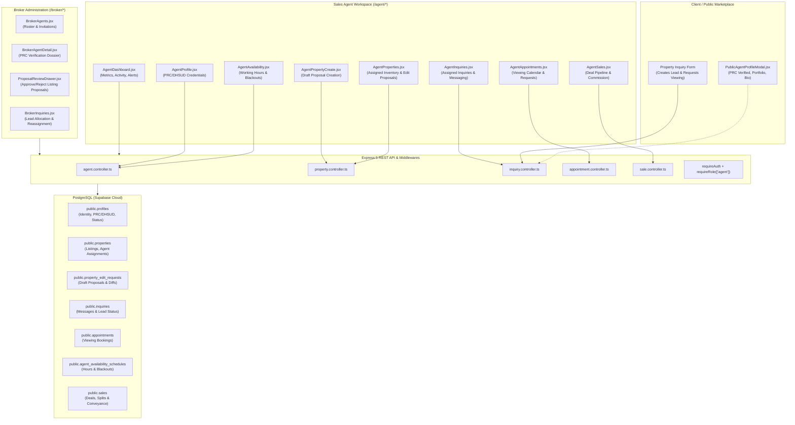
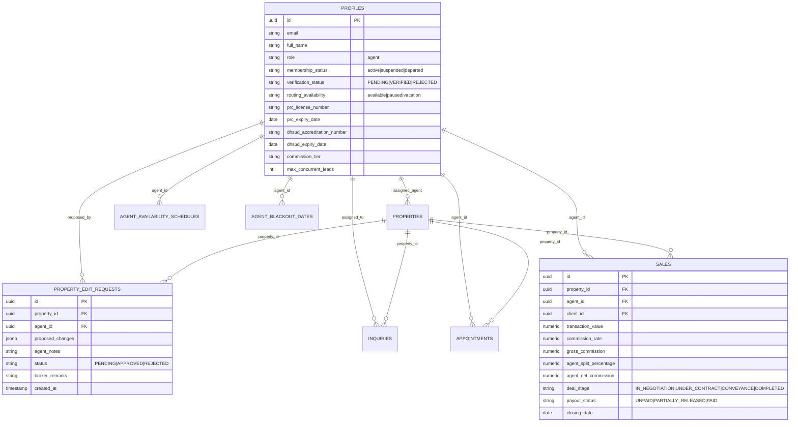

# Human Sales Agent Portal & Workflows — Requirements Specification

> **Standards Alignment:** ISO/IEC/IEEE 29148:2018 (Requirements Engineering), ISO/IEC/IEEE 42010:2022 (Architecture Description), and ISO/IEC 25010:2023 (Systems and Software Quality Requirements).  
> **Target Module:** `docs/modules/03-agent-management/`  
> **Cross-Module References:** [Module 01: User Management](../01-user-management/INDEX.md), [Module 02: Property Listing](../02-property-listing/INDEX.md), [Module 04: Sales and Reports](../04-sales-and-reports/INDEX.md), [Module 07: Inquiry](../07-inquiry/INDEX.md).  
> **Theme & UI Guide:** [design.md](../../design.md) (Modern Soft Minimalist SaaS: Teal `#0F766E` / Coral `#FF6B6B`).

---

## 1. Executive Summary & Regulatory Context

The **Human Sales Agent Portal** is the dedicated operational workspace for licensed real estate salespersons and consultants affiliated with **Human Shelter Realty**. In accordance with the Philippine **Republic Act No. 9646** (*Real Estate Service Act of 2009 / RESA*), the **Professional Regulation Commission (PRC)**, and the **Department of Human Settlements and Urban Development (DHSUD)**:

1. **Strict Supervisory Representation:** Real estate salespersons must operate under the direct supervision and legal authority of a licensed real estate broker. Salespersons cannot independently list or convey real estate without the managing broker's verification and approval.
2. **Credential Integrity:** Every salesperson must hold a current PRC Accredited Real Estate Salesperson registration and an active DHSUD registration. Expired or unverified agents are prohibited from receiving client leads or publishing properties.
3. **Operational Sovereignty:** While under broker governance, sales agents require an intuitive workspace to organize their assigned property listings, triage inquiries, schedule physical viewings, configure calendar availability, track ongoing sales pipelines, and calculate expected commission earnings.

---

## 2. Architecture & Ecosystem Interaction (ISO/IEC/IEEE 42010:2022)

---

## 3. Core Lifecycle & Governance Invariants

The Sales Agent operates within a **3-Dimensional Lifecycle State Machine**:

| Dimension | Permitted Values | Definition & Impact |
|---|---|---|
| **1. Membership Status** | `invited` \| `active` \| `suspended` \| `departed` | Governs platform authentication and account access. If `suspended` or `departed`, all portal write operations return `403 Forbidden`. |
| **2. Verification Status** | `PENDING` \| `VERIFIED` \| `REJECTED` | Governs regulatory compliance. Only `VERIFIED` agents can receive automated lead routing and have their public badge displayed. |
| **3. Routing Availability** | `available` \| `paused` \| `vacation` | Controlled by the agent to indicate live lead readiness. If `paused` or `vacation`, automated away messages trigger on new inquiries. |

### Architectural Invariants:
1. **INV-01 (Strict Broker Gate for Listings):** All property listings created or edited by a Sales Agent are submitted as proposals (`status: DRAFT_PENDING_APPROVAL` or `property_edit_requests`). No listing drafted by an agent may transition to `PUBLISHED` or `ACTIVE` without formal Broker review and approval.
2. **INV-02 (Data Isolation by Ownership):** Sales Agents may only access property dossiers, client inquiries, viewing appointments, and sales commission records that are explicitly assigned to their `agent_id` or where they are designated the primary transaction consultant.
3. **INV-03 (PRC/DHSUD Regulatory Gating):** An agent whose credentials are in `PENDING` or `REJECTED` status cannot represent properties on public listings, and the public profile modal will clearly display an "Under Supervisory Review" indicator.
4. **INV-04 (Immutable Audit Logging):** All status updates, proposal submissions, client message transmissions, and calendar changes generate structured audit records in `public.agent_audit_events`.

---

## 4. Functional Requirements Specification (ISO/IEC/IEEE 29148:2018)

### Module Area 1: Workspace Dashboard (`AgentDashboard.jsx`)

* **Requirement ID:** `REQ-AGENT-DASH-01`
* **Title:** Operational KPI & Activity Overview
* **Description:** The agent dashboard provides real-time visibility into workload, inquiry responsiveness, active listings, and regulatory standing.
* **Functional Capabilities:**
  1. **Metric Cards:**
     - **Active Listings:** Total properties currently assigned and published (`count`).
     - **Pending Proposals:** Count of draft listings or edit requests awaiting Broker approval.
     - **Open Inquiries:** Count of client inquiries requiring agent response or in active follow-up.
     - **Upcoming Viewings:** Appointments scheduled within the next 7 calendar days.
     - **Month-to-Date Closed Sales:** Aggregate closed transaction value and projected commission.
  2. **Compliance Status Banner:**
     - If `verification_status === 'VERIFIED'`, display verified badges (PRC & DHSUD) with expiration countdown.
     - If credentials expire within 30 days, render an amber warning pill with a direct link to the Profile Credential Renewal screen.
     - If `verification_status === 'REJECTED'`, render a high-priority red alert containing the Broker's specific rejection remarks and a "Resubmit Credentials" button.
  3. **Immediate Action Center:**
     - List pending property assignment invitations requiring agent acceptance.
     - List unanswered client inquiries with elapsed time badges.
     - List next scheduled property viewing with direct client WhatsApp/Phone call-to-action.

---

### Module Area 2: Property Inventory & Proposal Lifecycle (`AgentProperties.jsx`, `AgentPropertyDetail.jsx`, `AgentPropertyCreate.jsx`)

* **Requirement ID:** `REQ-AGENT-PROP-01`
* **Title:** Strict Broker Gate Listing & Proposal Management
* **Description:** Provides the agent with listing exploration, draft creation, assignment acceptance/declining, and change proposal workflows under strict broker supervisory authority.
* **Functional Capabilities:**
  1. **Listing Inventory Table / Grid:**
     - Filter assigned properties by status (`ACTIVE`, `PENDING_REVIEW`, `DRAFT`, `RESERVED`, `SOLD`).
     - Search by title, MLS key, project name, or geographic city.
  2. **Listing Assignment Acceptance Flow:**
     - When a Broker assigns an inventory item to an agent, status displays `ASSIGNMENT_PENDING`.
     - Agent can review property details and click **Accept Assignment** or **Decline Assignment** (requiring reason notes).
  3. **New Listing Proposal Creation (`AgentPropertyCreate.jsx`):**
     - Agents complete multi-step listing wizard: Basic Info, Location, Features/Amenities, Media Upload (Google Drive integration), Pricing & Terms.
     - Submission triggers: `POST /api/properties` with payload flag `is_draft: true` and status `DRAFT_PENDING_APPROVAL`.
     - System notifies the managing broker via email and notification center for review.
  4. **Listing Edit Proposal Flow (`AgentPropertyDetail.jsx`):**
     - For assigned properties already active, the agent cannot directly mutate price, title, or legal status.
     - Agent opens **"Propose Listing Edit"** modal, modifies fields (e.g., updated pricing, additional photos, revised description), and enters justification notes.
     - System records a delta record in `public.property_edit_requests` (`status: PENDING`) without mutating the live public listing.
     - Agent can view a side-by-side diff preview of "Current Value" vs "Proposed Value".

---

### Module Area 3: Lead & Inquiry Conversion Engine (`AgentInquiries.jsx`, `AgentInquiryDetail.jsx`)

* **Requirement ID:** `REQ-AGENT-INQ-01`
* **Title:** Direct Lead Triage, Multi-Turn Messaging, and Handoff
* **Description:** Enables agents to convert prospective inquiries into private viewings and qualified buyers.
* **Functional Capabilities:**
  1. **Triage Roster:**
     - Status filters: `NEW`, `CONTACTED`, `VIEWING_SCHEDULED`, `NEGOTIATION`, `CLOSED`, `ARCHIVED`.
     - Urgency indicators: Unread message count, lead score, and elapsed response time.
  2. **Inquiry Detail & Communication Workspace (`AgentInquiryDetail.jsx`):**
     - Complete conversation history with timestamped messages from client, AI concierge, and agent.
     - Integrated WhatsApp link (`https://wa.me/<phone>?text=...`) and phone dialer for rapid follow-up.
     - Property context widget: Quick summary of the inquired luxury property (price, floor area, location, photos).
  3. **Status Progression Bar:**
     - Intuitive stepper allowing the agent to advance the lead state through the conversion pipeline.
  4. **Viewing Booking Shortcut:**
     - Single-click action to schedule an appointment directly from the inquiry thread, pre-populating client and property details.

---

### Module Area 4: Appointment & Viewing Calendar (`AgentAppointments.jsx`, `AgentScheduleCalendar.jsx`)

* **Requirement ID:** `REQ-AGENT-APPT-01`
* **Title:** Property Tour & Viewing Coordination
* **Description:** Interactive scheduling environment for on-site client viewings, virtual walkthroughs, and buyer consultations.
* **Functional Capabilities:**
  1. **Dual Views:** Month/Week calendar grid and chronologically sorted list view.
  2. **Viewing Status Transitions:**
     - Client or Broker requested appointments appear as `REQUESTED`.
     - Agent can **Confirm Appointment**, **Propose Reschedule** (selecting alternate time slot), or **Cancel** (with mandatory cancellation reason).
     - Upon completion, agent marks as `COMPLETED` with private debrief notes (buyer interest level, feedback, next steps).
  3. **Clash Detection:**
     - Prevents double-booking by validating proposed times against existing appointments and blackout schedules.

---

### Module Area 5: Availability, Working Hours & Blackouts (`AgentAvailability.jsx`)

* **Requirement ID:** `REQ-AGENT-AVAIL-01`
* **Title:** Dynamic Routing Availability & Schedule Governance
* **Description:** Self-service controls for lead routing preferences and working hour calendars.
* **Functional Capabilities:**
  1. **Live Routing Availability Toggle:**
     - Status switcher: `Available for New Leads` (Green), `Paused` (Amber), `On Vacation` (Purple).
     - When `Paused` or `Vacation`, the system bypasses the agent in lead distribution and returns an automated away message.
  2. **Weekly Working Hours Configuration:**
     - Configurable time ranges for each day of the week (Monday through Sunday), e.g., `09:00 - 18:00`.
     - Toggle on/off for specific rest days.
  3. **Blackout Dates Manager:**
     - Ability to add single or multi-day blackout ranges (e.g., official holidays, personal leave).
     - Validates that no pending viewings exist on newly designated blackout dates without explicit reassignment warnings.
  4. **Workload Limiter:**
     - `max_concurrent_leads`: Number field allowing agents or brokers to set maximum concurrent active leads (default: 15).

---

### Module Area 6: Deal Pipeline & Commission View (`AgentSales.jsx`)

* **Requirement ID:** `REQ-AGENT-SALE-01`
* **Title:** Active Deal Pipeline, Conveyance & Net Commission Breakdown
* **Description:** Replaces mock data with real-time deal pipeline tracking, closing milestones, and transparent commission breakdown.
* **Functional Capabilities:**
  1. **Visual Deal Pipeline Stages:**
     - **Stage 1 — In Negotiation:** Letter of Intent (LOI) issued, price/terms under discussion.
     - **Stage 2 — Under Contract:** Contract to Sell (CTS) executed, reservation fee / earnest deposit deposited.
     - **Stage 3 — Conveyance / Closing:** Bank loan approval, title transfer processing, tax clearance certificate.
     - **Stage 4 — Completed:** Deed of Absolute Sale (DOAS) registered, final proceeds released.
  2. **Financial Metrics Summary:**
     - Total Closed Volume (YTD / MTD in PHP `₱`).
     - Total Net Commission Earned (Paid vs Pending Release).
     - Average Deal Closing Cycle (days from initial inquiry to closing).
  3. **Commission Split Transparency:**
     - Clear itemization on each deal card:
       * **Gross Transaction Value:** `₱ [Property Price]`
       * **Brokerage Commission Rate:** `[e.g., 5.0%]`
       * **Gross Commission Pool:** `₱ [Total Commission]`
       * **Agent Split Tier:** `[e.g., 60% Agent / 40% Brokerage]`
       * **Estimated Agent Net Commission:** `₱ [Agent Net Payout]`
       * **Payment Status:** `UNPAID` \| `PARTIALLY_RELEASED` \| `PAID`.
  4. **Historical Attribution Invariant:**
     - If an agent departs or is transferred, closed sales records irrevocably maintain the original agent's attribution for historical reporting and audit.

---

### Module Area 7: Professional Profile & Regulatory Compliance (`AgentProfile.jsx`)

* **Requirement ID:** `REQ-AGENT-PROF-01`
* **Title:** Profile Dossier & Regulatory Credential Management
* **Description:** Public presentation profile and official PRC/DHSUD credential submission.
* **Functional Capabilities:**
  1. **Public Marketing Profile:**
     - Professional headshot / avatar upload (stored in Supabase Storage `avatars` bucket).
     - Full legal name, professional title, mobile phone number, WhatsApp contact.
     - Multi-paragraph bio, real estate specialty areas (e.g., Forbes Park, BGC Condos, Tagaytay Estates), and years of experience.
     - Public profile live preview showing exact modal rendered to high-net-worth clients.
  2. **Regulatory License Management (RESA / RA 9646):**
     - **PRC Real Estate Salesperson License No.** + Expiry Date.
     - **DHSUD Accreditation Certificate No.** + Expiry Date.
     - File upload for digital credential scans (PDF, PNG, JPG).
  3. **Verification State Feedback:**
     - Displays badge status (`VERIFIED`, `PENDING`, `REJECTED`).
     - If rejected, displays the mandatory broker remediation comments with input fields unlocked for resubmission.

---

## 5. Non-Functional & Quality Requirements (ISO/IEC 25010:2023)

| Quality Characteristic | Requirement Specification | Verification Method |
|---|---|---|
| **Functional Suitability** | 100% of agent write operations strictly obey the 3D lifecycle states and Broker Gate policies. | Automated API unit/integration tests & RBAC middleware checks. |
| **Performance Efficiency** | Agent dashboard queries and calendar render response within `< 250ms` under 50 concurrent transactions. | Network profiling and indexed SQL query execution plans (`EXPLAIN ANALYZE`). |
| **Security & Isolation** | Zero row-level cross-tenant data leakage. Agent cannot inspect other agents' leads, deals, or commission splits. | PostgreSQL Row Level Security (RLS) policies and test harnesses. |
| **Usability & Accessibility** | WCAG 2.1 Level AA compliance; minimum contrast 4.5:1; full keyboard operability; mobile-responsive at `375px+`. | Playwright accessibility testing & Lighthouse automated audit (`>= 95`). |
| **Design Consistency** | Full conformance to `design.md` design tokens: Primary `#0F766E` (Teal), Accent `#FF6B6B` (Coral), font pairings. | Visual regression testing against approved mockups. |
| **Reliability** | Graceful degradation on network timeout; zero unhandled promise rejections on API failures. | Frontend Axios error interceptors with user-facing toast notifications. |

---

## 6. Data Model & Database Schema Alignment

---

## 7. REST API & Authorization Matrix

| Endpoint | Method | Role Allowed | Purpose & Boundary |
|---|---|---|---|
| `/api/agents/me/dashboard` | `GET` | `agent` | Retrieve personalized metrics, tasks, and alerts for authenticated agent. |
| `/api/agents/me/profile` | `GET`, `PATCH` | `agent` | Retrieve and update permitted personal profile, bio, and license credentials. |
| `/api/agents/me/availability` | `GET`, `PUT` | `agent` | Retrieve and update working hours, routing status, and blackout dates. |
| `/api/properties?agentId=me` | `GET` | `agent` | List inventory items assigned to caller. |
| `/api/properties` | `POST` | `agent` | Create new listing draft (`status: DRAFT_PENDING_APPROVAL`). Strictly gates direct publishing. |
| `/api/properties/:id/propose-edit`| `POST` | `agent` | Submit modification proposal on assigned property with field deltas. |
| `/api/properties/:id/assignment-response` | `POST` | `agent` | Accept or decline broker listing assignment. |
| `/api/inquiries?agentId=me` | `GET` | `agent` | Retrieve leads assigned to authenticated agent. |
| `/api/inquiries/:id/messages` | `POST` | `agent` | Transmit client communication in inquiry thread. |
| `/api/inquiries/:id/status` | `PATCH` | `agent` | Advance inquiry lifecycle stage (`NEW` -> `CONTACTED` -> `VIEWING_SCHEDULED`). |
| `/api/appointments?agentId=me`| `GET`, `POST` | `agent` | View viewing schedule and propose new client viewing appointment. |
| `/api/appointments/:id/status`| `PATCH` | `agent` | Confirm, reschedule, or cancel client viewing tour. |
| `/api/sales?agentId=me` | `GET` | `agent` | Retrieve active deal pipeline, transaction records, and commission splits. |

---

## 8. Requirements Traceability Matrix (RTM)

| Requirement ID | Acceptance Criterion (AC) | Verification Method | Target Component |
|---|---|---|---|
| **REQ-AGENT-DASH-01** | Dashboard displays active listings, open inquiries, upcoming viewings, and real-time credential alerts. | Playwright UI test & API mock check. | [`AgentDashboard.jsx`](file:///c:/Users/Win11x64/Desktop/My%20code%20space/CP_kerby/frontend/src/pages/portals/agent/AgentDashboard.jsx) |
| **REQ-AGENT-PROP-01** | Agent-created listings default to `DRAFT_PENDING_APPROVAL`; direct `PUBLISHED` status mutations return `403`. | Backend unit test in `property.controller.ts`. | [`AgentPropertyCreate.jsx`](file:///c:/Users/Win11x64/Desktop/My%20code%20space/CP_kerby/frontend/src/pages/portals/agent/AgentPropertyCreate.jsx) |
| **REQ-AGENT-PROP-02** | Proposing edits on active listings creates a delta in `property_edit_requests` without mutating `properties`. | Database state check after `POST /propose-edit`. | [`AgentPropertyDetail.jsx`](file:///c:/Users/Win11x64/Desktop/My%20code%20space/CP_kerby/frontend/src/pages/portals/agent/AgentPropertyDetail.jsx) |
| **REQ-AGENT-INQ-01** | Inquiries view lists only records where `assigned_agent_id === req.user.id`; messaging persists immediately. | End-to-end multi-agent isolation test. | [`AgentInquiries.jsx`](file:///c:/Users/Win11x64/Desktop/My%20code%20space/CP_kerby/frontend/src/pages/portals/agent/AgentInquiries.jsx) |
| **REQ-AGENT-APPT-01** | Appointments detect schedule collisions and disallow booking during designated blackout dates. | Unit test in `appointment.service.ts`. | [`AgentAppointments.jsx`](file:///c:/Users/Win11x64/Desktop/My%20code%20space/CP_kerby/frontend/src/pages/portals/agent/AgentAppointments.jsx) |
| **REQ-AGENT-AVAIL-01**| Setting routing availability to `paused` or `vacation` triggers auto-away replies and halts new lead assignment. | Integration test in `agentAvailability.service.ts`. | [`AgentAvailability.jsx`](file:///c:/Users/Win11x64/Desktop/My%20code%20space/CP_kerby/frontend/src/pages/portals/agent/AgentAvailability.jsx) |
| **REQ-AGENT-SALE-01** | `AgentSales.jsx` reflects active pipeline stages (`IN_NEGOTIATION` to `COMPLETED`) and displays net commission formula. | Visual inspection and live API response test. | [`AgentSales.jsx`](file:///c:/Users/Win11x64/Desktop/My%20code%20space/CP_kerby/frontend/src/pages/portals/agent/AgentSales.jsx) |
| **REQ-AGENT-PROF-01** | Credentials upload updates verification status to `PENDING` and alerts managing broker for review. | End-to-end broker approval cycle test. | [`AgentProfile.jsx`](file:///c:/Users/Win11x64/Desktop/My%20code%20space/CP_kerby/frontend/src/pages/portals/agent/AgentProfile.jsx) |

---

## 9. Implementation Roadmap & Incremental Rollout

1. **Phase 1: Sales Deal Pipeline & API Integration (Priority Gap)**
   - Eliminate hardcoded `agent-1` mock in [`AgentSales.jsx`](file:///c:/Users/Win11x64/Desktop/My%20code%20space/CP_kerby/frontend/src/pages/portals/agent/AgentSales.jsx).
   - Expand `sale.controller.ts` and `sale.service.ts` to support active deal stages (`IN_NEGOTIATION`, `UNDER_CONTRACT`, `CONVEYANCE`) and commission split calculations.
2. **Phase 2: Strict Broker Gate Listing Wizard & Proposal Diffing**
   - Connect `AgentPropertyCreate.jsx` to submit drafts directly into Broker Review queue.
   - Standardize `ProposalReviewDrawer.jsx` on broker portal to accept or reject with specific feedback.
3. **Phase 3: Lead Routing Automation & Auto-Away Engine**
   - Hook `AgentAvailability.jsx` routing states into inquiry assignment listeners to automatically send away messages when an agent is on vacation.
4. **Phase 4: Regulatory Expiration Automated Watchdog**
   - Implement scheduled job or background worker notifying agents and managing brokers 30 days prior to PRC license or DHSUD accreditation expiry.
