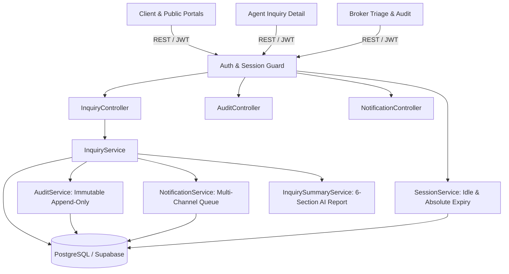

# Property Listing Inquiry Management: Communication, Notification, Audit, AI Summary & Session Handling
## System Module 04 — Modern SaaS Technical Architecture & Operation Manual

> **Module Name:** `04-property-listing-inquiry-module`  
> **Architecture Version:** 3.2.0  
> **Stack:** React 19 + Tailwind CSS v4 | Express + TypeScript | PostgreSQL (Supabase) + Dual-Mode In-Memory Fallback  
> **Design Language:** Modern SaaS (#0F766E Teal, #FF6B6B Coral, #F8FAFC Slate Ground, 8px Grid/Radius)  
> **Source Directive:** `docs/modules/06-audit/2026-10-21-communication-notification-audit-session-handling.md`

---

## 1. Executive Summary & Capabilities

The Property Listing Inquiry Management system unifies high-intent prospective buyers, PRC/DHSUD-accredited luxury property specialists, and managing brokers into a compliant, real-time communication platform. It handles:
- **Guest Lead Capture & Deduplication (`INQ-01`, `INQ-02`):** Reference codes (`INQ-YYYYMMDD-XXXX`), contact verification flags, and window-based merge for repeated guest form submissions.
- **Client Live Chat & Protected Access (`AUTH-01`, `AUTH-02`, `ROUTE-01`):** Synchronous chat episodes linked to inquiry dossiers, safe internal redirect paths (`validateReturnTo`), automatic fallback to the unassigned queue with overdue timeout escalation.
- **Idempotent Messaging & Read Receipts (`CHAT-01`, `CHAT-02`, `ACCESS-01`):** Client-generated `requestId` idempotency, cursor reconnect sync, delivery state transitions (`queued` -> `saved` -> `delivered` -> `read`), and instant revocation on agent reassignment.
- **Lifecycle & Task Management (`LIFE-01`, `TASK-01`):** Distinct business status (`active`/`inactive`) separate from episodic chat status; required reason/outcome capturing on transition; follow-up task tracking with obsolete reminder cancellation.
- **6-Section AI Client Summary Report (`AI-01`, `AI-02`):** Deterministic snapshot extraction, explicit `Not provided` flags, exact message citations, prompt-injection sanitization, and automatic `outdated` invalidation upon new inbound messages.
- **Multi-Channel Notification Engine (`NOT-01`, `NOT-02`):** Multi-channel queue (in-app, email, WhatsApp) with idempotent deduplication keys, active-view suppression, and signature-verified delivery callback handling.
- **Protected Broker Audit Viewer (`AUD-01`, `AUD-02`, `BROKER-01`):** Immutable append-only audit trail with sensitive credential/token redaction, filtered broker queries, and JSON evidence export.
- **Cross-Tab Session & Presence Synchronization (`SESSION-01`, `SESSION-02`, `SESSION-03`):** Idle (15 min) and absolute (12 hour) token limits, concurrent serialized refresh lock, `BroadcastChannel` account switch/logout coordination, and sensitive draft/cache clearing.

---

## 2. Relational Schema & Data Model

The schema migration is defined in [`backend/src/models/communication_audit_session_migration.sql`](file:///c:/Users/Win11x64/Desktop/My%20code%20space/CP_kerby/backend/src/models/communication_audit_session_migration.sql).

### Core Tables & Relations
1. **`inquiries` (Enhanced):**
   - `reference_code` (VARCHAR unique, format `INQ-YYYYMMDD-XXXX`)
   - `contact_verified` (BOOLEAN default FALSE)
   - `business_status` (VARCHAR: `active`, `inactive`)
   - `inactivation_outcome` (VARCHAR: `purchased`, `withdrawn`, `lost`, `unresponsive`)
   - `inactivation_reason` / `reactivation_reason` (TEXT)
   - `operational_status` (VARCHAR: `unassigned`, `accepted`, `overdue`)
   - `unanswered_client_messages_count` (INTEGER default 0)
   - `first_response_at` (TIMESTAMPTZ)
2. **`chat_sessions`:**
   - `inquiry_id` (UUID references inquiries)
   - `status` (`waiting`, `ongoing`, `ended`, `escalated`)
   - `started_at`, `ended_at`, `end_reason`
3. **`inquiry_messages` (Enhanced):**
   - `request_id` (VARCHAR unique per message send attempt)
   - `delivery_status` (`queued`, `saved`, `delivered`, `read`)
   - `read_at` (TIMESTAMPTZ)
   - `read_by` (UUID)
4. **`inquiry_ai_summaries`:**
   - `inquiry_id` (UUID references inquiries)
   - `version` (INTEGER)
   - `generation_status` (`ready`, `outdated`, `failed`)
   - `sections` (JSONB: 6 structured sections with citations)
   - `staff_reviewed_by`, `staff_reviewed_at`, `corrections` (JSONB)
5. **`inquiry_follow_up_tasks`:**
   - `inquiry_id` (UUID references inquiries)
   - `title`, `due_at`, `status` (`pending`, `completed`, `cancelled`)
6. **`audit_events` (Append-Only Immutable):**
   - `event_type`, `actor_id`, `actor_name`, `actor_type`, `actor_role`, `inquiry_id`, `target_type`, `target_id`, `outcome`, `reason`, `correlation_id`, `previous_values`, `new_values`
   - Trigger blocks `UPDATE` or `DELETE` at database level.
7. **`notification_jobs` & `notification_delivery_attempts`:**
   - `dedupe_key` (UNIQUE), `channel`, `status`, `attempt_count`, `next_retry_at`
8. **`auth_sessions` (Server-Side Sessions):**
   - `user_id`, `refresh_token_hash`, `idle_expires_at`, `absolute_expires_at`, `status` (`active`, `revoked`, `expired`)

---

## 3. Architecture & Service Layer

---

## 4. Key Endpoints

| Method | Path | Role | Description |
|---|---|---|---|
| `POST` | `/api/inquiries` | Public / Client | Submit guest or client inquiry (deduplicated by window) |
| `POST` | `/api/inquiries/request-chat` | Client | Start or resume synchronized agent chat episode |
| `POST` | `/api/inquiries/:id/reconnect` | Client / Agent / Broker | Reconnect chat, reconcile pending `requestIds`, sync cursor |
| `POST` | `/api/inquiries/:id/messages` | Participant / Staff | Send message with stable `requestId` deduplication |
| `POST` | `/api/inquiries/:id/messages/read` | Recipient | Mark unread messages as read |
| `PUT` | `/api/inquiries/:id/business-status` | Agent / Broker | Transition between Active and Inactive with reason/outcome |
| `POST` | `/api/inquiries/:id/ai-summary` | Staff | Generate or refresh structured 6-section AI summary report |
| `PUT` | `/api/inquiries/:id/ai-summary/review` | Staff | Apply staff review or corrections to AI summary |
| `POST` | `/api/inquiries/:id/tasks` | Staff | Create follow-up reminder task |
| `GET` | `/api/inquiries/:id/timeline` | Client / Staff | Retrieve activity timeline (internal notes redacted for clients) |
| `GET` | `/api/inquiries/broker-metrics` | Broker / Admin | Retrieve queue totals, overdue counts, SLA response metrics |
| `GET` | `/api/audit-events` | Broker / Admin | Query immutable audit log with filters |
| `POST` | `/api/audit-events/export` | Broker / Admin | Export signed audit events JSON file |
| `POST` | `/api/notifications/inquiry-event` | System / Staff | Enqueue deduplicated notification jobs |
| `POST` | `/api/notifications/callback/:provider` | Webhook Provider | Process signature-verified delivery status updates |
| `POST` | `/api/auth/refresh-session` | Authenticated | Execute serialized token refresh rotation |
| `POST` | `/api/auth/logout-all-sessions` | Authenticated | Revoke all active user sessions across devices |

---

## 5. UI/UX Components & Design System Conformance

- **Agent Inquiry Detail (`AgentInquiryDetail.jsx`):**
  - Modern SaaS color palette (`#0F766E` Teal primary, `#FF6B6B` Coral CTA, `#F8FAFC` background).
  - 6-Section AI Client Summary Card (`Ready` / `Outdated` badge, citation links, Refresh action).
  - Follow-up Tasks checklist with due dates and instant completion toggle.
  - Active/Inactive lifecycle modal capturing mandatory outcome and explanation.
  - Simplified Activity Timeline displaying assignment, note, and appointment milestones.
- **Broker Inquiry Management (`BrokerInquiries.jsx`):**
  - Executive SLA metrics bar (Total, Unassigned Queue, Overdue Escalations, Avg First Response).
  - Queue Tabs (`All`, `Active Pipeline`, `Inactive`, `Unassigned`, `Overdue SLA`).
- **Broker Inquiry Dossier (`BrokerInquiryDetail.jsx`):**
  - Supervising consultant plinth with Reassign modal capturing audit justification.
  - Tabbed Protected Broker Audit Viewer with event filtering, actor details, values diff, and JSON export.
- **Frontend Session Coordinator (`sessionCoordinator.js`):**
  - Cross-tab `BroadcastChannel('cp_kerby_session_sync')` broadcasting `LOGOUT`, `ACCOUNT_SWITCH`, and `ROLE_REVOKED`.
  - Immediate clearing of `inquiry_draft_*` and sensitive AI caches upon session invalidation.
  - Strict internal path sanitization for `returnTo` URLs to block open redirects.
  - Serialized token refresh lock preventing concurrent refresh race conditions.
