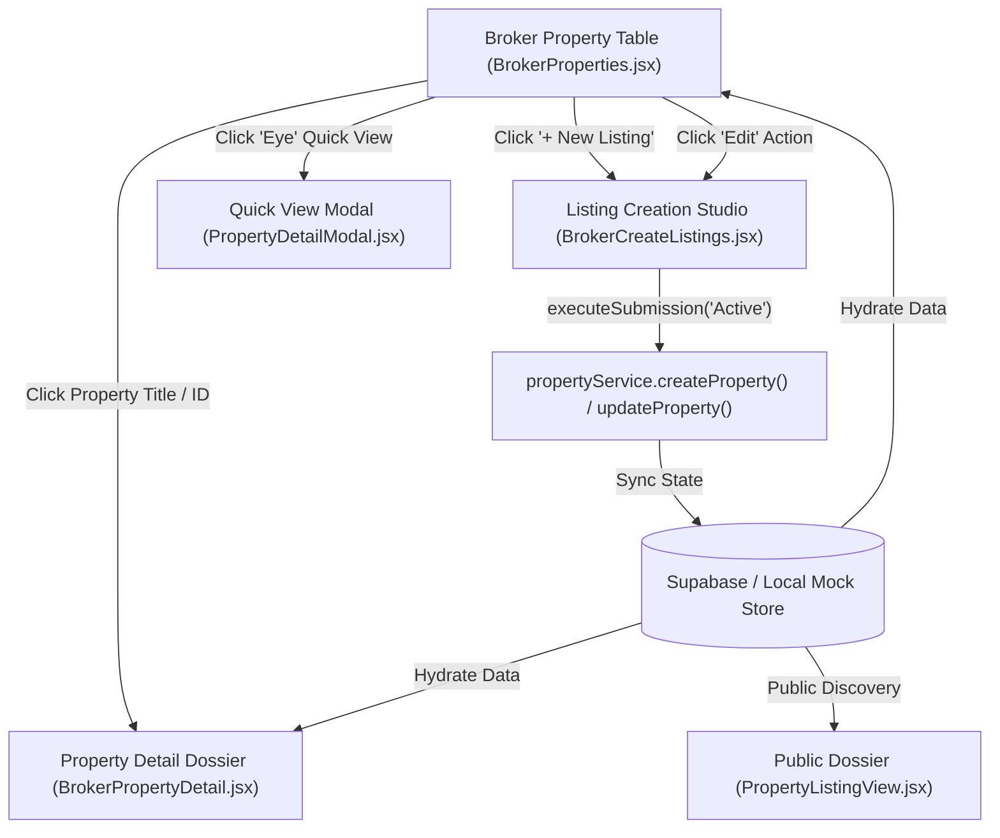

# Broker Property Lifecycle & Detail Studio Implementation Plan

> **For agentic workers:** REQUIRED SUB-SKILL: Use superpowers:subagent-driven-development (recommended) or superpowers:executing-plans to implement this plan task-by-task. Steps use checkbox (`- [ ]`) syntax for tracking.

**Goal:** Overhaul the Broker Property Detail studio (`BrokerPropertyDetail.jsx`) and quick-inspection modal (`PropertyDetailModal.jsx`) to achieve 100% aesthetic and functional alignment with the **Modern SaaS UI/UX Design System**, completing the full property listing creation, inspection, and management lifecycle.

**Architecture:** 
- Align the property detail dossier with the platform's Teal `#0F766E` / Coral `#FF6B6B` palette, 8px radius geometry, and `#CBD5E1` hairline borders on pure white cards.
- Restructure the detail layout into three primary operational blocks:
  1. **Hero Media & Google Drive Asset Showcase**: Dynamic cover viewport, responsive thumbnail ribbon, and direct Google Drive sync badge.
  2. **Architectural & Cadastral Metrics Grid**: Area breakdown (Lot vs Floor), beds/baths/parking steppers, and zoning/cadastral lot identification.
  3. **Confidential Broker Operational Vault**: Agent attribution, commission split, lockbox passcode, seller direct phone, and private showing instructions.
- Ensure two-way data integrity between `BrokerCreateListings.jsx`, `propertyService.js`, `BrokerProperties.jsx`, `BrokerPropertyDetail.jsx`, and public `PropertyListingView.jsx`.

**Tech Stack:** React 18, React Router v6, Tailwind CSS v4, Lucide React / Material Symbols, Vitest, Testing Library.

**Spec / Design Context:**
- `design.md` (Modern SaaS UI/UX Design System)
- `docs/implementation/PROPERTY_LISTING_FORM.md`
- `AGENTS.md` (Role-based standards for Broker & Agent portals)

---

## Global Constraints

- **Strict Token Adherence:** Primary Teal `#0F766E` (hover: `#115E59`), Coral `#FF6B6B` (conversion CTAs), `#F8FAFC` base ground, `#FFFFFF` surfaces with `#E2E8F0` / `#CBD5E1` borders, standard 8px radius (`rounded-lg`).
- **No Breaking Database / API Changes:** Retain all Supabase and `propertyService` schemas and field mappings (`price_raw`, `specs`, `confidential`, `location`, `images`).
- **Zero Business Logic Regressions:** Preserve listing status updates (`AVAILABLE`, `RESERVED`, `SOLD`, `INACTIVE`), Drive photo uploads, and fallback mock resilience.
- **Git Safety:** Local commits only. Remote push (`git push`) strictly forbidden without explicit authorization.

---

## Component Architecture & State Flow



---

## Proposed Changes

### Task 1: Redesign `BrokerPropertyDetail.jsx` with Modern SaaS Tokens

**Files:**
- Modify: `frontend/src/pages/portals/broker/BrokerPropertyDetail.jsx`
- Create / Update Test: `frontend/src/pages/portals/broker/BrokerPropertyDetail.test.jsx`

**Interfaces:**
- Consumes: `propertyService.getPropertyById(id)`, `propertyService.updateProperty(id, data)`, `driveService.uploadFile()`
- Produces: Polished listing detail view with breadcrumbs, action header, Google Drive media ribbon, architectural metrics, and confidential broker card.

- [ ] **Step 1: Write test assertions in `BrokerPropertyDetail.test.jsx`**
  - Verify header displays property title, formatted price in bold Teal, and transaction status pill.
  - Verify action cluster renders "Back to Listings", "Quick Edit", and status dropdown.
  - Verify confidential broker section displays commission split, lockbox passcode, and showing notes with private styling.

- [ ] **Step 2: Run test to observe failure**
  ```bash
  npx vitest run src/pages/portals/broker/BrokerPropertyDetail.test.jsx
  ```

- [ ] **Step 3: Implement Modern SaaS UI overhaul in `BrokerPropertyDetail.jsx`**
  - Replace deprecated colors (`#0D4446`, `#266F71`, `#F1F0EC`) with `#0F766E`, `#115E59`, and `#F8FAFC`.
  - Standardize all cards and buttons to `rounded-lg` (8px radius) and `#CBD5E1` hairline borders.
  - Add "Quick Edit" button (`/broker/properties/:id/edit`) linking directly to `BrokerCreateListings` in edit mode.
  - Add clean Cadastral GPS & Address card with interactive map pin badge.
  - Refine Drive photo upload button with clean loading spinner and thumbnail indicators.

- [ ] **Step 4: Verify test suite passes**
  ```bash
  npx vitest run src/pages/portals/broker/BrokerPropertyDetail.test.jsx
  ```

---

### Task 2: Align Quick-View `PropertyDetailModal.jsx` with Modern SaaS Aesthetics

**Files:**
- Modify: `frontend/src/components/ui/modals/PropertyDetailModal.jsx`
- Test: `frontend/src/components/ui/modals/PropertyDetailModal.test.jsx`

**Interfaces:**
- Consumes: `useSearchParams('propertyId')`, `mockProperties` / `propertyService`
- Produces: High-speed preview modal displaying property imagery, key specs, pricing, and inquiry action trigger.

- [ ] **Step 1: Write test in `PropertyDetailModal.test.jsx`**
  - Verify modal opens when `propertyId` search param is present.
  - Verify lot/floor area, bedroom, and bathroom badges render cleanly.

- [ ] **Step 2: Update `PropertyDetailModal.jsx` styling**
  - Replace legacy green and brown accents with Modern SaaS `#0F766E` and Coral `#FF6B6B`.
  - Upgrade carousel navigation arrows and dot indicators to `#0F766E`.
  - Harmonize specification pills with `rounded-lg` border tokens.

- [ ] **Step 3: Verify test passes**
  ```bash
  npx vitest run src/components/ui/modals/PropertyDetailModal.test.jsx
  ```

---

### Task 3: Cross-Stack Contract Synchronization & E2E Validation

**Files:**
- Verify: `frontend/src/services/propertyService.js`
- Verify: `frontend/src/pages/portals/broker/BrokerProperties.jsx`
- Verify: `frontend/src/pages/portals/broker/BrokerCreateListings.jsx`
- Verify: `frontend/src/pages/portals/broker/BrokerPropertyDetail.jsx`

- [ ] **Step 1: Verify Create-to-Detail round-trip workflow**
  - Simulate creating a property with custom lot area, cadastral ID, and confidential notes in `BrokerCreateListings.jsx`.
  - Confirm the resulting property item hydrates properly in `BrokerPropertyDetail.jsx`.

- [ ] **Step 2: Run full frontend test suite**
  ```bash
  npm test
  ```

- [ ] **Step 3: Run complete production build check**
  ```bash
  npm run build
  ```

---

## Verification Plan

### Automated Tests
1. `npx vitest run src/pages/portals/broker/BrokerProperties.test.jsx`
2. `npx vitest run src/pages/portals/broker/BrokerPropertyDetail.test.jsx`
3. `npm run build` in `frontend/`

### Manual Verification
1. Navigate to `/broker/properties` -> Verify table rendering, status filters, and action buttons.
2. Click on a property row -> Verify `/broker/properties/:id` opens with Modern SaaS styling and complete specs.
3. Click "Quick Edit" -> Verify `/broker/properties/:id/edit` populates the 7-section form.
4. Test photo upload to Google Drive from detail view.
