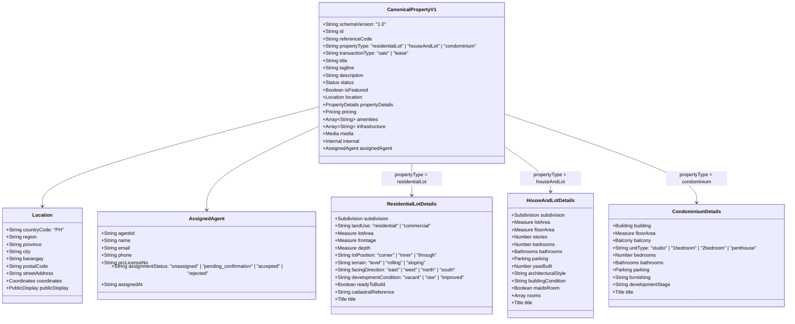
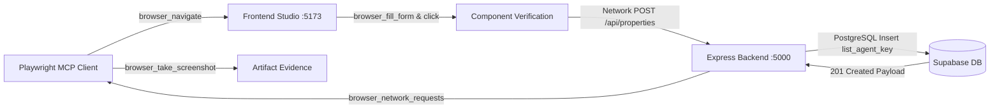

# Property Listing Form Scope Adaptation & shadcn/ui Component Redesign Implementation Plan

> **For agentic workers:** REQUIRED SUB-SKILL: Use superpowers:subagent-driven-development (recommended) or superpowers:executing-plans to implement this plan task-by-task. Steps use checkbox (`- [ ]`) syntax for tracking.

**Goal:** Re-design the property listing studio (`BrokerCreateListings.jsx`, `BrokerPropertyTypeSelect.jsx`, and `propertyService.js`) to provide an intuitive, high-conversion intake engine for the **three core Philippine real estate asset classes**:
1. `residentialLot` (**Subdivision Lot / Land**)
2. `houseAndLot` (**House and Lot**)
3. `condominium` (**Condominium**)

The implementation seamlessly integrates:
- **Real-World Philippine Broker Terminology** across all 7 form steps.
- **shadcn Skill Principles (`.agents/skills/shadcn`)** ensuring full component composition (`Card`, `CardHeader`, `CardTitle`, `CardDescription`, `CardContent`, `CardFooter`), `Label` + `Input` form structures, `Button` variants, `Badge` indicators, `Alert` callouts, and clean Tailwind CSS v4 layout utilities (`flex flex-col gap-*`, `size-*`, `cn()`).
- **Supabase & PostgreSQL Architecture Verification (`.agents/skills/supabase` & `.agents/skills/supabase-postgres-best-practices`)** confirming agent assignment via foreign key `list_agent_key` referencing `public.profiles(id)`, RLS authorization policies, and indexing.
- **Enterprise TypeScript Architecture (`.agents/skills/mastering-typescript`)** establishing end-to-end type safety across shared contracts (`shared/types/property.ts`), Zod schemas (`backend/src/schemas/property.schema.ts`), and client serialization (`propertyService.js`).
- **Live Full-Stack Playwright MCP Verification Guarantee** using lazy browser tools (`browser_navigate`, `browser_snapshot`, `browser_click`, `browser_fill_form`, `browser_take_screenshot`, `browser_network_requests`) against live running servers (`http://localhost:5173` and `http://localhost:5000`).

---

## 1. Real-World Broker Terminology & UI Navigation Lexicon

To eliminate technical jargon, all form steps, field labels, placeholders, and tooltips adopt the standard vocabulary used daily by Philippine licensed real estate brokers and property seekers:

### 1.1 Step Navigation Milestones

| Step # | Stepper Milestone Title | Purpose & Subtitle |
|:---:|---|---|
| **1** | **Listing Overview** | Title, headline, transaction type, asset category, and assigned listing agent |
| **2** | **Location & Address** | Subdivision, street, block & lot, or building and tower with map pin |
| **3** | **Property Specifications** | Tailored dimensions (sqm), room counts, terrain, and legal title |
| **4** | **Pricing & Terms** | Total contract price (TCP), price/sqm, HOA dues, and financing terms |
| **5** | **Features & Amenities** | Curated community infrastructure, home features, or tower amenities |
| **6** | **Photos & Maps** | Facade, interior gallery, architectural floor plans, and cadastral survey |
| **7** | **Review & Publish** | Pre-flight inspection ledger, agent assignment confirmation, draft saving, and live publication |

---

### 1.2 Asset-Specific Real Estate Vocabulary Matrix

| UI Field / Control | Subdivision Lot (`residentialLot`) | House and Lot (`houseAndLot`) | Condominium (`condominium`) |
|---|---|---|---|
| **Category Label** | **Subdivision Lot** *(Vacant Land)* | **House and Lot** *(Single-Family Home)* | **Condominium** *(Vertical Strata)* |
| **Transaction Type** | `For Sale` • `For Lease` | `For Sale` • `For Rent` | `For Sale` • `For Rent` |
| **Development Condition** | `Raw / Undeveloped Lot` • `Subdivision Phase Cut` • `Ready to Build` | `Brand New / RFO` • `Pre-Selling` • `Well-Maintained Resale` • `Renovated` | `Ready for Occupancy (RFO)` • `Pre-Selling` • `Resale` |
| **Primary Identifier** | **Subdivision Name**, **Phase**, **Block & Lot** | **Subdivision / Village**, **Street**, **Block & Lot** | **Building Name**, **Tower Name**, **Floor & Unit #** |
| **Area Metrics** | **Lot Area (sqm)** only | **Lot Area (sqm)** AND **Floor Area (sqm)** | **Usable Floor Area (sqm)** *(hides lot area)* |
| **Lot Dimensions** | **Road Frontage (m)** & **Lot Depth (m)** | Carport width / frontage | Balcony Area (sqm) & View Facing |
| **Lot Position / Cut** | `Corner Lot` • `Inner Lot` • `Through Lot` • `End Lot` | `Corner Lot` • `Regular Lot` | Unit Layout: `Studio` • `1BR` • `2BR` • `Penthouse` |
| **Topography / Terrain** | `Flat / Level` • `Gently Rolling` • `Sloping / Hillside` • `Elevated` | Flat or sloping yard | N/A |
| **Sun Orientation** | `East (Morning Sun)` • `West (Afternoon Sun)` • `North` • `South` | Facing morning or afternoon sun | Balcony View: `Skyline` • `Pool View` • `Bay View` |
| **Title Status** | `Clean Title (TCT)` • `Under Bank Mortgage` • `Tax Dec Only` | `Clean Title (TCT)` • `Under Mortgage` | `Condo Certificate of Title (CCT)` |
| **Cadastral Reference** | **Cadastral Survey / Lot Number** *(e.g. Lot 4, Blk 12, Psd-04)* | Subdivision Plan Reference | Master Deed / Unit Plan |
| **Bedrooms & Baths** | *Suppressed (defaults to 1 for DB)* | **Bedrooms**, **Full Baths**, **Powder Room** | **Bedrooms**, **Full Baths** |
| **Staff & Service Rooms** | *Suppressed* | **Maid's Room with T&B**, **Driver's Quarters**, **Dirty Kitchen** | Utility / Maid's Nook (large units) |
| **Assigned Agent** | **Assigned Listing Agent** *(PRC Broker/Salesperson)* | **Assigned Listing Agent** *(PRC Broker/Salesperson)* | **Assigned Listing Agent** *(PRC Broker/Salesperson)* |

---

## 2. shadcn Skill Principles & Enforcement Matrix

As mandated by `.agents/skills/shadcn`, the refactored code strictly adheres to these rules:

| Rule Category | Requirement from `.agents/skills/shadcn` | Implementation in Listing Studio |
|---|---|---|
| **Card Composition** | Full composition required: `CardHeader` + `CardTitle` + `CardDescription` + `CardContent` + `CardFooter`. Don't dump everything in `CardContent`. | Every stepper step and section container is composed with complete header, description, content, and optional action footer. |
| **Forms & Inputs** | Never use raw `div` with `space-y-*` or unassociated `<label>`. Each input must pair with a `<Label htmlFor="...">` and `<Input id="...">`. | All inputs across Steps 1–6 use explicit `<Label>` with matching `<Input>` or `<Textarea>`. |
| **Buttons & Actions** | Use built-in variants (`variant="default"`, `variant="outline"`, `variant="coral"`). No `isLoading` prop; compose with spinner icon + `disabled`. | Stepper Previous/Next, Save Draft, Publish, and amenity chip selectors use canonical `Button` variants. |
| **Badges & Indicators** | Use `Badge` component instead of custom styled spans (`<span className="...">`). Use built-in variants (`default`, `secondary`, `coral`, `outline`). | Asset status, workflow pills, assigned agent status, and contextual indicators use `<Badge>`. |
| **Callouts & Notices** | Use `Alert`, `AlertTitle`, and `AlertDescription`. Never build custom styled alert boxes. | Geocoding notices, validation error summaries, and submission warnings use composed `<Alert variant="destructive">` or `<Alert variant="teal">`. |
| **Layout & Spacing** | **No `space-x-*` or `space-y-*`.** Use `flex` with `gap-*` (e.g. `flex flex-col gap-4`) or `grid gap-6`. | Completely eliminate all `space-y-*` and `space-x-*` instances in touched components. |
| **Sizing & Classes** | Use `size-*` for uniform width/height (e.g. `size-10`). Use `truncate` shorthand. Use `cn()` for conditional classes. | Icon containers and avatars use `size-*`; dynamic classes use `cn()`. |

---

## 3. Supabase & PostgreSQL Architecture Verification (Agent Assignment)

### 3.1 Foreign Key Linkage & Profiles Model
In PostgreSQL and Supabase (`backend/src/models/supabase_schema.sql`):
- `public.properties.list_agent_key` is a foreign key of type `UUID NULL` with constraint:
  ```sql
  CONSTRAINT properties_list_agent_key_fkey FOREIGN KEY (list_agent_key) REFERENCES public.profiles (id)
  ```
- Profiles have `role TEXT NOT NULL DEFAULT 'agent' CHECK (role IN ('admin', 'broker', 'agent', 'client'))` and license field `prc_license_no TEXT`.
- An assignment represents designating a licensed agent (`public.profiles.id`) to manage, market, and receive client inquiries for that property.

### 3.2 Supabase Row-Level Security (RLS) Policy Verification
Supabase RLS on `public.properties` explicitly enforces agent ownership and visibility:
```sql
CREATE POLICY "Properties are publicly viewable by anyone."
  ON public.properties FOR SELECT
  USING (
    standard_status = 'Active' OR 
    (auth.uid() IS NOT NULL AND (
      created_by = auth.uid() OR 
      list_agent_key = auth.uid() OR
      EXISTS (
        SELECT 1 FROM public.profiles WHERE id = auth.uid() AND role IN ('admin', 'broker')
      )
    ))
  );
```
**Security Verification:**
- When a property is assigned to an agent (`list_agent_key = auth.uid()`), that agent is immediately granted secure access to view and manage their assigned listing even while in `Draft`, `Pending Confirmation`, or `Action Required` states.
- Neither unassigned users nor unrelated agents can inspect non-active listings.

### 3.3 Supabase Postgres Best Practices (`.agents/skills/supabase-postgres-best-practices`)
- **Foreign Key Indexing:** Foreign keys used in RLS policies must have an index to prevent table sequential scans during row evaluation:
  ```sql
  CREATE INDEX IF NOT EXISTS idx_properties_list_agent_key ON public.properties (list_agent_key);
  ```
- **Lifecycle Status Handshake:**
  - `UNASSIGNED`: `list_agent_key IS NULL`
  - `PENDING_CONFIRMATION`: `list_agent_key = agent_uuid`, `standard_status = 'Pending Confirmation'`, `custom_reso_attributes.assignment_status = 'PENDING_CONFIRMATION'`
  - `ACCEPTED`: `list_agent_key = agent_uuid`, `standard_status = 'Active'`, `custom_reso_attributes.assignment_status = 'ACCEPTED'`
  - `REJECTED`: `custom_reso_attributes.assignment_status = 'REJECTED'`, `custom_reso_attributes.assignment_declined_reason = '...'`

---

## 4. TypeScript Architecture Verification (`.agents/skills/mastering-typescript`)

### 4.1 Canonical Schema v1.0 Model Diagram


### 4.2 Shared TypeScript Interface (`shared/types/property.ts`)
```typescript
export type AssignmentStatus = 'UNASSIGNED' | 'PENDING_CONFIRMATION' | 'ACCEPTED' | 'REJECTED';

export interface AssignedAgentV1 {
  agentId: string | null;
  name?: string | null;
  email?: string | null;
  phone?: string | null;
  prcLicenseNo?: string | null;
  assignmentStatus?: 'unassigned' | 'pending_confirmation' | 'accepted' | 'rejected';
  assignedAt?: string | null;
}
```

### 4.3 Backend Zod Schema Validation (`backend/src/schemas/property.schema.ts`)
In `createPropertySchema`:
```typescript
listAgentKey: z.string().trim().optional().nullable(),
agentId: z.string().trim().optional().nullable(),
assignmentStatus: z.enum(['UNASSIGNED', 'PENDING_CONFIRMATION', 'ACCEPTED', 'REJECTED']).optional().nullable(),
```

### 4.4 Frontend Serialization (`frontend/src/services/propertyService.js`)
In `toApiPayload()`:
```javascript
listAgentKey: formData.assignedAgent?.agentId || formData.agentId || formData.listAgentKey || null,
agentId: formData.assignedAgent?.agentId || formData.agentId || formData.listAgentKey || null,
customResoAttributes: {
  ...formData.customResoAttributes,
  canonicalPayload: {
    ...canonicalV1Payload,
    assignedAgent: formData.assignedAgent ? {
      agentId: formData.assignedAgent.agentId,
      name: formData.assignedAgent.name,
      email: formData.assignedAgent.email,
      phone: formData.assignedAgent.phone,
      prcLicenseNo: formData.assignedAgent.prcLicenseNo,
      assignmentStatus: formData.assignedAgent.assignmentStatus || 'accepted',
      assignedAt: formData.assignedAgent.assignedAt || new Date().toISOString()
    } : null
  }
}
```

---

## 5. Three Complete Sample .json Payloads with Agent Assignment

### 5.1 Sample 1: Subdivision Lot (`residentialLot`)
```json
{
  "schemaVersion": "1.0",
  "id": "HSR-LOT-8821",
  "referenceCode": "CAD-HAV-B12-L04",
  "propertyType": "residentialLot",
  "transactionType": "sale",
  "title": "Prime Corner Lot in Havila Highlands Subdivision",
  "tagline": "Elevated residential lot overlooking Laguna de Bay",
  "description": null,
  "status": {
    "publication": "published",
    "availability": "available"
  },
  "isFeatured": true,
  "assignedAgent": {
    "agentId": "a1b2c3d4-e5f6-4a7b-8c9d-0e1f2a3b4c5d",
    "name": "Elena Rossi",
    "email": "elena.rossi@humanshelterrealty.com",
    "phone": "+63 917 555 1234",
    "prcLicenseNo": "PRC-REB-0024891",
    "assignmentStatus": "accepted",
    "assignedAt": "2026-10-29T03:00:00Z"
  },
  "location": {
    "countryCode": "PH",
    "region": "Region IV-A (CALABARZON)",
    "province": "Rizal",
    "city": "Antipolo City",
    "barangay": "San Roque",
    "postalCode": "1870",
    "streetAddress": "Forest Ridge Avenue",
    "coordinates": {
      "latitude": 14.5824,
      "longitude": 121.1689
    },
    "publicDisplay": {
      "showExactAddress": false,
      "mapPrecision": "approximate"
    }
  },
  "propertyDetails": {
    "subdivision": {
      "id": null,
      "name": "Havila Highlands Executive Subdivision",
      "phase": "2",
      "block": "12",
      "lot": "4"
    },
    "landUse": "residential",
    "lotArea": {
      "value": 270,
      "unit": "sqm"
    },
    "frontage": {
      "value": 15,
      "unit": "m"
    },
    "depth": {
      "value": 18,
      "unit": "m"
    },
    "lotPosition": "corner",
    "terrain": "level",
    "facingDirection": "east",
    "developmentCondition": "vacant",
    "readyToBuild": true,
    "cadastralReference": "Lot 4, Block 12, Psd-04-098231",
    "title": {
      "type": "tct",
      "reportedStatus": "clean",
      "verificationStatus": "unverified"
    }
  },
  "pricing": {
    "amount": 6480000,
    "currency": "PHP"
  },
  "amenities": [
    "gatedEntrance",
    "rfidAccess",
    "perimeterFence",
    "communityPark",
    "playground"
  ],
  "infrastructure": [
    "undergroundElectricalCabling",
    "concreteRoads",
    "curbsAndGutters",
    "stormDrainage",
    "streetLighting"
  ],
  "media": {
    "coverImageId": "photo-001",
    "photos": [
      {
        "id": "photo-001",
        "url": "https://images.unsplash.com/photo-1500382017468-9049fed747ef",
        "caption": "Sample image — replace with an actual property photo",
        "altText": "Illustrative landscape photo",
        "sortOrder": 0,
        "isPlaceholder": true
      }
    ],
    "documents": []
  },
  "internal": {
    "privateRemarks": "Title in possession of listing broker. Ready for deed of absolute sale.",
    "showingInstructions": "Coordinate with village gate guardhouse. Gate pass pre-approved under HSR."
  }
}
```

---

### 5.2 Sample 2: House and Lot (`houseAndLot`)
```json
{
  "schemaVersion": "1.0",
  "id": "HSR-HSE-9042",
  "referenceCode": "AYL-ALP-B08-L15",
  "propertyType": "houseAndLot",
  "transactionType": "sale",
  "title": "Modern Tropical 4-Bedroom Villa in Ayala Alabang Village",
  "tagline": "Architect-designed luxury home with private lap pool and landscaped garden",
  "description": null,
  "status": {
    "publication": "published",
    "availability": "available"
  },
  "isFeatured": true,
  "assignedAgent": {
    "agentId": "a1b2c3d4-e5f6-4a7b-8c9d-0e1f2a3b4c5d",
    "name": "Elena Rossi",
    "email": "elena.rossi@humanshelterrealty.com",
    "phone": "+63 917 555 1234",
    "prcLicenseNo": "PRC-REB-0024891",
    "assignmentStatus": "accepted",
    "assignedAt": "2026-10-29T03:00:00Z"
  },
  "location": {
    "countryCode": "PH",
    "region": "National Capital Region (NCR)",
    "province": "Metro Manila",
    "city": "Muntinlupa City",
    "barangay": "Ayala Alabang",
    "postalCode": "1780",
    "streetAddress": "Talisay Street, District 2",
    "coordinates": {
      "latitude": 14.4262,
      "longitude": 121.0267
    },
    "publicDisplay": {
      "showExactAddress": false,
      "mapPrecision": "approximate"
    }
  },
  "propertyDetails": {
    "subdivision": {
      "id": null,
      "name": "Ayala Alabang Village",
      "phase": "2B",
      "block": "8",
      "lot": "15"
    },
    "lotArea": {
      "value": 450,
      "unit": "sqm"
    },
    "floorArea": {
      "value": 380,
      "unit": "sqm"
    },
    "stories": 2,
    "bedrooms": 4,
    "bathrooms": {
      "full": 4,
      "half": 1,
      "total": 5
    },
    "parking": {
      "capacity": 2,
      "type": "coveredCarport"
    },
    "yearBuilt": 2023,
    "architecturalStyle": "Modern Tropical",
    "buildingCondition": "brandNew",
    "maidsRoom": true,
    "rooms": [
      {
        "type": "Primary Bedroom",
        "level": "Second Floor",
        "features": ["En-suite Bathroom", "Walk-in Closet", "Private Balcony"]
      },
      {
        "type": "Maid's Quarters",
        "level": "Ground Floor",
        "features": ["Dedicated Toilet & Bath"]
      }
    ],
    "title": {
      "type": "tct",
      "reportedStatus": "clean",
      "verificationStatus": "verified"
    }
  },
  "pricing": {
    "amount": 88000000,
    "currency": "PHP"
  },
  "amenities": [
    "privateSwimmingPool",
    "landscapedGarden",
    "lanaiTerrace",
    "coveredCarport",
    "gatedSubdivisionSecurity"
  ],
  "infrastructure": [
    "solarPanelSystem",
    "undergroundDrainage",
    "cctvSurveillance",
    "highSpeedFiberReady"
  ],
  "media": {
    "coverImageId": "photo-hse-001",
    "photos": [
      {
        "id": "photo-hse-001",
        "url": "https://images.unsplash.com/photo-1600585154340-be6161a56a0c",
        "caption": "Villa Front Facade & Garden",
        "altText": "Front view of two-storey luxury home",
        "sortOrder": 0,
        "isPlaceholder": false
      }
    ],
    "documents": []
  },
  "internal": {
    "privateRemarks": "Direct to seller. Clean title in bank safe deposit box.",
    "showingInstructions": "24-hour advance booking required. Escort client from Acacia Gate."
  }
}
```

---

### 5.3 Sample 3: Condominium (`condominium`)
```json
{
  "schemaVersion": "1.0",
  "id": "HSR-CND-7719",
  "referenceCode": "RCK-PRO-L28-U02",
  "propertyType": "condominium",
  "transactionType": "sale",
  "title": "2-Bedroom Executive Suite in The Proscenium Residences",
  "tagline": "High-floor Rockwell corner unit with sweeping skyline views and balcony",
  "description": null,
  "status": {
    "publication": "published",
    "availability": "available"
  },
  "isFeatured": true,
  "assignedAgent": {
    "agentId": "a1b2c3d4-e5f6-4a7b-8c9d-0e1f2a3b4c5d",
    "name": "Elena Rossi",
    "email": "elena.rossi@humanshelterrealty.com",
    "phone": "+63 917 555 1234",
    "prcLicenseNo": "PRC-REB-0024891",
    "assignmentStatus": "accepted",
    "assignedAt": "2026-10-29T03:00:00Z"
  },
  "location": {
    "countryCode": "PH",
    "region": "National Capital Region (NCR)",
    "province": "Metro Manila",
    "city": "Makati City",
    "barangay": "Poblacion",
    "postalCode": "1200",
    "streetAddress": "Estrella Street corner J.P. Rizal Avenue",
    "coordinates": {
      "latitude": 14.5668,
      "longitude": 121.0375
    },
    "publicDisplay": {
      "showExactAddress": true,
      "mapPrecision": "exact"
    }
  },
  "propertyDetails": {
    "building": {
      "name": "The Proscenium at Rockwell",
      "tower": "The Lincoln Tower",
      "floorLevel": "28",
      "unitNumber": "Unit 28B"
    },
    "floorArea": {
      "value": 118,
      "unit": "sqm"
    },
    "balcony": {
      "hasBalcony": true,
      "area": {
        "value": 12,
        "unit": "sqm"
      },
      "facing": "Makati CBD Skyline & Pasig River"
    },
    "unitType": "2bedroom",
    "bedrooms": 2,
    "bathrooms": {
      "full": 2,
      "half": 0,
      "total": 2
    },
    "parking": {
      "hasDedicatedSlot": true,
      "slots": 1,
      "slotNumber": "Basement 2, Slot #142"
    },
    "furnishing": "fullyFurnished",
    "developmentStage": "rfo",
    "title": {
      "type": "cct",
      "reportedStatus": "clean",
      "verificationStatus": "verified"
    }
  },
  "pricing": {
    "amount": 38500000,
    "currency": "PHP"
  },
  "amenities": [
    "resortStyleSwimmingPool",
    "skyLounge",
    "conciergeService",
    "fitnessGym",
    "functionRoom",
    "highSpeedElevators",
    "helipad"
  ],
  "infrastructure": [
    "oneHundredPercentBackupPower",
    "cctvSurveillance",
    "automatedFireSprinklers",
    "centralizedGarbageChute"
  ],
  "media": {
    "coverImageId": "photo-cnd-001",
    "photos": [
      {
        "id": "photo-cnd-001",
        "url": "https://images.unsplash.com/photo-1545324418-cc1a3fa10c00",
        "caption": "Living Suite & Panoramic Balcony",
        "altText": "Condo living room overlooking balcony",
        "sortOrder": 0,
        "isPlaceholder": false
      }
    ],
    "documents": []
  },
  "internal": {
    "privateRemarks": "Currently tenanted until Q1 2027. Immediate rental income generation.",
    "showingInstructions": "Requires 48-hour advance notice to Building Admin and Tenant."
  }
}
```

---

## 6. Playwright MCP End-to-End Verification Architecture



### 6.1 Verification Scenarios Executed via Playwright MCP
1. **Scenario 1: Residential Lot E2E**
   - Navigate to `http://localhost:5173/broker/properties/types` via `browser_navigate`.
   - Click `residentialLot` card via `browser_click`.
   - Verify Step 1: title, tagline, reference code, assigned agent selector.
   - Verify Step 2: subdivision, block, lot, PSGC Antipolo City geocoding pin.
   - Verify Step 3: lotArea (270 sqm), frontage (15m), depth (18m), terrain (`level`), cadastral reference. Confirm bedrooms and interior rooms are not displayed.
   - Verify Step 5: community infrastructure chips toggle properly.
   - Verify Step 7: summary ledger displays land metrics without 0 beds / 0 baths and shows assigned agent card.
   - Submit form -> inspect network response (`browser_network_requests`) -> confirm 201 Created, `list_agent_key` assigned, and PostgreSQL record insertion.
   - Capture screenshot (`browser_take_screenshot`).

2. **Scenario 2: House and Lot E2E**
   - Select `houseAndLot` -> fill dual area (450 sqm lot, 380 sqm floor), 2 stories, 4 beds, 5 baths, covered carport, assigned agent.
   - Submit form -> inspect 201 Created -> verify `properties`, `property_rooms`, and `list_agent_key`.
   - Capture screenshot.

3. **Scenario 3: Condominium E2E**
   - Select `condominium` -> fill 118 sqm floor area, Lincoln Tower, 28th floor, balcony (12 sqm), 2 beds, assigned agent. Confirm lot area input is absent.
   - Submit form -> inspect 201 Created -> verify `properties` table and `list_agent_key`.
   - Capture screenshot.

---

## 7. Implementation Tasks

### Task 1: Redesign Type Selection Gateway (`BrokerPropertyTypeSelect.jsx`)

**Files:**
- Modify: `frontend/src/pages/broker/BrokerPropertyTypeSelect.jsx`
- Test: `frontend/src/pages/broker/__tests__/BrokerPropertyTypeSelect.test.jsx`

- [ ] **Step 1: Write failing unit test in `BrokerPropertyTypeSelect.test.jsx`**
  - Verify that clicking "Subdivision Lot" navigates to `/broker/properties/create?type=residentialLot`.
  - Verify "House and Lot" navigates to `?type=houseAndLot`.
  - Verify "Condominium" navigates to `?type=condominium`.
  - Verify full shadcn `Card` composition (`CardHeader`, `CardTitle`, `CardDescription`, `CardContent`, `CardFooter`).
- [ ] **Step 2: Implement shadcn component composition**
  - Import `Card`, `CardHeader`, `CardTitle`, `CardDescription`, `CardContent`, `CardFooter` from `@/components/ui/card`.
  - Import `Badge` from `@/components/ui/badge` and `Button` from `@/components/ui/button`.
  - Group into 3 prominent Primary Residential Asset cards (`residentialLot`, `houseAndLot`, `condominium`) followed by Secondary/Commercial options in an accordion or grouped section.
  - Apply clean Tailwind v4 gap layout (`flex flex-col gap-6`, `grid grid-cols-1 md:grid-cols-3 gap-6`), removing all `space-y-*` or `space-x-*`.
- [ ] **Step 3: Run unit tests and confirm pass**
  - Run `npm run test --prefix frontend -- BrokerPropertyTypeSelect --run`.
- [ ] **Step 4: Commit changes**
  - `git commit -m "feat(broker): align property type selection to schema v1.0 assets with shadcn"`

---

### Task 2: Refactor Stepper Header & Action Bar (`BrokerCreateListings.jsx`)

**Files:**
- Modify: `frontend/src/pages/broker/BrokerCreateListings.jsx`
- Test: `frontend/src/pages/broker/__tests__/BrokerCreateListings.test.jsx`

- [ ] **Step 1: Write failing unit test for Stepper Header and Action Bar**
  - Verify 7 milestones render with real-world titles.
  - Verify buttons use shadcn variants (`variant="outline"`, `variant="coral"`, `variant="default"`).
- [ ] **Step 2: Implement shadcn Stepper Header**
  - Wrap stepper header in a top sticky `Card`.
  - Display progress indicator, current step badge, and responsive milestone pills.
- [ ] **Step 3: Implement shadcn Sticky Action Bar**
  - Wrap footer actions in a sticky bottom `Card` / `CardContent`.
  - Use `Button` with spinner icons for `isSubmitting`.
- [ ] **Step 4: Run unit tests and confirm pass**
  - Run `npm run test --prefix frontend -- BrokerCreateListings --run`.
- [ ] **Step 5: Commit changes**
  - `git commit -m "feat(broker): refactor stepper header and action controls to shadcn"`

---

### Task 3: Redesign Step 1 (Listing Overview) & Step 2 (Location & Address)

**Files:**
- Modify: `frontend/src/pages/broker/BrokerCreateListings.jsx`
- Test: `frontend/src/pages/broker/__tests__/BrokerCreateListings.test.jsx`

- [ ] **Step 1: Write failing unit test for Steps 1 & 2**
  - Verify Step 1 features `assignedAgent` selector, title, tagline, reference code.
  - Verify Step 2 shows subdivision/phase/block/lot for `residentialLot` & `houseAndLot`, and building/tower/floor/unit for `condominium`.
- [ ] **Step 2: Refactor Step 1 (Listing Overview)**
  - Use shadcn `Card`, `Label`, `Input`, `Textarea`, `Badge`.
  - Add Assigned Listing Agent selector / display.
  - Add development condition selector.
- [ ] **Step 3: Refactor Step 2 (Location & Address)**
  - Branch inputs dynamically based on `propertyType`.
  - Add geocoding indicator notice using `<Alert variant="teal">`.
- [ ] **Step 4: Run unit tests and confirm pass**
  - Run `npm run test --prefix frontend -- BrokerCreateListings --run`.
- [ ] **Step 5: Commit changes**
  - `git commit -m "feat(broker): redesign steps 1 and 2 to schema v1.0 with real-world terms and shadcn"`

---

### Task 4: Redesign Step 3 (Property Specifications)

**Files:**
- Modify: `frontend/src/pages/broker/BrokerCreateListings.jsx`
- Test: `frontend/src/pages/broker/__tests__/BrokerCreateListings.test.jsx`

- [ ] **Step 1: Write failing unit test for Step 3**
  - Verify `residentialLot` displays lotArea, frontage, depth, terrain, cadastral reference, title. Suppresses bedrooms/baths/rooms.
  - Verify `houseAndLot` displays dual area, stories, bedrooms, bathrooms, carport, maid's room.
  - Verify `condominium` displays floorArea, balcony, unitType, bedrooms, bathrooms, parking. Suppresses lot area.
- [ ] **Step 2: Implement `residentialLot` specifications panel**
  - `lotArea` (sqm), `frontage` (m), `depth` (m), `lotPosition`, `terrain`, `facingDirection`, `cadastralReference`, `title`.
- [ ] **Step 3: Implement `houseAndLot` specifications panel**
  - Dual metrics (`lotArea` and `floorArea`), `stories`, `bedrooms`, `bathrooms`, `parking`, `maidsRoom`.
- [ ] **Step 4: Implement `condominium` specifications panel**
  - Usable `floorArea`, `balcony` (area and facing), `unitType`, `parkingSlotNumber`.
- [ ] **Step 5: Run unit tests and confirm pass**
  - Run `npm run test --prefix frontend -- BrokerCreateListings --run`.
- [ ] **Step 6: Commit changes**
  - `git commit -m "feat(broker): implement schema v1.0 specifications with real-world terms and shadcn"`

---

### Task 5: Redesign Steps 4–7 & Dual-Envelope Serialization (`propertyService.js`)

**Files:**
- Modify: `frontend/src/pages/broker/BrokerCreateListings.jsx`
- Modify: `frontend/src/services/propertyService.js`
- Test: `frontend/src/services/__tests__/propertyService.test.js`
- Test: `frontend/src/pages/broker/__tests__/BrokerCreateListings.test.jsx`

- [ ] **Step 1: Write failing tests for Steps 4–7 & serialization**
  - Verify `toApiPayload()` serializes Schema v1.0 JSON with `assignedAgent` into `custom_reso_attributes.canonicalPayload`.
  - Verify `listAgentKey` is set on the top-level payload for Supabase foreign key & RLS.
- [ ] **Step 2: Refactor Steps 4, 5, 6, and 7**
  - Step 4: Pricing & payment terms.
  - Step 5: Curated amenities & infrastructure arrays.
  - Step 6: Photo gallery & cadastral/document uploads.
  - Step 7: Pre-flight inspection ledger with assigned agent card.
- [ ] **Step 3: Implement `toApiPayload()` dual-envelope serialization**
  - Populate top-level SQL columns (`title`, `price`, `address`, `city`, `list_agent_key`, `lot_size_area`, `sqft`, `beds`, `baths`).
  - Embed full Canonical v1.0 payload in `custom_reso_attributes.canonicalPayload`.
- [ ] **Step 4: Run unit tests and confirm pass**
  - Run `npm run test --prefix frontend -- BrokerCreateListings propertyService --run`.
- [ ] **Step 5: Commit changes**
  - `git commit -m "feat(broker): implement schema v1.0 pricing, amenities, media, and serialization"`

---

### Task 6: Playwright MCP Full-Stack E2E Verification (Browser -> Backend -> Database)

**Files:**
- Test: Playwright MCP Tools (`call_mcp_tool` with `playwright`)
- Artifact: Visual screenshots captured to `<Artifact Directory>/`

- [ ] **Step 1: Verify local servers are listening**
  - Confirm `localhost:5173` (Vite) and `localhost:5000` (API) are responsive.
- [ ] **Step 2: Execute Scenario 1 (residentialLot) via Playwright MCP**
  - Navigate to `http://localhost:5173/broker/properties/types` via `browser_navigate`.
  - Select `residentialLot`, fill all required steps, assign agent, capture network submission to `/api/properties`, verify 201 Created and `list_agent_key`, and capture screenshot.
- [ ] **Step 3: Execute Scenario 2 (houseAndLot) via Playwright MCP**
  - Select `houseAndLot`, fill dual area & residential specs, submit to `/api/properties`, verify 201 Created, and capture screenshot.
- [ ] **Step 4: Execute Scenario 3 (condominium) via Playwright MCP**
  - Select `condominium`, fill strata tower & unit specs, submit to `/api/properties`, verify 201 Created, and capture screenshot.
- [ ] **Step 5: Run Vitest regression suite**
  - `npm run test --prefix frontend -- BrokerCreateListings BrokerPropertyTypeSelect propertyService --run`

---

### Task 7: Master Living Requirements & Module Change Records Documentation

**Files:**
- Modify: `docs/REQUIREMENTS_SPECIFICATION.md` (Register `FR-PL-022`)
- Modify: `docs/modules/02-property-listing/ui-specification.md`
- Create: `docs/modules/02-property-listing/2026-10-29-property-listing-form-scope-adaptation-verification.md`
- Modify: `docs/modules/02-property-listing/INDEX.md`

- [ ] **Step 1: Register `FR-PL-022` in `docs/REQUIREMENTS_SPECIFICATION.md`**
  - "FR-PL-022: Tailored Multi-Asset Listing Intake Engine (Subdivision, House & Lot, Condominium)"
  - Add revision record in Section 1.
- [ ] **Step 2: Update `ui-specification.md`**
  - Document the Schema v1.0 data structure, shadcn/ui components, agent assignment model, and Playwright verification evidence.
- [ ] **Step 3: Create dated verification record**
  - Embed Playwright screenshots and test execution logs in `2026-10-29-property-listing-form-scope-adaptation-verification.md`.
- [ ] **Step 4: Update `INDEX.md`**
  - Register new change record and specification updates.
- [ ] **Step 5: Commit documentation**
  - `git commit -m "docs(property): register FR-PL-022 and document schema v1.0 property listing adaptation"`

---

## 8. Rollback & Risk Mitigation
- All form modifications are non-destructive and backward compatible with existing listings.
- If an existing listing has legacy or unclassified property types (e.g., Commercial, Warehouse), the form gracefully falls back to the comprehensive standard House & Lot / Generic specification layout without dropping any fields.
- Agent assignment defaults cleanly to the current session user (`auth.uid()`) if no explicit agent is selected, avoiding unassigned orphaned listings.
