# Step-by-Step Single-Field Client Registration Design

**Date:** 2026-11-25
**Status:** Approved Design Spec (Ready for Plan)
**Scope:** `/register` client registration flow (`SmartAuthFlow`) + supporting backend OTP verification endpoints

---

## 1. Goal & User Experience

Replace the all-at-once client registration form on `/register` with a calm, **one-step-at-a-time** registration journey that verifies the client's email first, collects one piece of information per screen, allows skipping the optional profile photo, and finishes with a clear **"Account Created!"** confirmation card.

Existing `/register` behaviors remain intact:
- **Existing email** -> routes to Login (`step: 'login'`)
- **Invited broker agent email** -> routes to Broker Invitation (`step: 'invite'`)
- **Brand-new email** -> immediately dispatches a 6-digit email OTP and enters the step-by-step client registration flow.

---

## 2. Step-by-Step Client Registration Flow

```mermaid
flowchart LR
    S1["1. Email Entry"] -->|"New email -> Send 6-digit OTP"| S2["2. Email OTP"]
    S2 -->|"Valid code -> 15m verificationToken"| S3["3. Phone Number"]
    S3 -->|"Valid phone"| S4["4. Full Name"]
    S4 -->|"Valid name"| S5["5. Profile & Password"]
    S5 -->|"Create Account"| S6["6. Account Created Card"]
    S6 -->|"Click 'Go to Dashboard'"| D["/client/dashboard"]
```

### Step 1: Email Entry (`email`)
- **Fields:** `Email address` (required, with typo suggestion helper like `gmial.com -> gmail.com`).
- **Buttons:** `Continue`, Google Sign-Up, `I have a broker invite code`, `Back to home`.
- **Behavior for new email:** Calls `POST /api/auth/identify`. When `status === 'new'`, immediately calls `POST /api/auth/register-otp/initiate` with `{ email, channel: 'email', role: 'client' }`, sets cooldown (`60s`), shows confirmation banner, and transitions to Step 2 (`otp`).

### Step 2: Email Verification Code (`otp`)
- **Fields:** 6-digit OTP input (`OtpInput`).
- **Buttons:** `Verify Email` (disabled until 6 digits entered; auto-submits on 6th digit), `Resend code` (enabled after 60s countdown), `Edit` / `Use another email` (returns to Step 1).
- **Behavior:** Calls `POST /api/auth/register-otp/verify-email` with `{ email, otp }`.
  - On success: stores returned `verificationToken` (valid for 15 minutes) in component state, clears errors, and advances to Step 3 (`phone`).
  - On failure: shows inline red alert with remaining attempts (e.g., `Incorrect verification code. 4 attempt(s) remaining.`).

### Step 3: Phone Number (`phone`)
- **Fields:** Single focused `Mobile number` input (`type="tel"`, placeholder `+63 917 000 0000`, required).
- **Validation:** Must contain at least 7 digits when trimmed. Any error clears automatically as soon as the user types.
- **Buttons:** `Continue` (primary), top-left `Back` button (returns to Step 1 / email entry).

### Step 4: Full Name (`name`)
- **Fields:** Single focused `Full name` input (`type="text"`, placeholder `Juan Dela Cruz`, required).
- **Validation:** Must be at least 2 non-whitespace characters. Error clears automatically as soon as the user types.
- **Buttons:** `Continue` (primary), top-left `Back` button (returns to Step 3 while preserving entered phone number).

### Step 5: Profile & Password (`profile`)
- **Optional Profile Photo (skippable):**
  - Displays a circular preview avatar showing the user's initials (derived from their Full Name) by default.
  - Clearly labeled **"Profile photo (optional — you can skip this)"**.
  - `Upload photo` button accepts `image/jpeg`, `image/png`, `image/webp` up to 5 MB; shows live preview and a `Remove` button once chosen.
  - Users can completely skip uploading a photo and proceed directly with just their password.
- **Create a Password:**
  - Password input with `Show password` / `Hide password` toggle, live strength label (`Weak`, `Fair`, `Good`, `Strong`), progress bar, and 4-item checklist (`At least 8 characters`, `1 uppercase letter`, `1 number`, `1 special symbol`).
  - Editing the password automatically clears any previous password validation alert.
- **Terms Agreement:**
  - `Terms of Service and Privacy Policy` checkbox (checked by default; red warning if unchecked).
- **Buttons:** `Create Account` (primary, shows spinner while submitting), top-left `Back` button (returns to Step 4 while preserving form state).
- **Behavior:** Calls `POST /api/auth/register-otp/complete` with `{ email, verificationToken, phone, fullName, password, avatarDataUrl? }`.
  - On success: stores session tokens via `AuthContext`, remembers email, and advances to Step 6 (`success`).
  - On expired `verificationToken`: shows friendly warning (*"Your email verification expired. Let's send a fresh 6-digit code."*), re-initiates OTP, and routes back to Step 2 while keeping phone, full name, and photo intact.

### Step 6: Account Created Card (`success`)
- Replaces the form with a clean, celebratory confirmation card following `DESIGN.md` tokens (`bg-surface`, `border-outline`, `rounded-xl`, `bg-emerald-50` success accent, `#0F766E` Teal primary CTA):
  - Green checkmark icon badge + **"Account Created!"** title + short confirmation line.
  - Summary tile displaying the client's **avatar (uploaded photo or initials)**, **Full Name**, **Verified Email**, and **Phone Number**.
  - Single primary button: **"Go to Dashboard"** — remains on screen until clicked, then navigates to `/client/dashboard` (or validated `returnUrl`).

---

## 3. Design System Alignment (`DESIGN.md`)

- **Canvas & Surfaces:** `#F8FAFC` (`bg-background`) canvas, `#FFFFFF` (`bg-surface`) card with `1px` `#E2E8F0` (`border-outline`) hairline border and `rounded-xl shadow-xs`.
- **Primary Brand CTA:** Single solid Teal (`bg-primary hover:bg-primary-hover text-white h-11 rounded-lg`) button per step; secondary actions use `variant="ghost"` or `variant="outline"`.
- **Spacing & Ergonomics:** Strict 8px grid (`gap-4`, `p-6`, `gap-2`), `44px` (`h-11`) minimum touch targets on inputs and buttons, `focus-visible:ring-2 focus-visible:ring-primary/20`.
- **Components:** Built exclusively with `shadcn/ui` primitives (`Card`, `Button`, `Input`, `InputGroup`, `Field`, `Checkbox`, `Alert`, `Progress`, `Avatar`, `Spinner`) and `lucide-react` icons, wrapped in `<MotionConfig reducedMotion="user">` with smooth step transitions.

---

## 4. Backend Architecture & API Contract

### 4.1 `backend/src/services/otp.service.ts`
Extend `OtpService` with a short-lived verified-email ticket store (`Map<string, VerifiedEmailTicket>`, 15-minute TTL):
- `verifyEmailAndIssueTicket(email, enteredOtp)`: validates the 6-digit OTP (same 5-attempt limit, 10-minute expiry, and non-production `123456` dev helper), deletes the OTP challenge, generates a cryptographically random `verificationToken` (`crypto.randomBytes(32).toString('hex')`), stores `{ email, token, expiresAt: now + 15 * 60 * 1000 }`, and returns `{ valid: true, verificationToken }`.
- `consumeVerificationTicket(email, token)`: checks that the ticket exists, matches the normalized email, and has not expired; deletes it immediately on success (single-use) and returns `{ valid: true }` or `{ valid: false, expired: boolean, reason: string }`.

### 4.2 `backend/src/schemas/auth.schema.ts`
- **`registerInitiateSchema`**: Make `password` and `fullName` optional so email-first initiation works with `{ email, channel?, role? }` while preserving compatibility with callers that still pass them.
- **`registerVerifyEmailSchema` (new)**: `{ email: z.string().email(), otp: z.string().length(6) }`.
- **`registerCompleteSchema` (new)**: `{ email: z.string().email(), verificationToken: z.string().min(16), phone: z.string().min(7).max(30), fullName: z.string().trim().min(2).max(120), password: strongPasswordSchema, avatarDataUrl: z.string().max(7_000_000).optional() }`.

### 4.3 `backend/src/controllers/auth.controller.ts` & `backend/src/routes/auth.routes.ts`
- **Update `POST /api/auth/register-otp/initiate`:** Only require `email` (no longer reject missing `password` so Step 1 can send the OTP right away).
- **Add `POST /api/auth/register-otp/verify-email`:** Calls `OtpService.verifyEmailAndIssueTicket(email, otp)` and returns `{ email, verificationToken, expiresInSeconds: 900 }`.
- **Add `POST /api/auth/register-otp/complete`:**
  1. Validates `verificationToken` via `OtpService.consumeVerificationTicket(email, verificationToken)`.
  2. Creates the verified client account in Supabase (reusing the account creation + profile upsert + session token issuance logic), saving `full_name`, `phone`, and optional `avatar_url` (uploading `avatarDataUrl` to storage or storing safely if provided; skipped if omitted).
  3. Returns `201 Created` with `{ user, token, refreshToken }`.
- **Backwards Compatibility:** Keep `POST /api/auth/register-otp/verify` intact for any existing callers/tests.

---

## 5. Frontend Module Boundaries

Keep `SmartAuthFlow.jsx` focused on orchestration and extract the new step-by-step registration screens into dedicated components under `frontend/src/components/auth/smart-auth/`:

| File | Responsibility |
| :--- | :--- |
| `frontend/src/services/authService.js` | Add `verifyRegistrationEmail(email, otp)` and `completeRegistration(payload)` |
| `frontend/src/context/AuthContext.jsx` | Expose `completeRegistration(payload)` that updates `user` state and stores auth tokens |
| `frontend/src/components/auth/smart-auth/AuthStepProgress.jsx` | Add step progress labels for `otp` (Step 2 of 5), `phone` (Step 3 of 5), `name` (Step 4 of 5), `profile` (Step 5 of 5), and `success` (100% Complete) |
| `frontend/src/components/auth/smart-auth/RegisterPhoneStep.jsx` | Single-field mobile number step with live validation & auto-clearing error |
| `frontend/src/components/auth/smart-auth/RegisterFullNameStep.jsx` | Single-field full name step with live validation & auto-clearing error |
| `frontend/src/components/auth/smart-auth/RegisterProfileStep.jsx` | Optional/skippable profile photo picker (initials fallback) + password strength meter + 4-rule checklist + Terms checkbox |
| `frontend/src/components/auth/smart-auth/RegisterSuccessCard.jsx` | Celebratory "Account Created!" confirmation card + summary + "Go to Dashboard" button |
| `frontend/src/components/auth/SmartAuthFlow.jsx` | Orchestrates `email -> otp -> phone -> name -> profile -> success` for new clients while preserving `login` and `invite` flows |

---

## 6. Verification & Testing Strategy

1. **Backend Unit Tests:**
   - Test `OtpService.verifyEmailAndIssueTicket` and `consumeVerificationTicket` (valid token, wrong email, expired token, single-use replay rejection).
   - Test `POST /api/auth/register-otp/initiate` with email only, `POST /api/auth/register-otp/verify-email`, and `POST /api/auth/register-otp/complete` (with and without profile photo).
2. **Frontend Unit Tests (Vitest + Testing Library):**
   - Verify step transitions (`email -> otp -> phone -> name -> profile -> success`).
   - Verify validation warnings on each step and auto-clearing on edit.
   - Verify skipping profile photo works seamlessly and renders initials on the Account Created card.
   - Verify Account Created card stays visible until `Go to Dashboard` is clicked.
3. **Playwright MCP End-to-End Verification:**
   - Walk through `/register` in a live browser capturing step-by-step screenshots for Email -> Email OTP -> Phone -> Full Name -> Profile (skipping photo) -> Account Created Card -> Dashboard.
