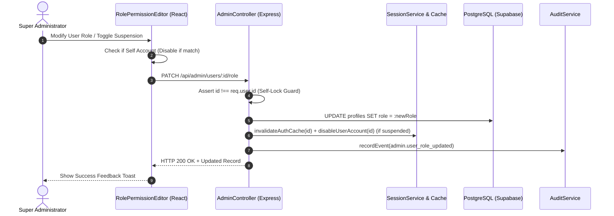

# Implementation Plan: Comprehensive User Management Module

**Branch**: `003-user-management` | **Date**: 2026-11-11 | **Spec**: [specs/003-user-management/spec.md](spec.md)

**Input**: Feature specification from `/specs/003-user-management/spec.md`

## Summary
Implement and govern the complete administrative User Management module for Human Shelter Realty. This encompasses role-based access control (RBAC across `admin`, `broker`, `agent`, and `client`), self-lockout prevention guards, server-side pagination with debounced search, agent PRC/DHSUD professional accreditation badging, and active multi-device session inspection and termination via `SessionService`.

---

## Technical Context

**Language/Version**: TypeScript 5.9+ (Backend), JavaScript / React 18+ (Frontend)  
**Primary Dependencies**: Express 5.2.1, Supabase JS Client 2.116, Tabler Icons React, Vite 8  
**Storage**: PostgreSQL (Supabase `profiles`, `auth.users`, `audit_events`), in-memory session cache + JSON persistent store  
**Testing**: Vitest, React Testing Library, Playwright MCP  
**Target Platform**: Node.js runtime, Modern Web Browsers (Chrome, Edge, Safari, Firefox)  
**Project Type**: Monorepo Web Application (`backend/`, `frontend/`, `specs/`)  
**Performance Goals**: Sub-500ms role and suspension propagation, bounded range queries $O(1)$ response time  
**Constraints**: Zero administrative self-lockout, 100% token revocation upon account suspension  
**Scale/Scope**: Up to 100,000 users, 15 users per page default, 4 core platform roles  

---

## Constitution Check

*GATE: Must pass before Phase 0 research. Re-check after Phase 1 design.*

- **Principle I (Strict Design System)**: PASS. UI strictly adheres to `DESIGN.md` tokens (Teal `#0F766E`, `#1E293B`, `#64748B`, `#F1F5F9`, `rounded-xl`).
- **Principle II (Auth & Security)**: PASS. GoTrue `bcrypt` cost factor 10, SHA-256 session token hashes, `.env` protection.
- **Principle III (Test-Driven Verification)**: PASS. Vitest component tests and Playwright MCP live browser verification.
- **Principle IV (Senior Dev Simplicity)**: PASS. Smallest complete solution without over-engineering or speculative frameworks.
- **Principle V (Specification-First Workflow)**: PASS. Spec Kit lifecycle enforced (`spec.md` -> `plan.md` -> `tasks.md` -> `analyze`).
- **Principle VI (User Management & Privilege Isolation)**: PASS. Lowest-privilege default (`client`), closed agent onboarding, dual-layer enforcement, and immutable audit logging.

---

## Project Structure

### Documentation (this feature)

```text
specs/003-user-management/
├── spec.md              # Feature specification
├── plan.md              # Implementation plan (this file)
├── research.md          # Technical research & security architecture
├── data-model.md        # Profiles, sessions, and audit entities
├── quickstart.md        # Running instructions & test commands
├── contracts/
│   └── admin-users.json # OpenAPI 3.0 contract specification
├── checklists/
│   └── requirements.md  # Quality validation checklist
└── tasks.md             # Task breakdown (generated by /speckit-tasks)
```

### Source Code

```text
backend/src/
├── controllers/
│   └── admin.controller.ts    # listUsers (paginated), updateUserRole, updateUserStatus
├── middleware/
│   ├── auth.middleware.ts     # requireAuth, session validation, profile cache
│   └── role.middleware.ts     # requireRole RBAC guard
├── models/
│   ├── fix_handle_new_user_trigger_migration.sql # Hardened trigger
│   └── supabase_schema.sql    # Master schema
└── services/
    ├── session.service.ts     # Session tracking & kill switch
    └── audit.service.ts       # Audit logging

frontend/src/
├── components/auth/
│   ├── RolePermissionEditor.jsx      # Paginated directory, PRC badges, self-lock
│   ├── RolePermissionEditor.test.jsx # Automated component tests
│   └── SessionManagementPanel.jsx    # Real-time multi-device session inspector
└── pages/portals/super-admin/
    └── AdminUsersPage.jsx     # Portal layout & tab switcher
```

---

## Architecture & Data Flow


